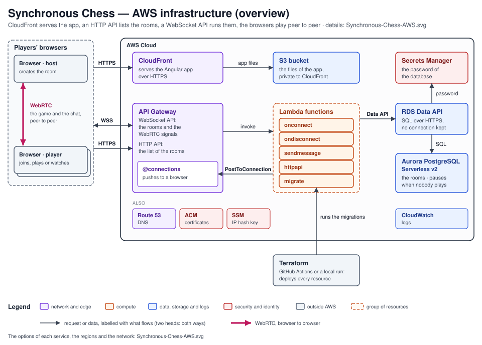

# **Synchronous Chess**

[](https://sonarcloud.io/summary/new_code?id=Steins-fr_synchronous-chess) [](https://sonarcloud.io/summary/new_code?id=Steins-fr_synchronous-chess) [](https://sonarcloud.io/summary/new_code?id=Steins-fr_synchronous-chess) [](https://sonarcloud.io/summary/new_code?id=Steins-fr_synchronous-chess) [](https://sonarcloud.io/summary/new_code?id=Steins-fr_synchronous-chess)

This project is an online chess board game. It implements the chess variant called `Synchronous chess`. For more detail about the rules, see [this website](http://www.hexenspiel.de/engl/synchronous-chess/) 

## **In progress - demo**

The app is currently in development. Its testing version, https://sc-staging.steins.fr, answers its owner only
([Access to staging](#access-to-staging)).

The website follows the language of the browser, and its menu switches it, also during a game.

In the demo, you can choose either to create a room or join an existing one. 

The room creator is the host, if he leave the room, the participants can continue to interact but no-one can join anymore.

### Synchronous Chess demo

Each participant, the host included, takes a free seat with the `Play white` / `Play black` buttons. The seats are final once the first move is played; the others are spectators.

Drag & Drop a piece to validate a move. The registered move will be displayed with two green cells: the origin and the destination. When both players has played, both moves will be played.

For the Synchronous Chess rules, please refer to [this website](http://www.hexenspiel.de/engl/synchronous-chess/).

### Chat demo

A simple chat demo with ping displayed between peers. For the moment, you have to click on the send button for sending the message. The `Enter` key is not supported.
The displayed errors are generics, this need some more works.

## **Application**

### **Backend**
---

The backend is designed to run on AWS Lambda, in `application/backend/websocket-api` (see its [README](application/backend/websocket-api/README.md)).

**Language**: Typescript.

#### Services

The code the lambdas share, in `shared/`, bundled into each lambda by esbuild:

**Room service**: Manage the room (create/update/remove).

**Connection service**: Manage the websocket connections and links connections to a room. That permits to identify the room for connection id. Used for removing a player from the room queue or detect room host disconnection.

#### API Lambdas

The API is composed of 3 lambdas for managing websocket connection, disconnection and messages, a 4th serving the routes of the HTTP API, a 5th applying the migrations of the database on deploy, and on production a 6th keeping the database out of its deep sleep. The websocket serves the connectivity of the rooms only (create, join, reconnect, the players, the WebRTC signals and the notifications of the room), everything else goes through HTTPS. The disconnection, message and HTTP API lambdas use the services and the *PostgreSQL database* (Aurora Serverless v2, through its Data API).

**onconnect** - Handle and log new websocket opened connection.

**ondisconnect** - Handle websocket disconnection. It will remove a player from a room queue, or let the room wait 10 minutes for its host to reconnect if the host was disconnected.

**ping** - A route with a mock integration, no lambda: the clients send `{"message":"ping"}` every 5 minutes on an open socket, as API Gateway closes a connection without message for 10 minutes.

**sendmessage** - Handle all the websocket exchanges separated in host and peer roles. Available messages:
 - **create** - Create a new room if the room name is available (or its room expired), with a secret token of the host;
 - **reconnect** - Move the room to the connection sending it, with the name and token of the player: the host, before API Gateway closes its connection (2 hours at most) or once it closed, or a player of the room taking it over while the room waits for its host (refused with `Host connected` before), which becomes the host;
 - **add player** - only host - Add a new player to the room player list;
 - **remove player** - only host - Remove a player from the room player list, keeping the hash of its token: its page joins a private room again without its password;
 - **get players** - only host - Get the room player list
 - **signal to peer** - only host - Send the RTC signal to a specific peer waiting in the room queue;
 - **join** - Ask to join a room and add the player in the room queue, with a secret token of the player;
 - **signal to host** - only peer - Send the RTC signal to the room host. The peer have to be in the waiting queue.

**httpapi** - Behind the HTTP API, a handler per route, selected by its method and path. Available routes:
 - **`GET /rooms?game=<game>&search=<text>`** - The open rooms of a game, without connection: the most recent first, or the ones whose name holds the search.
 - **`GET /health`** - The API is up, once its database answers (a paused cluster resumed): the pages of the app wait for it before they show.

**wakedatabase** - Production only, invoked every 12 hours by EventBridge: wakes the database, unless it ran within the 8 last hours (its capacity in CloudWatch). After 24 hours paused, Aurora puts it into a deeper sleep, whose resume outlasts the retries of the other lambdas.


### **Frontend**
---

The synchronous chess board game with chat. 

The players exchange their moves and chat messages directly over WebRTC, through block chains ordered by the host,
which the other participants watch for cheats. The moves stay hidden until both players are committed.
See [Block chains and anti-cheat](documentation/blockchain-and-anti-cheat.md) and
[Chess game session](documentation/chess-game-session.md).

**Required**: Backend API (its websocket API and its HTTP API).

**Technology**: Angular 17+.

**Language**: Typescript.

### **Databases**
---

A PostgreSQL database: Aurora Serverless v2 on AWS, paused when nobody plays, PGlite in memory locally and in the specs.
The schema is written with Drizzle in `application/backend/websocket-api/shared/database/schema.ts`, its migrations in
`drizzle/` (see the [README of the API](application/backend/websocket-api/README.md#database)).

#### Rooms

- id: Id of the room also the room name;
- connection_id: Websocket connection id of the host;
- host_player: Player name of the host;
- max_player: Maximum of player that can join the room;
- game: The game of the room, chess or chat;
- created_at, name_key: The date of its creation and its name in lower case, to list and search the rooms;
- password_hash, is_private: The salted hash of the password of a private room;
- expires_at: Set while the host is disconnected, in epoch seconds: the room no longer exists after it, and the creation of a room deletes it.

Deleted with their room:
- room_players: The players currently in the room, in the order they joined;
- room_queue: The joining players, with their connection;
- room_tokens: SHA-256 of the token of each player, by name, sent with create or join: the host reconnects the room with its own;
- room_password_attempts: The passwords each client gave a private room in a row.

#### Connections

A relation table: given a connectionId, we can found the room ID in which the player is participating.

- connection_id: Websocket connection id of a peer or host;
- room_name: Room ID.

## **Infrastructure**

The project is hosted on Amazon Web Services and uses Terraform to provision and manage the cloud infrastructure.



The options of each service, the regions, the network of the database and the roles of the lambdas:
[detailed diagram](documentation/resources/Synchronous-Chess-AWS.svg).

#### Services:
 - S3: Stores the frontend files, and the Terraform states;
 - CloudFront: Serves the frontend from S3 and manage the cache, on staging to the signed cookies of its owner only;
 - Lambda: Run the Room API, behind the WebSocket API and the HTTP API, and on staging the login of its owner and the authorizers of both APIs;
 - Cognito: The login of the owner of staging (managed login), the one user of its pool, which the bootstrap keeps;
 - API Gateway: Manages the Websocket connections and messages (the connectivity of the rooms), and the HTTPS requests of the HTTP API (the list of the rooms), then transmits them to the lambdas;
 - Aurora Serverless v2 (PostgreSQL): Stores the Rooms informations for the API, reached by the lambdas through its Data API;
 - Secrets Manager: Keeps the password of the database, which the Data API reads;
 - Systems Manager Parameter Store: Keeps the key of the hashes of the IPs of the clients, out of the Terraform state, which the sendmessage lambda reads, and on staging the key signing the access cookies, which its owner writes;
 - Route 53: Manage the DNS records;
 - CloudWatch: Monitors and logs;
 - ACM: Manage the certificates.

Terraform provisions every resource but the Route 53 zone of the main domain, which must exist: it reads it, then adds
the DNS records of the app, of the websocket API, of the HTTP API, and the ones validating their ACM certificates.

#### Terraform init backend configuration

Important: Terraform states are stored in a S3 bucket, `synchronous-chess-terraform`.

The Terraform backend configuration variables:
- bucket: S3 bucket where is stored the terraform states;
- key: Bucket path of the terraform states: `<stage>/terraform.tfstate` for each stage, `bootstrap/terraform.tfstate`
  for `infrastructure/bootstrap`;
- region: AWS region.

A plan or an apply locks the state with a `<key>.tflock` object beside it (`use_lockfile`): a run of the CI and one of a
workstation never write the same state at once.

#### Terraform plan vars

- stage: Stage name: `production` or `staging` from the CI, `development` locally;
- main_domain_name: Domain name principal. As example, 'steins.fr'
- access_public_key: The public key of the access cookies of staging, `ACCESS_PUBLIC_KEY` of its GitHub environment:
  required on staging, refused on the other stages, which stay public ([Access to staging](#access-to-staging)).

The app will be deployed by adding automatically sub-domains, which its environment of the stage targets
(`application/frontend/game-app/src/environments`).
- frontend: sc-{stage}.{main_domain_name};
- backend: sc-ws-{stage}.{main_domain_name}, the websocket API;
- backend: sc-api-{stage}.{main_domain_name}, the HTTP API, a domain of its own: API Gateway does not map a websocket
  API and an HTTP API to the same domain. Readable by the pages of its stage only (CORS), with their cookies on staging
  (its access cookies), and by `http://localhost:4200` on the development stage, for `npm run serve:dev` of the game app.

The lambdas and the app are built before the plan: `npm run build` in `application/backend/websocket-api`, and
`npm run build -- --configuration=<stage>` in `application/frontend/game-app` (`dist/game-app/browser`).

#### Deployment

**Once per account**, before any stage: [`infrastructure/bootstrap`](infrastructure/bootstrap/README.md).

It is applied locally with an admin profile, and creates:
- the trust of AWS in GitHub Actions, and the deploy role of each stage;
- the boundaries of the roles of the lambdas, and the account of API Gateway;
- then the GitHub environments, their secrets and the repository variables are set from it.

**From the CI**, for `staging` and `production`:
1. Run Terraform Plan (Actions), from a branch for staging, from `main` for production, with the stage. A production
   plan waits for the approval of its environment.
2. Note the Run ID in its summary, and read the plan there.
3. Run Terraform Apply with that Run ID and the same stage. A production apply waits for an approval again, then checks
   that the plan was made from a commit of `main`.

To destroy a stage, tick `destroy` in steps 1 and 3: the plan removes every resource of the stage, which its summary
lists, and Terraform Apply applies it the same way. Their runs are named `Terraform Plan <stage> (destroy)` and
`Terraform Apply <stage> (destroy)`, and an apply refuses a plan whose `destroy` differs from its own.
- The bootstrap and the empty state of the stage remain: a plan without `destroy` deploys it again.
- So does the execution log group of its WebSocket API, `/aws/apigateway/<api id>/<Stage>`, which API Gateway creates
  outside the state and keeps forever: delete it with the admin profile.

A plan is refused once the state has changed since, and its artifacts expire after 7 days: plan again. The artifacts and
summaries of the runs are public: the state and the plan never hold a secret.

After the first apply of a stage:
- its WebSocket domain takes a few minutes to answer, the time its API mapping spreads;
- the next plan replaces the deployment of the WebSocket API once: the routes and integrations read back empty
  attributes the state did not hold yet, which change the hash of the deployment. Apply it, then a plan shows no change.

**Locally**, for `development`, or any stage with the admin profile:

```bash
aws sso login --profile admin && export AWS_PROFILE=admin
(cd application/backend/websocket-api && npm ci && npm run build)
(cd application/frontend/game-app && npm ci && npm run build -- --configuration=<stage>)
cd infrastructure
terraform init -reconfigure -backend-config="bucket=synchronous-chess-terraform" -backend-config="key=<stage>/terraform.tfstate"
terraform plan -var="stage=<stage>" -var="main_domain_name=steins.fr" -out=tfplan
terraform apply tfplan
```

- A staging plan takes the public key of its access cookies:
  `export TF_VAR_access_public_key="$(gh variable get ACCESS_PUBLIC_KEY --env staging)"`.
- To destroy the stage, plan with `-destroy`: `terraform plan -destroy -var="stage=<stage>" ... -out=tfplan`. The lambdas
  are built first all the same, their archives being read by the plan.
- Terraform 1.16 is required, from 1.16.4 (the CI runs 1.16.4).
- `-reconfigure` keeps the state of another stage from being migrated when the stage changes in the same folder.
- The lock is shared with the CI. Use `terraform force-unlock <ID>` only after a run that died.

#### Access to staging

Staging answers its owner only, production stays public. The owner signs in on the managed login of Cognito, then the
three entry points of the stage check the same signed cookies of CloudFront:
- the front: CloudFront refuses a request without them (`trusted_key_groups` of its distribution) with a page sending
  to the login, still a 403: `access-denied.html`, served without the cookies;
- the WebSocket API: the authorizer of `$connect` (`wsauthorizer`) refuses the handshake, 401 without any cookie, 403
  without these ones;
- the HTTP API: its authorizer (`httpauthorizer`) refuses its routes without them (403). `/auth/login` and
  `/auth/callback` stay open: the `access` lambda runs the login there.

The login is the authorization code flow of Cognito with PKCE, its app client without secret: `/auth/login` sends to the
managed login, which sends the code back to `/auth/callback`, which exchanges it, then sets the cookies
(`CloudFront-Policy`, `CloudFront-Signature`, `CloudFront-Key-Pair-Id`, `CloudFront-Hash-Algorithm`) on `steins.fr` for
7 days, `HttpOnly`. The browser sends them to the front and to both APIs, of the same site, the app sending them to the
HTTP API (`httpApiWithCredentials` of its staging environment). They also reach the other hosts of `steins.fr`,
production included, which ignore them. Neither the cookies nor the tokens of Cognito are logged, nor kept.

The cookies are signed with an RSA key of the owner, never in the state, the plan nor the repository:
- its private key in the SSM parameter `/sc/staging/access-signing-key`, a SecureString outside Terraform, which the
  `access` lambda alone reads, and the deploy role of staging is denied;
- its public key in the GitHub variable `ACCESS_PUBLIC_KEY` of the staging environment, which the plan gives to
  CloudFront and to the authorizers (`access_public_key`).

**Once**, after the bootstrap is applied (it adds the user pool of staging and the `access` policy of its deploy
role), with the admin profile, in a temporary folder outside the repository: the private key goes to SSM, the public
key straight to GitHub.

```bash
cd "$(mktemp -d)" && umask 077
openssl genrsa -out key.pem 2048
aws ssm put-parameter --region eu-west-1 --name /sc/staging/access-signing-key --type SecureString --value file://key.pem \
  --tags Key=Application,Value="Synchronous chess" Key=Environment,Value=staging
openssl rsa -in key.pem -pubout | gh variable set ACCESS_PUBLIC_KEY --env staging --repo Steins-fr/synchronous-chess
shred -u key.pem
```

Outside the repository, `gh` needs `--repo`. The public key is derived again from the parameter, the private key never
shown:
`aws ssm get-parameter --region eu-west-1 --name /sc/staging/access-signing-key --with-decryption --query Parameter.Value --output text | openssl rsa -pubout | gh variable set ACCESS_PUBLIC_KEY --env staging --repo Steins-fr/synchronous-chess`.

Its user pool, `sc-access-staging`, belongs to the bootstrap (`terraform output access_user_pool_ids`), and only takes
the users an admin creates: create the owner once, whom Cognito emails a temporary password. It outlives the destruction
of staging.

```bash
pool=$(aws cognito-idp list-user-pools --max-results 60 --query "UserPools[?Name=='sc-access-staging'].Id" --output text)
aws cognito-idp admin-create-user --user-pool-id "$pool" --username <email> \
  --user-attributes Name=email,Value=<email> Name=email_verified,Value=true
```

Then plan and apply staging, whenever needed.

**On each device**, a phone included: open https://sc-staging.steins.fr, which sends to the login
(https://sc-api-staging.steins.fr/auth/login), and sign in, which sends back to the front. The first time, with the
temporary password, then a new password and an authenticator app, whose code is asked at each login. Sign in again once
the cookies expired, after 7 days.

**To rotate the key**, which signs every device out: the same commands, with `--overwrite` instead of `--tags`, then plan
and apply staging. The key of SSM and the variable change together: the `access` lambda refuses to load while they
differ. A destroyed staging keeps the parameter, outside Terraform, and its user pool, in the bootstrap: its owner signs
in again once it is deployed again.

## **CI/CD**

GitHub Actions, in `.github/workflows`:
- `application-pull-request.yml`, on the pull requests changing `application/**`: the lint, type check and tests with
  coverage of the game app and of the websocket API (`application-ci.yml`), then one SonarCloud scan of both;
- `application-main.yml`, on `main`: the same without the lint, for the badges;
- `terraform-plan.yml`, run by hand for a stage: builds the lambdas and the app, plans the infrastructure, and keeps
  the plan with the builds;
- `terraform-apply.yml`, run by hand with the run of a plan: checks the plan run, then applies it from its commit.

The Terraform workflows:
- run in the GitHub environment of their stage: `staging` from any branch, `production` from `main` with an approval;
- assume the deploy role of that stage through OIDC, from the secret `AWS_ROLE_ARN` of the environment;
- read the bucket of the states in `vars.TF_STATE_BUCKET`, the domain in `vars.MAIN_DOMAIN_NAME`, and the public key of
  the access cookies of staging in `vars.ACCESS_PUBLIC_KEY` of its environment;
- pin the Terraform version, which a saved plan is applied with.

## QA - SonarCloud

[Frontend Dashboard](https://sonarcloud.io/dashboard?id=Steins-fr_synchronous-chess)
