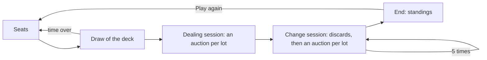

# Bid Poker session

The **Bid Poker** is a game of the manga *Liar Game*: 4 to 8 players buy their poker hand at auction, lot after lot,
their bids sealed. It is played in a room, peer to peer, without any game server: the lots are public, every player
sees the cards of the others, and only the bids and the discards stay hidden until their phase closes.

A **session** is the state of the games of the room for one participant. Every participant runs its own, and the
sessions stay the same because they apply the same messages, in the same order, delivered by the `bid` block chain of
the room (see [Block chains and anti-cheat](blockchain-and-anti-cheat.md)).

The code lives in `application/frontend/game-app/src/app/modules/bid-poker`.

- [Classes](#classes)
- [Rules](#rules)
- [The deck](#the-deck)
- [Sealed bids and discards](#sealed-bids-and-discards)
- [Life cycle](#life-cycle)
- [Seats](#seats)
- [An auction](#an-auction)
- [A change session](#a-change-session)
- [End of the game](#end-of-the-game)
- [A new game](#a-new-game)
- [The clock of a phase](#the-clock-of-a-phase)
- [Reloading the page](#reloading-the-page)
- [Messages](#messages)
- [Interface](#interface)
- [Limits](#limits)
- [Testing](#testing)

## Classes

| Class | File | Role |
|---|---|---|
| `BID_POKER_RULES` | `classes/rules/bid-poker-rules.ts` | The rules of the manga: the seats, the coins, the lots, the sessions, the fines and prizes, the times |
| `drawCatalogue` | `classes/rules/catalogue.ts` | The lots of the dealing session, cut from the deck shuffled by the seed of the draw |
| `settle` | `classes/rules/standings.ts` | The end of the game: the best hand of each player, the pigs, the places, the prizes, the fines |
| `BidPokerGame` | `classes/rules/bid-poker-game.ts` | The game in signals: the phases, the auctions, the discards, the coins, the bank, the cards held, the events |
| `PlayedCommitRevealGame` | `modules/commit-reveal/classes/played-commit-reveal-game.ts` | A game of the room (`PlayedBidGame` of `bid-poker-session.ts`), without a setup: its players, the id of its secrets, the draw of its deck, then the game |
| `BidPokerSession` | `classes/game-sessions/bid-poker-session.ts` | The games of the room, built on `CommitRevealSession`: the catalogue drawn, the bids and the discards committed then revealed |
| `CommitRevealSession` | `modules/commit-reveal/classes/commit-reveal-session.ts` | The session of every game committing then revealing its moves, shared by the Bid Poker, the Minority Game, the Contraband, the Garden of Eden and the Fixed Roulette: the messages applied in the order of the chain, the seats, the draw of the seed, the values the local player seals and their reveals, the claims of a timeout, a new game |
| `phaseClock`, `watchMatch`, `canRematchOf`, `pastResultsOf` | `modules/commit-reveal/helpers` | What the tables of these games share: the clock of a phase in minutes and seconds and the claims of its timeout, the warning before leaving a game in progress, a new game, the games over |
| `FairDraw`, `SeededRandom` | `modules/commit-reveal/classes` | The seed of the deck no player chose alone, and the shuffle every page makes alike from it |
| `SealedCommitments`, `SealedStore`, `commitmentOf` | `modules/commit-reveal/classes` | The commitments of the players, and the values of the local player kept across the reloads of the page |
| `bestHand`, `compareHands` | `modules/playing-cards/helpers/hand-evaluator.helper.ts` | The best 5 cards of a player, and their ranking |
| `TableSeats` | `modules/game-table/classes/table-seats.ts` | The 8 seats of the table: the requests of the participants, the salts, a seat freed |
| `BidTableComponent` | `components/bid-table` | Shows the session, turns the clicks into seats, bids and discards, runs the clock of each phase |
| `BidSeatComponent`, `BidLotComponent` | `components/bid-seat`, `components/bid-lot` | A seat with the cards and the coins of its player; a lot of the catalogue with what became of it |

## Rules

- 4 to 8 players take the seats; one of them starts the game. Each player gets 300 coins, and owes 100 at the end.
- **The dealing session.** The 52 cards, no joker, are shuffled and cut into 9 or 10 lots of 5 or 6 cards, the
  catalogue. Each lot is auctioned in turn: every player bids at the same time, sealed, 0 for no bid. The highest bid
  wins the lot; on a tie, the first bid committed in the chain wins. The coins go to the bank; a lot nobody bids on
  leaves the game. A player may win several lots.
- **5 change sessions.** Each player may discard cards, sealed too. The cards a player discards make one lot, in the
  order of its discards; the lots are auctioned in the order of the seats of their sellers, their letters starting at
  A again. The coins go to the seller, who does not bid on its own lot; a lot nobody bids on goes back to it. A player
  without a card has nothing to discard.
- **The end.** The hand of a player is its best 5 cards, ranked as in poker, the high card included; fewer than 5 cards
  is no hand. The **pigs** are the last place: every player without a hand, and every player who withheld a sealed
  value; without any, the players of the worst hand. There is always one pig at least. Each pig pays 150 coins; the 1st,
  2nd and 3rd of the others win 100, 40 and 10 coins multiplied by the number of pigs. Equal hands share the prizes of
  the places they cover, in whole coins: the rest, and a place without a player, go to the bank. All hands equal: every
  player is a pig. The balance of a player is its coins, minus its debt and its fine, plus its prize: the players and the
  bank together keep every coin: at the end, the bank gets the debts and the fines no prize paid.

## The deck

No player shuffles alone (`FairDraw`):

1. A seated player starts the game with `BP_draw` naming the seated players, 4 at least. A start naming others, a seat
   changed meanwhile, is void. The players of the game are then final, in the order of their seats.
2. Each player commits to a random part: the SHA-256 of the context of the draw, its index and its part. The context is
   the id of the game, made of the salts of the players (drawn when each took its seat), the index of the game in the
   room and its attempt: no commitment of another game, nor of another room of the same name, counts here.
3. Once every player committed, each one reveals its part. A part not matching its commitment is reported
   (`invalidReveal`) and not kept.
4. The seed is the SHA-256 of the parts in the order of the seats. Every page shuffles the deck from it
   (`SeededRandom`), draws one way to cut 52 cards into lots of 5 and 6 (8 × 5 + 2 × 6, or 2 × 5 + 7 × 6), shuffles the
   order of the sizes, and cuts the deck: the same catalogue on every page.

## Sealed bids and discards

A bid is the commitment `SHA-256(id:bid:index:session:lot:amount:salt)`, sent with `BP_commit`; the discards the
commitment `SHA-256(id:discard:index:session:discard:[cards]:salt)`, sent with `BP_commit` without a lot. The value and the salt
are kept in the tab (`SealedStore`, kind `bids`) before the commitment is sent, by commitment, until revealed, refused or
withheld, or until the chain refuses its commitment (too late, or a second one); the game over, or a new game started,
the page clears its seals, a commitment lost on its way included. The commitment names the lot and the session the value
was sealed for, fixed before the hash: a timeout applied meanwhile does not move it to the next one. Once every player
the phase waits for committed, or its time is over, each page reveals the value of its player (`BP_reveal`, `BP_discard`).

- No participant, the sequencer included, reads a value before its phase closes: the commitment hides it.
- The first commitment of a player for a round counts (`SealedCommitments`), and the order of the commitments in the
  chain decides a tie, the same for every participant.
- A reveal not matching its commitment, or not of the form a page sends, is reported (`invalidReveal`) and counts as
  none. A bid above the coins of its player, a seller bidding on its own lot, or a card discarded that its player does
  not hold, is reported (`illegalMove`) and counts as none.
- **A value withheld.** The reveals come one after the other in the chain: the last bidder reads the bids of the others
  before revealing its own. A player who sealed a value and does not reveal it in time, or reveals another one, could
  take its bid back that way: its value counts as none, and the player is a **pig** at the end, whatever its cards.

## Life cycle

Each auction is a bidding phase (`BIDDING`), then a reveal phase (`REVEALING`); each change session a discarding phase
(`DISCARDING`), then a reveal phase (`DISCLOSING`), then the auctions of its lots. A phase closes as soon as every
player it waits for acted.

## Seats

The table has 8 seats (`TableSeats`). A participant takes a free seat with `Sit here`, leaves it with `Leave`, while the
seats are open: before the game starts, and once it is over. Another seated player, or the host, frees the seat of a
player away (`Free the seat`, `BP_unseat`). The table shows every seat, the one of the local player at the bottom, a
spectator seeing it from the first free seat.

## An auction

The status tells the lot and the players the phase waits for. A bidder types its bid and clicks `Bid`, or `No bid`; its
page seals it, its seat shows `Sealed` to every page, never the amount. Once every bidder committed, the pages reveal the
bids, the lot goes to its winner, the catalogue tells it (`To bob for 12 coins`, `Unsold: out of the game`), and the
history of the room tells the bids revealed.

## A change session

The players pick the cards to discard in their hand, in their order, then click `Discard 2 cards`, or `Keep my cards`.
Once every player committed, the pages reveal the discards: each player's discards make a lot, auctioned the same way,
the coins going to its seller. A session without any discard goes on to the next one.

## End of the game

After the 5th change session, every page settles the game: the standings below the lot (place or `Pig`, the kind of
hand, the coins at the end), the place of each player on its seat, its best 5 cards outlined.

## A new game

Once the game is over, a seated player clicks `Play again`: the game joins the former games of the room (in the history,
`Game 1: bob first, 2 pigs: alice, dave`, or `Game 1: No winner, 4 pigs: …` when every player is a pig), the seats stay open, and a seated player starts the next one. The new game has
its own commitments and its own seals.

## The clock of a phase

Each phase has its time, from when the page sees it (`phaseClock`, shown in minutes and seconds): 20 seconds for each
step of the draw, 90 seconds for the first lot (60 to read the catalogue, 30 to bid), 30 for the other lots, 15 to
reveal, 45 to discard. A player away gives the phase 15 seconds more, once. Once the time is over, the page of a player
claims it (`BP_timeout`, with the step its clock ran for, a late tick of the clock of a phase closed claiming nothing):
the first claim in the chain counts, a claim naming a step past is void.

- A claim coming before the time of the phase, on the time of the chain (the time of its block minus the time of the
  block opening the phase, 2 seconds of slack), is void: a page can not close a phase early to win a lot. Its page waits
  again for 5 seconds, then claims again.
- The players late, the local player included, bid or discard nothing, and are **absent**: the game no longer waits for
  them, until they commit again. A lot or discards opening with every player they would wait for absent wait for every
  player again: the game does not play its phases out at once, every lot unsold. A player who sealed a value and did not reveal it withheld it.
- The draw timing out frees the seats of its late players and opens the seats again: a seated player starts the game
  again (a new attempt, with its own commitments) once 4 players are seated.

## Reloading the page

The chain replays the whole game to a reloaded page, its cards and its coins included. The values the player sealed come
back from the session storage of the tab (key `synchronous-chess:sealed-bids:<room>:<player>`, by commitment): its bid
shows sealed again, and its page reveals it. The random part of the draw comes back too (kind `draws`, by the context of
the draw, until the deck is drawn or the draw times out): a page reloaded before its commitment came back commits to the
same part again. Without session storage, a value sealed is lost: its player withholds it.

## Messages

| Type | Payload | Sent by | When |
|---|---|---|---|
| `BP_seat` | `{ seat, salt }` / `{ seat: null }` | a participant | the seats open |
| `BP_unseat` | `{ seat, name }` | another seated player, the host | a player away, the seats open |
| `BP_draw` | `{ game, attempt, players }` | a seated player | the start, 4 players at least |
| `BP_draw` | `{ game, attempt, commitment }`, then `{ game, attempt, part }` | each player, by its page | the draw |
| `BP_commit` | `{ game, attempt, session, lot, commitment }` (`lot` null for the discards) | a player | a bid, discards |
| `BP_reveal` | `{ game, attempt, session, lot, amount, salt }` | each bidder, by its page | the bidding closed |
| `BP_discard` | `{ game, attempt, session, cards, salt }` | each player, by its page | the discarding closed |
| `BP_timeout` | `{ game, attempt, step }` | a player, by its page | the time of the phase over |
| `BP_rematch` | `{ game }` | a seated player | the game over |

## Interface

- The status line (`<output>`, the `status` role) and the clock of the phase above the cloth; the lot auctioned on the
  cloth (`#auction`), then the standings once the game is over; the actions of the local player below it (`#actions`);
  the catalogue of the session (`#catalogue`); the seats (`#seat-0` to `#seat-7`), the one of the local player at the
  bottom, full width, its cards larger.
- The status, the cloth, the actions and the catalogue keep their tallest height (`SteadyHeightDirective`), and a lot
  keeps the line of its outcome: the page does not jump.
- The sounds: a seat taken, the deck shuffled into the catalogue, the coins of a lot sold, the cards of a lot
  discarded, and the end of the game (won, lost as a pig, or ended without a prize). A page reloaded hears the changes
  from its first live message only.

## Limits

- **The sequencer and a tie.** The sequencer can not read the bids, but it may hold the commitment of another player for
  less than the 10 seconds of the watch of the censorship, so that its own comes first on a tie it can not foresee.
- **A value withheld** makes its player a pig: a player whose tab lost its storage, or closed for good during a reveal,
  is one too.
- **The draw.** The last player to reveal its part reads the seed first: by withholding its part, it times the draw
  out and starts it again. It learns nothing of the bids, and every lot is public anyway.
- **8 players** leave no seat to a spectator: the room holds 8 participants, the WebRTC mesh of a phone.
- A reloaded page starts the clock of the phase again.

## Testing

- The rules: `classes/rules/*.spec.ts`: the catalogue pinned for a seed, the auctions (highest bid, tie to the first
  committed, coins to the bank or to the seller, a lot unsold, a seller bidding its own lot, a bid above the coins, a
  discard of a card not held), the change sessions, the absent players, the values withheld, the standings (pigs,
  shares, rounding, every hand equal).
- The draw and the shuffle: `fair-draw.spec.ts`, `seeded-random.spec.ts` of `modules/commit-reveal`.
- The session: `bid-poker-session.spec.ts`, a `RoomHub` of 4 players and a spectator, lighter rules (3 lots of 5 cards,
  1 change session): the start, the draw, the auctions, the cheats, the timeouts (an early claim void, a bid sealed as
  the bidding closes naming its lot, the draw timing out), a reload keeping a sealed bid, the seals leaving the tab
  (revealed, refused, withheld, refused by the chain, the game over, a new game), a new game.
- The table: `bid-table.component.spec.ts`, the clock on fake timers (`setInterval` and `performance` only); the seat,
  the lot, the texts of the history and the sounds have their own specs.
- End to end: `e2e/bid-poker.e2e.ts`, a game to its end watched by a spectator with the chat and a new game, a tie by the
  order of the chain with the page keeping its place, a lot nobody bids on, a player reloading the page during an
  auction. A game takes about 15 seconds: no scenario is `SLOW`.
