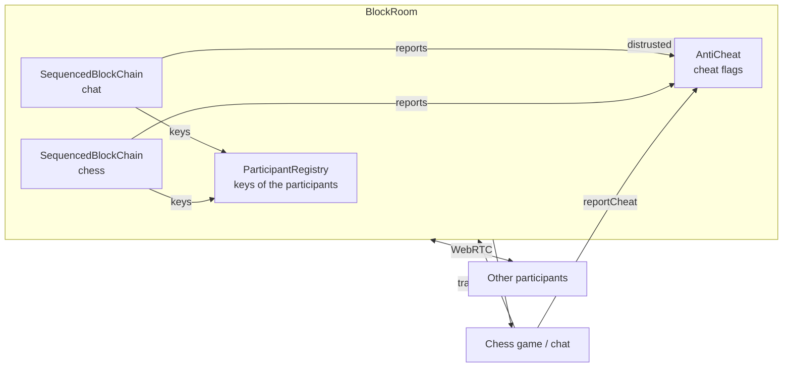
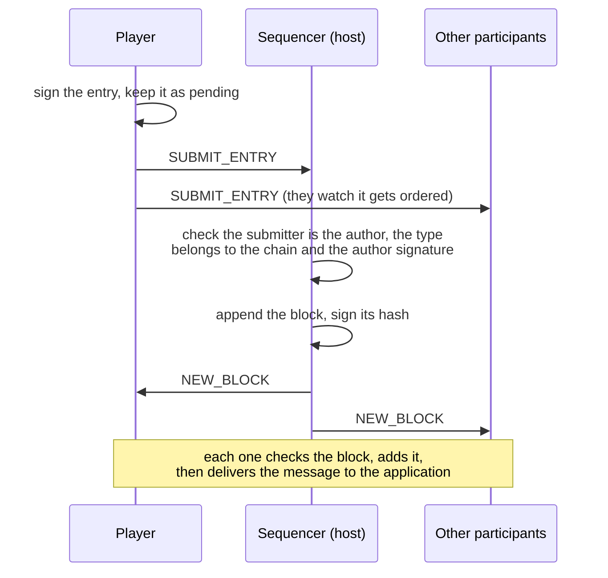
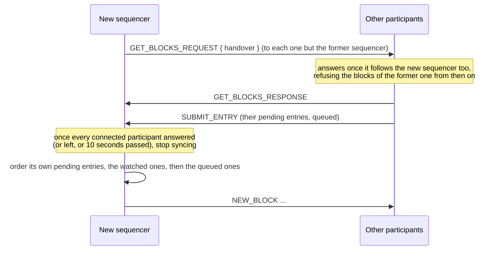

# Block chains and anti-cheat

The players of a room talk directly to each other over WebRTC, without a game server. Every chess move
and chat message goes through a **block chain**, so that all the participants receive the same
messages in the same order and can check who wrote them. An **anti-cheat** system runs beside the
chains: the participants watch the one ordering the blocks, check what they receive, and report the
cheats to each other.

The code lives in `application/frontend/game-app/src/app/services/room-manager/classes/room/block-room`.

- [Overview](#overview)
- [Identity of the participants](#identity-of-the-participants)
- [Blocks and signatures](#blocks-and-signatures)
- [Ordering the blocks](#ordering-the-blocks)
- [Delivering the blocks](#delivering-the-blocks)
- [Catching up](#catching-up)
- [Watching the sequencer](#watching-the-sequencer)
- [Changing the sequencer](#changing-the-sequencer)
- [Hidden moves: commit then reveal](#hidden-moves-commit-then-reveal)
- [Hidden cards: mental poker](#hidden-cards-mental-poker)
- [Sealed bids: the auctions of the Bid Poker](#sealed-bids-the-auctions-of-the-bid-poker)
- [Sealed votes: the Minority Game](#sealed-votes-the-minority-game)
- [Sealed trunks: Contraband](#sealed-trunks-contraband)
- [Sealed apples: the Garden of Eden](#sealed-apples-the-garden-of-eden)
- [Hidden bullets: the cylinder of the roulette](#hidden-bullets-the-cylinder-of-the-roulette)
- [A fair draw](#a-fair-draw)
- [Private conversations](#private-conversations)
- [Anti-cheat](#anti-cheat)
- [Messages](#messages)
- [Trust model and limits](#trust-model-and-limits)
- [Adding a message type or a chain](#adding-a-message-type-or-a-chain)

## Overview

A room (`BlockRoom`) runs **one block chain per feature**: `chat`, and the chain of its game, `chess`,
`poker`, `roulette`, `bid` (the Bid Poker), `minority` (the Minority Game), `contraband` or `eden` (the Garden of Eden),
and `private` for a game declaring private conversations, the Contraband (see [Private conversations](#private-conversations)); the
watched conversations travel on the `chat` chain. Each chain orders its
blocks on its own, so a busy chat never delays the moves of the game. The chains share the WebRTC
connections and the identity of the participants.

Each chain is ordered by a single participant, the **sequencer**: the host of the room, then the
participant taking over when it leaves or when most of the others report it as cheating. The
participants sign their messages and submit them to the sequencer, which appends them to the chain
and broadcasts the blocks. A single participant orders the chain, so it can not fork; the others
watch it.



| Class | File | Role |
|---|---|---|
| `BlockRoom` | `block-room.ts` | Routes each message type to its chain, dispatches the received messages, names the sequencer, ticks the chains every 2 seconds |
| `SequencedBlockChain` | `block-chain/sequenced-block-chain.ts` | Submits, orders, receives, checks and delivers the blocks of one chain, watches the sequencer |
| `Chain` | `block-chain/chain.ts` | The list of blocks, hashing and signing |
| `ParticipantRegistry` | `block-chain/participant-registry.ts` | Exchanges the public keys, shared by all the chains |
| `ParticipantKeyStore` | `block-chain/participant-key-store.ts` | Keeps the key pair of the player in the browser, and its key pair of agreement, which encrypts its private conversations |
| `AntiCheat` | `anti-cheat/anti-cheat.ts` | Collects the cheat reports into flags, names the accusers of a sequencer |
| `SynchronousChessOnlineGameSession` | `modules/chess/classes/game-sessions` | Seats the players, commits then reveals the moves, reports the cheated ones (see [Chess game session](chess-game-session.md)) |
| `SealedStore`, `SealedCommitments` | `modules/commit-reveal/classes` | Keep the hidden values of a player across the reloads of the page, and the first commitment of each player for each round (see [Hidden moves](#hidden-moves-commit-then-reveal)) |
| `FairDraw`, `SeededRandom` | `modules/commit-reveal/classes` | Draw a seed no player chose alone, and shuffle from it alike on every page (see [A fair draw](#a-fair-draw)) |
| `CommitRevealSession` | `modules/commit-reveal/classes` | The session the Bid Poker, the Minority Game, the Contraband and the Garden of Eden are built on: seats the players, draws the seed, seals then reveals the values of the local player, takes the claims of a timeout (see [Hidden moves](#hidden-moves-commit-then-reveal)) |
| `PlayedCommitRevealGame` | `modules/commit-reveal/classes` | A game of these sessions: its players, its setup, the id of its secrets, the draw of its seed, then the game |
| `MentalDeck` | `modules/mental-poker/classes` | Shuffles, deals and opens a deck no participant sees, checks it at the end of the game (see [Mental poker](mental-poker.md)) |
| `SeventeenPokerSession` | `modules/seventeen-poker/classes/game-sessions` | Seats the players, deals each hand with a mental deck, reports the illegal actions (see [Seventeen Poker session](seventeen-poker-session.md)) |
| `Cylinder` | `modules/russian-roulette/classes/cylinder` | Loads, spins and fires a cylinder no participant sees, checks it at the end of the game (see [Russian roulette session](russian-roulette-session.md#the-cylinder)) |
| `RussianRouletteSession` | `modules/russian-roulette/classes/game-sessions` | Seats the players, fires the chambers of the cylinder, reports the illegal moves (see [Russian roulette session](russian-roulette-session.md)) |
| `BidPokerSession` | `modules/bid-poker/classes/game-sessions` | Seats the players, draws the deck, seals then reveals the bids and the discards, reports the cheats (see [Bid Poker session](bid-poker-session.md)) |
| `MinoritySession` | `modules/minority-game/classes/game-sessions` | Seats the players, draws the askers, seals then reveals the votes, reports the cheats (see [Minority Game session](minority-game-session.md)) |
| `ContrabandSession` | `modules/contraband/classes/game-sessions` | Seats the players in their countries, draws the pairs, seals then reveals the trunks, takes the calls, reports the cheats, gives the private conversations of the match (see [Contraband session](contraband-session.md)) |
| `EdenSession` | `modules/garden-of-eden/classes/game-sessions` | Seats the players, seals then reveals the apples, counts them, takes the players out of paradise, reports the cheats (see [Garden of Eden session](garden-of-eden-session.md)) |
| `PrivateConversations` | `modules/private-conversations/classes` | Publishes the key of agreement of the player, encrypts its messages to each member of a conversation the game declares, checks, reads and reports the messages of the conversations; sends and reads the watched ones in clear text, moderated as the chat (see [Private conversations](#private-conversations)) |

The application only sees `Room.transmitMessage()`, `Room.messenger()` and `Room.reportCheat()`: a
message is delivered to every participant, its sender included, once its block is added to the chain
and checked.

## Identity of the participants

Each player has an **ECDSA P-384 key pair**, which signs its messages.

- **Kept across reloads.** `ParticipantKeyStore` stores the key pair of each player name in IndexedDB
  (database `synchronous-chess`, store `participant-keys`). A player reloading the page keeps its
  identity, so the blocks it signed before stay verifiable. The private key is not extractable: it
  can only sign. Without storage (private browsing, blocked site data), the page uses a key pair of
  its own, which a reload replaces.
- **Exchanged once per room.** `ParticipantRegistry` sends the public key to each new player, for all
  the chains at once. The request carries the key of the requester too, so if a request is lost (sent
  before the other side knew the player), the request of the other side still exchanges both keys.
  The key of a connection is registered once, from its request or its response.
- **Keyring.** A participant keeps the keys of the previous connections of its player: a player who
  lost its stored key signs with a new one, and its older blocks stay verifiable.
- **Departed participants** are kept 60 seconds, the time for the blocks they wrote to reach everyone,
  then forgotten. A participant who leaves before any of its keys is known is forgotten at once.
- **Key of agreement.** A player member of a [private conversation](#private-conversations) has a second key
  pair, ECDH on P-384, which encrypts its messages and reads the ones sent to it. `ParticipantKeyStore` keeps it in
  the same store, under the key `['agreement', name]`, apart from the identity of the name: its private key is not
  extractable either, it can only derive bits. It is not exchanged by `ParticipantRegistry`: the player publishes it
  on the `private` chain, signed by its identity. Without storage, the page uses a key pair of its own and warns that
  a reload will make its private messages unreadable.

## Blocks and signatures

```ts
interface ChainEntry {      // a message of a participant
    id: string;            // random UUID, to detect a replayed entry
    data: AppMessage;      // { from, type, payload }
    signature: string;     // by the author
}

class Block {
    index: number;
    previousHash: string;
    entry: ChainEntry;
    sequencer: string;          // the participant who ordered the block
    time: number;               // when the sequencer ordered it, in milliseconds since 1970
    hash: string;
    sequencerSignature: string; // by the sequencer, over the hash
}
```

| What | Signed or hashed content | By |
|---|---|---|
| Entry signature | `chain id JSON(data)` | the author (`data.from`) |
| Block hash (SHA-256) | `chain index previousHash sequencer time entry.id entry.signature JSON(entry.data)` | |
| Sequencer signature | the block hash | the sequencer |

The **chain name** is part of both the entry signature and the block hash: an entry or a block of one
chain is not valid on another chain of the room.

The genesis block (index 0) is the same for every chain, with a fixed hash and the time 0.

**The time of a block** is set by its sequencer, on the time of its system when its page started, then
a monotonic clock: a clock of the system set, by the network or after a sleep, does not make it jump. It
never goes back from the previous block, nor goes more than a day after it, the first block of a chain
being before 2100: a block out of these bounds is invalid. So far ahead, adding seconds would not change
a time, and the next sequencers would give it to all their blocks; an honest chain never meets them, a
chain idle for more than a day going on from the latest time it may give. The time is the same on every
page, the history included, so a rule of the application reads it alike everywhere
(`Room.sequencedAt()`; the chat counts the messages of an author over the last seconds of the chain on
it). A new sequencer whose clock is late takes on the time of the chain: it adds the gap to its clock,
rather than giving the time of the latest block to the next ones.

The sequencer could forge the times, spreading a flood of its own over seconds that never passed. Each
participant watches its clock on the blocks it receives live (`SequencerClock`): the delay of a block,
from its time to its reception, is the gap between the two clocks plus the network, which only makes it
longer. The first live blocks of a sequencer, at least 5 over at least 30 seconds, set the shortest
delay, some of them late not mattering; a later block received more than 5 seconds sooner tells a clock
jumping ahead: the participant reports it once (`clockAhead`), and the block is kept, its time already
in the chain. The watch starts again when the clock of the system of the participant moves apart from
its monotonic clock (set, or the page asleep), when the sequencer changes, and when the key of the
sequencer is received again: its page may have reloaded on a clock set meanwhile, or it may order again
after a sequencer whose clock was ahead, taking on its time. A sequencer connecting again starts a new
warm-up, at the risk of losing the ordering meanwhile. The warm-up checks no jump: a block received
sooner than the previous ones is not told apart from previous ones received late, so a sequencer may run
its clock ahead over each warm-up, up to a day per block, and spread a flood over it. Its first blocks all
received late, by a network jammed or a page frozen over the whole warm-up, the next one received at
its time makes the participant report an honest sequencer: lowering the shortest delay after the warm-up
would let a sequencer run ahead 5 seconds at a time. A clock ahead from the first blocks on, or running late,
is not told apart from a slow network: a sequencer could pack the messages of an honest author, as it
could already hold them for less than 10 seconds, or spread its own messages back over an idle time of
the chain. Freezing its clock, giving every block the time of the previous one, it would hide an honest
author after 8 messages as long as it orders: telling a clock late from a page suspended or a slow
network would make the participants report honest sequencers.

## Ordering the blocks



- An entry is submitted to **every participant**: the sequencer orders it, the others watch it.
- A participant accepts an entry only from its own author: the WebRTC connection proves who sent it.
  It checks the author signature: the sequencer before ordering, so it can not be blamed for a forged
  entry, the others before watching, so they do not report an honest sequencer for refusing it. The
  entries of an author whose key is still being exchanged wait for it (at most 32 per author). An entry
  already in the chain (submitted again) is not ordered twice.
- When the sequencer transmits a message, it orders the entry directly.
- A participant adds a `NEW_BLOCK` only from its current sequencer. Each chain handles its messages one
  at a time, so the blocks are added strictly in order.
- The entries of the local participant stay **pending** until their block is added: they are submitted
  again when the sequencer becomes ready (its key is received) or when it changes.

## Delivering the blocks

Every block the sequencer sends is added to the chain, so that the chains of all the participants stay
the same. The application receives the blocks **in their order, once checked**, and every participant
leaves the same cheated blocks out of it, so that the game and the chat stay the same everywhere:

- a block not signed by its sequencer, a replayed entry, or an entry of another chain is left out;
- an entry not signed by its author is left out;
- the entry of an author whose key is still being exchanged waits for the key, and the next blocks
  with it;
- the entry of an author who left before the participant joined (unknown) is delivered: its key can
  not be known.

## Catching up

A participant missing blocks asks for them with `GET_BLOCKS_REQUEST { from }`, the index of its next
block. The response carries the blocks that fit in **64 000 characters of JSON**, at least one: a data
channel message holds 256 KiB in Chromium, a character taking up to 3 bytes, and the blocks of a card
game carry decks of several kilobytes. A response reaching the index asked from is followed by a request
for the next page, until an empty one: a response of blocks before it is not the page asked for.

A participant catches up:

- with the sequencer, once the key of the sequencer is received (joining the room);
- with the sequencer, when a `NEW_BLOCK` leaves a gap after its latest block;
- with another participant, whose chain head goes further than its own;
- with the new sequencer, when it changes.

A participant only processes the responses it asked for. A block received from a participant other
than the sequencer must be signed by its sequencer. A refused block stops the catch up with that
participant, since asking again would bring the same block.

The blocks a participant joining the room catches up with are the **history** of the chain:
`Room.isHistory()` tells the application whether a message it delivers is one, so that a reloaded page
replaying them does not animate them as new moves. A chain is caught up once every participant it
asked for blocks answered with an empty page (the sequencer, or the others when its link to it is lost),
once a `NEW_BLOCK` of the sequencer follows its latest block, or once it collected the blocks as a new
sequencer; the sequencer of a new room starts caught up.
The blocks added before are its history, delivered later included (waiting for the key of their author);
the ones added after are live, those caught up with later (a gap, a lost connection) included.

## Watching the sequencer

Every 2 seconds, the room ticks its chains:

- **Withheld entries.** Each participant watches the entries submitted to the sequencer, once their
  author signature is checked. An entry the sequencer does not order within **10 seconds**, while it
  orders other entries of the chain, is reported as censored. A new sequencer gets the same delay
  again.
- **Different chains.** Each participant shows the head of its chain (index, hash, sequencer and its
  signature) to the others, and to each new participant once its key is received. A head:
  - further than the local chain makes the participant catch up with the one showing it, so a block the
    sequencer withheld from it still arrives;
  - differing from the local block at the same index, both signed by the same sequencer, proves the
    sequencer sent different chains to the participants: it is reported as a conflicting block. A
    difference without such a proof is only logged.

## Changing the sequencer

The sequencer changes when it leaves the room, or when **more than half of the other participants**
reported it for a cheat only a sequencer can commit (see the table below). The next sequencer is the
first participant by name among the connected ones, a distrusted sequencer never coming back: every
participant knows the same participants and reports, so they all name the same one. When no
participant can take over, the sequencer stays.

**Leaving the room.** A participant losing its connection to another one does not know whether the
other left, or only their link broke. Each participant tells the others whom it is connected to
(`connectedParticipants`), whenever a participant becomes ready or leaves. A participant has left the
room once **every other connected participant** told it lost it too: a participant which did not tell
yet is waited for, and a participant connected again before that has not left. So the participants
all notice a departure, and change their sequencer, from the same participants; a single broken link
changes nothing.

**Restoring a connection.** Until then, the connection is negotiated again through a participant still
connected to both: every participant relays the signals of two others, as the host does for a joining
player. Of the two, the first by name connects, the other answers through the same relay; the attempt
is repeated at each tick of the room (2 seconds) while the other is lost. A participant which lost
all the others may have lost its own network: it joins the room again through the websocket, the
others connecting to it as to a joining player. Refused for 20 seconds because the host is gone, it is
the last participant: the participants it lost have left the room, and it takes it over. The host
does so too once it lost several participants: they may still be connected to each other, so it closes
the socket of its room for them to take it over, then joins it; nobody taking it over, it takes its
room back. Having lost a single participant, the host decides at once that it left: alone too, the
other one joins the room again.



The former sequencer may have sent its last blocks to some participants only. The new sequencer first
collects the blocks of all the participants, so these blocks are kept and **no block is rolled back**:

- The participants notice the change at different times. A participant answers the collection only
  once it follows the new sequencer itself: the blocks the former sequencer sends it until then are
  in its answer, and it refuses the next ones.
- The former sequencer is not asked: it is distrusted, and the blocks it sent are collected from the
  participants who received them.
- A participant not following the new sequencer within **10 seconds** is not waited for anymore, so a
  participant who never answers can not block the chain.

The entries the former sequencer did not order are submitted again by their authors, and the new
sequencer orders the entries it watched before taking over; an entry already in the chain is not
ordered twice.

**Joining after a change.** A player joining the room, or reloading the page, starts with the host as
sequencer: it missed the changes. Once the key of a participant is received, each side tells the other
which sequencer it follows, the number of changes it made and the distrusted sequencers
(`sequencerState`). A participant follows the sequencer that more than half of the other participants
follow, if they made more changes than itself; a single participant can not make it follow another
sequencer.

**Taking the room over.** Joining goes through the host, which holds the room on the websocket API. Once
the room agrees its host left, the sequencer, after the handover, takes it over: it moves the room of
the API to a new socket of its own (`reconnect` with its name and the token it joined with, retried
while the former host connection is still open), tells the API the players of the room (the former
host leaves them), then lets the players join and relays their signals. The host removes a player from
the room of the API once the room agrees it left, not when only its connection is lost: it may still
take the room over. The other participants
connect to the joining players through it. The former host, back on a reloaded page, joins the room
again like any player, at once from the URL of its page and the session of its tab.

## Hidden moves: commit then reveal

In synchronous chess both players play at the same time. Without care, the first move ordered would
reach the other player before it plays, and the sequencer would see it even before ordering it. The
online game session hides the moves:

1. A player plays its move (or promotion) locally, and sends only a **commitment**: the SHA-256 of
   the turn number, its color, the action and a random salt (`SC_GS_commit`).
2. Once the commitments of every player of the turn are in the chain, each player **reveals** its
   action and salt (`SC_GS_reveal`). A turn played by a single player is revealed at once.
3. The participants check each reveal against the commitment of its player for the current turn, then
   run it. The first commitment of a player for a turn is final.

A reveal not matching its commitment (`invalidReveal`) or a move against the rules (`illegalMove`) is
ignored by every participant alike, and reported against its player with `Room.reportCheat()`.

The games share the parts of a commit-reveal (`modules/commit-reveal`), each one keeping its messages:
`commitmentOf()` hashes the parts of a commitment joined by the separator of the game (a space for the chess, a
colon for the roulette), a part holding it having a fixed form (an id of salts joined by colons), so two lists of
parts never give one text; `drawSalt()` draws the salt; `SealedCommitments` keeps the first
commitment of each player for each round, in the order of the chain; `SealedStore` keeps the values the player
committed to across the reloads of the page.

The turn number is counted by each participant, the same for all of them since they run the same
actions.

A player plays its action at once, and a turn played alone ends at once, so it may play the next turn
before the commitments of the previous one are in the chain: it keeps each action it played until it
is revealed. A player runs its own actions when playing them; after a reload of the page, the chain
replays its reveals, which it runs like the ones of the other players.

**Reloading the page.** `SealedStore` keeps the actions the player committed to and whose reveal
is not in the chain yet, with their salt, in the session storage of the tab (key
`synchronous-chess:sealed-<kind>:<room>:<player>`, the kind `turns` for the chess, `bids` for the Bid Poker, its discards
included, `votes` for the Minority Game, `trunks` for the Contraband, `apples` for the Garden of Eden, and `draws` for the random
part of a fair draw of these four). When the chain replays a commitment of the player
that its new page did not play, the stored action of that turn is used if it matches the commitment:
the action of a previous game in a room of the same name never does. It is played once the game
reaches its turn, then revealed as usual. The page does not know whether its reveal is in the chain
already, so it may reveal it twice: the other participants ignore a reveal matching the commitment of
a turn its player already played. Without session storage (blocked site data), the action is lost.

The Bid Poker, the Minority Game, the Contraband and the Garden of Eden share all but their moves: their sessions are built on
`CommitRevealSession`, which applies their messages one after the other in the order of the chain, seats the players,
draws the seed of the game ([A fair draw](#a-fair-draw)), takes the claims of a timeout on the time of the chain and
starts a new game. It holds the life of a value the local player seals, the same for the four games: kept in the tab
before its commitment is sent, the commitment naming its round fixed before the hash; removed once the chain does not
take its commitment (too late, or a second one), once revealed, refused or withheld, and once the game is over or a new
one starts; revealed by its page once the phase calls for it, again by a reloaded page. Each game keeps its own messages
and their checks, its start and what a value is.

## Hidden cards: mental poker

A card game needs more than a hidden move: a hand stays hidden for a whole round, and no participant
can deal, the players and the sequencer included. `MentalDeck` (`modules/mental-poker`) runs the
mental poker of Shamir, Rivest and Adleman over the chain of its game: each player encrypts and
shuffles the deck, then puts a key of its own on each card; a card is dealt by asking the keys of every
player but its recipient, and opened by asking all of them. Once the game is over, the players disclose
all their keys and every participant checks the deck. See [Mental poker](mental-poker.md), and the
Seventeen Poker, its first game, in [Seventeen Poker session](seventeen-poker-session.md).

## Sealed bids: the auctions of the Bid Poker

The Bid Poker auctions public lots of cards: only the bids and the discards are hidden, by the shared commit-reveal. Each
player commits to its bid on the lot, or to its discards, with the id of the game, its index and a salt; once every
player committed, or the time of the phase is over, the pages reveal them. The first commitment of a player counts, and
the order of the commitments in the chain decides a tie. The deck is shuffled from the seed of a fair draw of every
player. A value withheld, not revealed or revealed otherwise than committed, makes its player a pig at the end: the
reveals come one after the other, and the last one could otherwise take its bid back once it read the others. A claim
of a timeout is checked on the time of the chain: one coming before the time of its phase is void. See
[Bid Poker session](bid-poker-session.md).

## Sealed votes: the Minority Game

The Minority Game hides the votes only, by the shared commit-reveal: each player still in commits to its vote, yes or
no, with the id of the game, its index, the question and a salt; once every voter committed, or the time of the vote is
over, the pages reveal them, and the majority loses. The askers of the questions are drawn from the seed of a fair draw
of every player, alike on every page. A question is free text, checked on receipt as a message of the chat (no link nor
e-mail address). A vote withheld, not revealed or revealed otherwise than committed, eliminates its player, or loses it
the most a round gives in the score variant: the last one to reveal could otherwise change the count once it read the
others. A claim of a timeout is checked on the time of the chain. See [Minority Game session](minority-game-session.md).

## Sealed trunks: Contraband

The Contraband hides the trunks only, by the shared commit-reveal: in each game, the smuggler commits to the money of its
trunk with the id of the match, its index, the index of the game and a salt; the inspector calls, then the page of the
smuggler reveals the trunk, and the call settles the money. No participant, the sequencer and the inspector included,
reads a trunk before the call. The pairs of the games are drawn from the seed of a fair draw of every player, alike on
every page. The smuggler reveals after the call: a trunk withheld, not revealed in time, revealed otherwise than
committed or out of the rules, is seized at the most it could hold, so withholding never pays. The reveal waits 15
seconds, more than the watch of the censorship: a sequencer holding the reveal of a smuggler is caught first. A claim
of a timeout is checked on the time of the chain. The countries and the pairs of each game talk in the
[private conversations](#private-conversations) the game declares. See [Contraband session](contraband-session.md).

## Sealed apples: the Garden of Eden

The Garden of Eden hides the apples only, by the shared commit-reveal: in each round, each player still in paradise
commits to its apple, gold, silver or red, with the id of the game, the index of its player, the round and a salt; once every player
still in committed, or the time of the vote is over, the pages reveal them, and the table of gains counts them. No
participant, the sequencer included, reads an apple before the vote closes. The apples revealed and the balances are
public: an anonymous tally would hide only gold against silver, the gains telling the red apples anyway. The seed of the
fair draw every game built on `CommitRevealSession` makes is unused. An apple withheld, not revealed in time or revealed
otherwise than committed, loses 1,000 million and does not count, as much as a lone red apple: the last one to reveal
could otherwise change the count once it read the others, and it never saves its loss that way. A claim of a timeout is
checked on the time of the chain. See [Garden of Eden session](garden-of-eden-session.md).

## Hidden bullets: the cylinder of the roulette

The 24-shot Russian roulette hides the bullets each player loads, and the offset of the cylinder, from every
participant, the players included: a shot tells only the count of bullets of its chamber. The `Cylinder`
(`modules/russian-roulette`) runs the exponential ElGamal over the chain of its game: each player gives its share of
the key with its proof, loads its bullets under the key of both with the proof of a bit for each chamber and of their
count, then each player turns the cylinder and re-randomizes it. A chamber fires with the share of each player, proven
made with its key. Once the game is over, the players disclose their keys and every participant checks the spins. See
[Russian roulette session](russian-roulette-session.md#the-cylinder) and
[The exponential ElGamal](mental-poker.md#the-exponential-elgamal).

## A fair draw

A game drawing at random, the first shooter of the roulette, needs a draw no player chose alone, nor the sequencer.
`FairDraw` (`modules/commit-reveal`) draws a seed over the chain of its game:

1. Each player draws a random part, keeps it in its tab (the game stores it: `FairDraw` keeps nothing, a reload would
   lose it), and sends its commitment: the SHA-256 of the context of the draw (unique to it), its index among the
   players drawing (not its seat: a seat may be free between them) and its part, joined by colons. The first
   well-formed commitment of a player counts: a malformed one is a cheat, not kept.
2. Once every player committed, each one reveals its part. A part not matching its commitment is an `invalidReveal`,
   not kept: a later reveal matching it still counts.
3. Once every part is revealed, the seed is the SHA-256 of the parts in the order of the seats, joined by colons: the
   same for every participant, whatever the order of the reveals.

The roulette draws its first shooter from the parity of the last hexadecimal digit of the seed. From a seed,
`SeededRandom` makes every page draw alike: its bytes are the SHA-256 digests of `seed:0`, `seed:1`... one after the
other; a draw below a bound reads the bytes holding the bits of the bound minus one, keeps these bits only and draws
again a value not below the bound, so no value is likelier than another; `shuffle()` is a Fisher-Yates from the last
item. Its specs pin its draws: a change of the bytes, of their order or of the shuffle, which would change every deck,
can not go unnoticed.

## Private conversations

A game may give some of its players conversations of their own, a team or two players facing each other: the other
participants, the sequencer included, see who writes to whom and when, never what. `PrivateConversations`
(`modules/private-conversations`) runs them on a chain of their own, `private`: its blocks are signed, ordered and
watched as on every chain, so the conversations never delay the moves of the game, and each text is encrypted end to
end, for each of its recipients. The room shows them in a third panel, beside the chat and the history, to their
members only.

A game may also declare a **watched** conversation, its players bluffing before the whole room: its members write, every
participant reads, spectators and latecomers included (see [A watched conversation](#a-watched-conversation)).

### The keys on the chain

- Each member publishes the public key of its [key pair of agreement](#identity-of-the-participants) in a `PV_key`:
  the four fields of its point, `{ kty, crv, x, y }`, without the `ext` and `key_ops` the export adds. Its id is the
  SHA-256 of these fields, the same on every page.
- A page publishes the key of its player once it is a member of a conversation declared, unless the latest key of its
  player on the chain is already this one: a spectator publishes none. It publishes its key again when another key
  shows in the name of its player (an older one, after its storage was lost, or a forged one), and when a part sent to
  it names an older key of its player (a page that did not take the new one), once for each older key. A page reloaded
  may publish the same key again while it catches up: a key published again is not counted. A key the chain does not
  send back within 15 seconds (lost at a change of sequencer) is published again; one sent back but refused is not.
- The latest key a participant published is its current one: the messages sent to it are encrypted for it. Every page
  records every key, to check the messages naming it the same everywhere; but a key appended live in the name of a
  participant away from this page (not in its `room.players()` when it applies) does not replace the current one it
  had: unknown to the room once it left, its entry is not checked, and the sequencer may have forged it. A key
  published again is not counted again; a participant publishing a 17th key (`MAX_KEYS_PER_PARTICIPANT`, a few lost
  storages, not a flood of keys), a key malformed or a point off the curve is reported. The keys appended live in the
  name of a participant away, and on its own page the keys in its name other than its own, are not counted: forged,
  they would make its own key refused. They are bounded apart, 16 at most, the next ones ignored without report. A key published by another
  participant than its own is of no use to it: the part of a recipient is read with a key it published itself.

### A message and its parts

A `PV_message` is an envelope `{ conversation, id, key, parts }`: the id of the conversation, the id of the message (a
UUID, the same when it is sent again), the id of the key of its sender, and **a part for each recipient**, its sender
included, who reads its own messages again after a reload. A part is `{ to, key, iv, data }`: the recipient, the id of
its key, then the initialization vector and the text encrypted with its tag, in base64. The functions of
`private-crypto.ts` are pure:

- **The key of a pair.** The bits of ECDH (384) between the private key of one participant and the public key of the
  other go through HKDF-SHA-384 into a key of AES-GCM 256, the same for both of them. Its info is the version of the
  format, the room and the ids of both keys, sorted; its salt is zero, as RFC 5869 gives when there is none: the bits of
  ECDH are already secret, and both sides derive the key apart. A participant shares a key with itself for its own copy.
- **The AAD** of a part binds it to the version, the room, the conversation, the id of the message, the sender and the id
  of its key, the recipient and the id of its key: copied elsewhere, a part does not decrypt.
- **The text encrypted** is `${at}\n${text}`, the time its sender wrote it by its clock and its text, padded as ISO/IEC
  7816-4 does (a byte `0x80`, then zeros) to a multiple of 256 bytes: two short texts have the same size, the length of a
  message showing to the nearest block only. Each part draws an initialization vector of 12 bytes.

The longest message of the chat, encrypted, is a part of 4120 base64 characters: a message to 8 members holds in about
34 000 characters, under the 64 000 of a response catching up.

### What a game declares

`declare(list)` **replaces** the conversations: each one is `{ id, members, title, open, watched? }`. Its id
(`^[a-z0-9][a-z0-9-]{0,63}$`) is unique in the room, the game and its attempt prefixing it, and its 1 to 8 members and
its kind are fixed: declaring an id again with other members, or watched once private, throws. `open` drives the composer and the notice of a conversation
closed only: a message received while it is closed still shows (see the [limits](#trust-model-and-limits)). The page of
the game merges `privateBlockChains` into its routing, and gives the instance to the layout of the room
(`app-room-layout`, `[conversations]`). The Contraband declares one for each country of 2 players or more, and one for
the customs of each game, between its smuggler and its inspector (see [Contraband session](contraband-session.md#private-conversations)).

### Checking the messages

The messages apply one after the other, in the order of the chain, a key before the messages using it. Three levels:

1. **Every page, on the `private` chain alone**: the form of the envelope (`isPrivateEnvelope`: its fields and none
   other, 1 to 8 parts to distinct recipients, each no longer than the longest message encrypted), the keys it names,
   published by its sender and by each recipient, and its sender among its recipients. Then the rate of its author, as
   for the chat (see [The flood of the chat](#messages)): on the times of the chain, an author over 8 messages in 10
   seconds is hidden, the conversation telling it once.
2. **Every page, once the conversation is declared**: its sender and each recipient are its members. A message of a
   conversation not declared yet waits: the `private` chain of a page reloaded may replay before the chain of the game,
   which declares it. The messages waiting are judged in the order of the chain once the declaration applies; a page
   keeps 256 of them at most of each author (`WAITING_MAX`), its oldest dropped first, so an author never pushes out
   the messages of another one, and not the ones hidden by the rate of their author: a conversation made up is never
   declared. A message of the other kind than its conversation (an envelope in a watched one, a watched message in a
   private one) is refused at this level.
3. **The recipients alone** decrypt their part, then check its text as the chat does (`isChatText`: not blank, 1000
   characters at most, no link nor e-mail address). A part encrypted for an older key of its recipient, or no part at
   all (it was away), shows a notice of a message unreadable, not reported. A message sent again shows once, by its
   author and its id.

A message failing the first level, or a key failing, is reported `invalidMessage` by every page alike, the first one of
each author only. A message failing the second level is reported by the pages that judge it: a page declaring the
conversation late judges the messages it kept waiting only. A text failing the third level is reported by its recipient, the first one of each author: the
others can not read it to check.

### Sending

- A message gets a part for each member present in the room (`room.players()`), for its current key, and for its
  sender. A member away gets none: a sequencer forging a key in its name, once it is forgotten, reads nothing. Back, it
  sees the message unreadable, and the next ones are encrypted for its own key, the forged one never current.
- The composer waits until each member present, its player included, has a key on the chain (`Preparing the
  encryption…`): a sequencer withholding a key is reported for censoring it (`censoredEntry`). It waits as the one of the
  chat too, every conversation counted together: 3 messages in 10 seconds, 5 messages not sent back. A message shows at
  once, sending, failed when the room does not send it back within 15 seconds; sent again, it keeps its id and is
  encrypted again.
- **No moderation** of a private conversation. The host, often a player, could silence its opponent without reading
  what it writes; removing a participant from the room already stops its messages. A watched conversation is moderated
  as the chat (see below).

### A watched conversation

A conversation declared `watched: true` is the talk of the players of a match before the whole room: its members write,
every participant reads. Encrypting a text everyone reads would protect nothing, so its messages travel in clear text:

- A `PV_watched` is `{ conversation, id, at, text }`: a text of the chat (`ChatText`) and its conversation. It travels
  on the **`chat` chain**, ordered with the decisions of its moderator. A member of watched conversations only publishes
  no key, and its composer never waits for one.
- **Every page** checks its form and its text (`isWatchedText`: its fields and none other, the ids, then `isChatText`:
  not blank, 1000 characters at most, no link nor e-mail address), reported `invalidMessage` by every page. Then, once
  the conversation is declared, its author is a member, and the conversation a watched one. Every page reads it, the
  members as the others: a spectator coming later, or a page reloaded, reads the history of the chain.
- **The rate** is counted as for the chat and the private messages, an author over 8 messages in 10 seconds hidden, but
  apart from the envelopes: the two kinds travel on two chains, ordered apart, and a page receives them in its own order.
- **A message appended live in the name of an author the page can not check** (`Room.isSigned()`) is dropped once
  counted, without report: unknown to the room once it left, the sequencer may have forged it. A participant this page
  lost but the room still knows (its key kept a minute) signs its messages: checked, they show as on every other page.
- **Moderated as the chat**: `PrivateConversations` applies the decisions of the moderator of the chat in its own
  queue, in the order of the `chat` chain, as `ChatComponent` does (`isModeratorDecision`, the decision ordered by its
  author, not on itself), and drops a watched message of an author muted or removed at its time, before counting its
  rate, as the chat hides it: neither shown, counted nor told, on every page alike, the history included. Its own
  message, sending, is dropped from its page. A mute only reaches the messages ordered after it, whatever the clocks
  of the sequencers. The composer of a member muted waits as the one of the chat (`You are muted until 12:38 PM`), the
  panel reading the end of its mute from the chat. Hiding a player's messages in the options of the chat does not
  apply to a watched conversation; an invalid decision is reported by the chat only.
- **The panel** shows the watched conversations to every participant (`Players' talk` on the button of the room bar,
  `Conversation of the players` in its title when no private conversation shows beside them); a participant who is not
  a member reads it without composer (`Only the players write here`).

### A key changed, a page reloaded

- **Reloaded**, a page keeps its key pair (IndexedDB), replays the chain, reads its own copies and the parts sent to it
  again; it publishes its key again only while it catches up, or when another key shows in its name.
- **A key lost** (storage cleared, another browser, private browsing): the page publishes a new key, which becomes the
  current one of its player. The messages encrypted for the older key, sent before the others applied the new one
  included, show unreadable to it; the next ones are readable.

## Anti-cheat

The participants report the cheats they detect with an `anti_cheat` message to all the others, outside
the chains: a report does not need to be ordered, and the sequencer can not hide it.

### Checks

| Reason | Detected when | Against | Left out of the application |
|---|---|---|---|
| `forgedAuthor` | The entry is not signed by any known key of its author | the sequencer, which checks it (counted against it when reported by the author only) | yes |
| `replayedEntry` | The entry id is already in the chain | the sequencer | yes |
| `wrongChain` | The message type belongs to another chain | the sequencer | yes |
| `forgedSequencing` | The block is not signed by its sequencer | the sequencer | yes |
| `invalidBlock` | The hash of a block of the sequencer does not match its content, or its time goes back from the previous block, or more than a day after it | the sequencer | not added |
| `conflictingBlock` | The sequencer sent another block for an index already in the chain, a block not following the latest one, or a head proves it signed two blocks for the same index | the sequencer | not added |
| `censoredEntry` | The sequencer orders other entries, not this one, for 10 seconds | the sequencer | |
| `clockAhead` | A live block of the sequencer is received more than 5 seconds sooner, from its time, than the shortest delay of its first ones (5 over 30 seconds at least): its clock jumped ahead | the sequencer | no |
| `illegalMove` | A revealed move, an action of the poker (a bet, an exchange), a move of the roulette (a pass, a shot), a bid or a discard of the Bid Poker (above the coins of its player, on its own lot, a card not held), a question or a vote of the Minority Game (a question of another player than the asker, a vote of a player eliminated, a vote neither yes nor no), a move of the Contraband (a trunk committed by another player than the smuggler, a call by another player than the inspector, a trunk out of the rules), or an apple of the Garden of Eden (committed by a player out of paradise, revealed as something else than an apple) is against the rules | the player | yes |
| `invalidReveal` | A revealed move does not match its commitment, or its turn, or a random part of a draw, a bid or discards of the Bid Poker, a vote of the Minority Game, a trunk of the Contraband, or an apple of the Garden of Eden, its commitment | the player | yes |
| `invalidShuffle` | A deck is not one (a card missing or twice), or, once the keys are disclosed, not made from the previous one with the keys of its player | the player | a deck that is not one breaks the deck |
| `invalidCardKey` | A key is malformed, does not give the card to its recipient (with two players), or is not the one disclosed at the end of the game | the player | a malformed key |
| `invalidLoad` | A key of a cylinder without the proof of its player, or a load without the proofs of its bullets | the player | yes |
| `invalidSpin` | A spin of a cylinder is not one (a chamber missing or out of the group), or, once the keys are disclosed, not the cylinder received turned | the player | a spin that is not a cylinder breaks the cylinder |
| `invalidShare` | A share of a chamber without its proof, or a key disclosed that is not the one of its player | the player | yes |
| `invalidMessage` | A message of the chat not of the form the composer sends: over 1000 characters, or blank. The first one of each author only, the same block on every page. A key or a message of a private conversation: a key malformed or a 17th one, an envelope malformed, naming keys not published by their participants, its sender not among its recipients or not a member, a recipient not a member, a message of the other kind than its conversation, a watched message malformed, holding a link, or of a participant not a member, reported by every page alike; a text not decrypted or not of the form of the composer, reported by its recipient only. The first one of each author for each of the two (see [Checking the messages](#checking-the-messages)) | the player | yes |

The reasons **against the sequencer** count to take the ordering away from it: only reports from
connected participants other than the sequencer count, and more than half of them must have reported
it. A `forgedAuthor` report counts only when the author of the entry makes it: an author giving
different keys to the participants makes some of them find its entries forged, while the sequencer
checked them, so only the author knows for sure its entry was forged.

### Reports and flags

A participant reports a cheat once per subject and reason. `AntiCheat` gathers its own reports and the
reports of the others into **flags**, one per block or withheld entry:

```ts
interface CheatFlag {
    chain: BlockChainName;
    subject: string;    // the hash of the block, or the id of the withheld entry
    index?: number;     // the index of the block, none for a withheld entry
    author: string;     // the author the entry claims
    sequencer: string;
    reports: ReadonlyArray<{ reporter: string; reason: CheatReason }>;
}
```

The room exposes them as the `BlockRoom.cheatFlags` signal. The chess and chat pages notify each new
report (`modules/room-layout/cheat-notifications.ts`).

## Messages

| Origin | Type | Payload | Sent by → to |
|---|---|---|---|
| `block_room_participant` | `getPublicKeyRequest` | `{ publicKey }` | a participant → a new player |
| `block_room_participant` | `getPublicKeyResponse` | `{ publicKey }` | → the requester |
| `block_room_service` | `submitEntry` | `ChainEntry` | a participant → everyone |
| `block_room_service` | `newBlock` | `Block` | the sequencer → everyone |
| `block_room_service` | `getBlocksRequest` | `{ from, handover? }` | a participant → the one it catches up with, a new sequencer → each participant |
| `block_room_service` | `getBlocksResponse` | `Block[]` (64 000 characters of JSON at most, one block at least) | → the requester |
| `block_room_service` | `chainHead` | `{ index, hash, sequencer, sequencerSignature }` | a participant → everyone, every 2 seconds |
| `anti_cheat` | `cheatReport` | `CheatReport` | a participant → everyone |
| `anti_cheat` | `sequencerState` | `{ sequencer, handovers, distrusted }` | a participant → each participant whose key it receives |
| `anti_cheat` | `connectedParticipants` | `{ participants }` (sender excluded) | a participant → everyone, when a participant becomes ready or leaves |

The `block_room_service` messages carry the name of their chain in a `chain` field.
`isNetworkMessage` validates the envelope of the received messages (origin, type, known chain name);
their payload is trusted, and a payload making a handler throw is logged.

The chess game sends `SC_GS_seat`, `SC_GS_commit` and `SC_GS_reveal` through the
`chess` chain, the Seventeen Poker its `SP_*` and `MP_*` messages through the `poker` chain, the roulette its `RR_*`
messages through the `roulette` chain, the Bid Poker its `BP_*` messages through the `bid` chain, the Minority Game its `MG_*` messages through the `minority`
chain, the Contraband its `CB_*` messages through the `contraband` chain, the Garden of Eden its `GE_*` messages through
the `eden` chain, the chat
`chatMessage` through the `chat` chain, the private conversations `PV_key` (`{ key }`, the public key of agreement of
its sender) and `PV_message` (`{ conversation, id, key, parts }`, see [A message and its parts](#a-message-and-its-parts))
through the `private` chain, and `PV_watched` (`{ conversation, id, at, text }`, see [A watched conversation](#a-watched-conversation))
through the `chat` chain.

**The flood of the chat.** The sequencer orders every message of the chat: refusing the messages of an
author over the rate, it would be reported for censoring them by the participants watching them. Each
page filters them instead, on the times of the chain alone (`chat-flood.ts`): an author with 8 messages
already within the last 10 seconds of the chain is hidden, its hidden messages and the ones sent twice counted, until its rate
falls back; the log tells it once. Every page hides the same messages, a page reloaded and a participant
joining late included. The composer sends 3 messages in 10 seconds at most, and waits while 5 of its
messages are not sent back: held while the room has no sequencer, they are ordered at once when it has
one again. The network packing the messages of an honest player on the chain never makes it pass 8.

## Trust model and limits

- **The sequencer decides the order**, and can not change the entries, which are signed by their
  authors. Forged, replayed, misrouted, withheld or conflicting blocks are reported, left out of the
  application, and take the ordering away from it once most of the others report it.
- **The moves are hidden** until every player of the turn is committed: neither the sequencer nor the
  opponent can adapt its move.
- **The connection authenticates the sender** of a message (`from` is stamped by the receiving side), so
  submissions and reports need no signature.
- **A majority can take the ordering away.** With two participants, a single report of the other one is
  enough. A group of participants reporting falsely together can name another sequencer, not change
  the blocks.
- **Keys of a player.** Each participant checks the entries against the keys the author gave it, so
  the sequencer can not forge them. A player giving different keys to the participants makes them
  leave its own entries out differently: their games then differ. It can not make them report the
  sequencer.
- **The time of the blocks** is the clock of the sequencer, watched by the others on the live blocks
  only: a page reloaded or joining late trusts the times of the history. A page suspended, or a slow
  network, through the first 30 seconds of a sequencer makes its receiver report an honest sequencer:
  with two participants, that single report takes the ordering away.
- **History of departed players.** A participant who joins after a player left for good can not check
  the signatures of its blocks: they are trusted on the hash chain of the sequencer. `Room.isSigned()` tells the
  application whether the page checked the signature of a message it delivers, for a rule to tell such an entry apart.
- **Reloading during a game** replays the moves from the chain, and the hidden move committed and not
  revealed yet from the session storage. A move played in the new page before the chain replays its
  commitment replaces the stored one, and can not be revealed: the first commitment is final.
- **The private conversations** hide their texts only:
  - **Their metadata shows** to every participant: who writes to whom, in which conversation, when, the ids of the keys,
    and the length of each text to the nearest 256 bytes.
  - **No forward secrecy.** The keys of agreement are static for a player and a browser: whoever takes the private key
    of a member, from its browser, reads every message sent to it, the past ones of the chain included.
  - **The reports of a recipient can not be checked**: only it reads its part, so a text it calls invalid is its word.
    A false report is a flag naming its author, nothing more.
  - **A departed member can be impersonated**, as on every chain: once it is forgotten, 60 seconds after it left, the
    sequencer may append a key or a message in its name, which the participants can not check. It reads nothing sent
    while the member is away, who gets no part, nor once it is back on the pages that saw the forged key live. A page
    joining while the member is away replays that key as history and takes it, until the member back publishes its
    own again (its page sees the key in its name): a message sent meanwhile can be read by the sequencer. The messages
    forged in its name read as its own.
  - **No moderation** of a private conversation: the host can not mute a member in it; removing it from the room stops
    its messages.
  - **A watched conversation is as authentic as the chat**: in clear text, a message is checked by the signature of its
    entry only. A page that no longer knows its author drops a message appended in its name live, but a page joining
    later replays it as history, and reads it as written by its author.
  - **A moderator who is a player** can mute its opponent in a watched conversation, as in the chat: the room host
    is often one of the two players of a duel. A removal hides the messages ordered from it on, the earlier ones stay.
  - **The messages waiting** for a conversation are bounded by author: an author sending to conversations made up
    pushes out its own messages only, 256 of them at most on each page.
  - **A key lost makes the history unreadable** to its player: the messages encrypted for it, its own copies included,
    show unreadable after a reload without its storage. A new key a page receives while it sees its participant away
    (its link cut for a moment) does not become current there: the first message it sends shows unreadable to that
    participant, whose page then publishes its key again.
  - **A conversation closed is closed in the composer only**: a modified client may still write in it, and its members
    read it. The messages are not filtered by the time of the game, which another chain orders.
- The app is in development: the message format changes freely, all the participants run the same
  build.

## Adding a message type or a chain

The chain of each message type is declared next to the payloads of its feature, with a
`BlockChainRouting`:

```ts
// modules/chat-page/components/chat/chat.component.ts
export const chatBlockChains: BlockChainRouting<ChatPayloads> = {
    [ChatMessengerType.CHAT_MESSAGE]: BlockChainName.CHAT,
};
```

- **New message type**: add it to the payloads of the feature and to its routing; the compiler requires
  every type to be routed.
- **New chain**: add its name to `BlockChainName` (`block-chain-name.enum.ts`) and route the types to it.
- **Page using several features**: merge their routings with `mergeBlockChainRoutings`, which refuses a
  type routed twice, and pass the result to `RoomManagerService.buildBlockRoom`:

```ts
// modules/chess/pages/synchronous-chess/synchronous-chess.ts
this.roomManagerService.buildBlockRoom<ChatPayloads & ChessPayloads>(
    setup, this.maxPlayer, mergeBlockChainRoutings(chatBlockChains, chessBlockChains),
);
```

- **Cheats of the application**: report a delivered message the application finds cheated with
  `room.reportCheat(message, reason)`, as the chess session does for the illegal moves.
- **Card game**: route the messages of its decks to the chain of the game with
  `mentalDeckBlockChains(chain)`, merged with the routing of the game (see [Mental poker](mental-poker.md)).

To simulate a slow network while debugging, add `?latency=<ms>` to the URL: the sequencer delays the
broadcast of its blocks.
