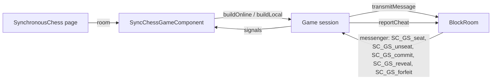
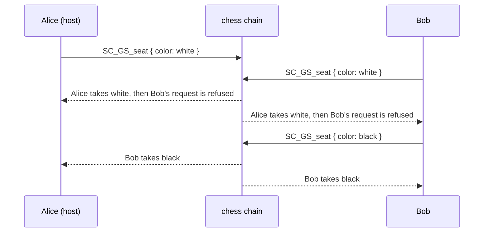
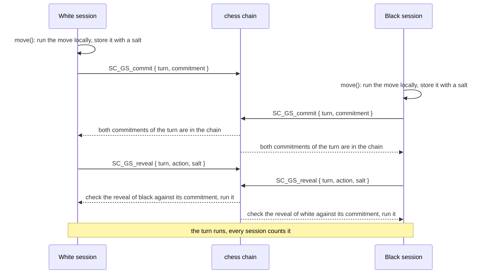

# Chess game session

A **game session** is the state of a synchronous chess game for one participant of a room: the board,
the players seated at it, the turn being played, and the actions the local player sent. Every
participant runs its own session, and the sessions stay the same because they apply the same messages,
in the same order, delivered by the `chess` block chain of the room.

The code lives in `application/frontend/game-app/src/app/modules/chess/classes/game-sessions`. The
ordering and checking of the messages is described in
[Block chains and anti-cheat](blockchain-and-anti-cheat.md).

- [Classes](#classes)
- [Life cycle](#life-cycle)
- [Seats](#seats)
- [Playing a turn](#playing-a-turn)
- [End of the game](#end-of-the-game)
- [Reloading the page](#reloading-the-page)
- [Messages](#messages)
- [Interface](#interface)
- [Limits](#limits)
- [Testing](#testing)

## Classes

| Class | File | Role |
|---|---|---|
| `SynchronousChessGameSession` | `synchronous-chess-game-session.ts` | Abstract base: the game (`SynchronousChessGame`), the seats (`configuration`), the move preview, the count of the turns run, `runMove` and `runPromotion` |
| `SynchronousChessOnlineGameSession` | `synchronous-chess-online-game-session.ts` | The session of a room: seats, spectators, hidden moves (commit then reveal), cheat reports |
| `SynchronousChessLocalGameSession` | `synchronous-chess-local-game-session.ts` | Without a room: shows the starting board, ignores every action |
| `SynchronousChessGameSessionBuilder` | `synchronous-chess-game-session-builder.ts` | Builds the online session of a room, or the local one |
| `SealedTurnStore` | `sealed-turn-store.ts` | Keeps the hidden action of the local player across the reloads of the page |
| `SyncChessGameComponent` | `components/sync-chess-game` | Shows the session, and turns the clicks and drops into seat requests and actions |

The rules of the game (moves, turns, check, end of the game) belong to `SynchronousChessGame`, its
turns and `DrawRules` (`classes/games`, `classes/turns`); the session only decides **who** plays and
**when** an action is applied.

Every participant runs the same online session: the host has no role in the game, but freeing the seat
of a player away before it starts. It creates the room, and orders the block chains until it leaves (see
[Changing the sequencer](blockchain-and-anti-cheat.md#changing-the-sequencer)).

## Life cycle

- The page builds the `BlockRoom` once the room is set up, and gives it to the component.
- The component builds a session from its `room` input: an online session for a room, a local one
  before. Only a new room builds a new session.
- The session subscribes to its message types, and unsubscribes when the component is destroyed
  (`destroy()`).
- The state is made of signals (the board, the seats, the move preview...), read by the template.

## Seats

A session has two seats, white and black. Each participant, the host included, takes a free seat
itself. The others are spectators.

A request is an `SC_GS_seat` message: a color to take the seat of that color, `none` to leave its
seat. Every participant applies the requests **in the order of the chain**, so they all seat the same
players, without anyone deciding for the others:

| Request | Applied when | Effect |
|---|---|---|
| Take a seat | The seat is free | The participant is seated; if it was seated at the other color, that seat is freed |
| Take a seat | The seat is taken by another participant | Refused: the first request in the chain kept the seat, and the participant keeps its own seat |
| Leave its seat | Always, before the game starts | The seat is freed |
| Any | The game has started | Refused: the seats are final |
| Malformed color | | Refused |

A refused request is not a cheat: two participants requesting the same seat at the same time is
expected.

**The game starts** with the first commitment of a player in the chain. From then on, the seats are
final (`seatsOpen()` is false): a player who leaves the room keeps its seat, and can come back to it by
reloading the page.

**A player away.** A seated player missing from the list of the players of the room is away
(`awayPlayers()`). Until the game starts, the other seated player, or the host, frees its seat with
`Free the seat` (`release()`), shown on that seat: an `SC_GS_unseat` message naming
the color and its player. Every page applies it in the order of the chain, with the seats, a page
replaying the chain included:

| Request | Applied when | Effect |
|---|---|---|
| Free a seat | Sent by the player of the other color, or by the host as the sequencer of the block of its request, the seat still held by the player it names, before the game starts | The seat is freed |
| Free a seat | Otherwise: the game started, the seat taken by another participant meanwhile, sent by a spectator who is not the sequencer | Refused |

No page can tell when the player was away, as for a timeout at poker: the chain applies the request
whatever the presence of the player. The host decides as the sequencer of the block of its request, so a
page joining late, or replaying the chain, applies it alike, even once another participant orders the
chain. Once the game started, a player away ends it instead (see [End of the game](#end-of-the-game)).

**Spectators.** `spectatorNumber()` counts the connected participants of the room without a seat. Each
participant counts them from its own list of players.

**Playing.** `playingColor` is the color the local player can play now: its color while both seats
are taken and it has not played the current turn, `none` otherwise. A spectator never plays.

## Playing a turn

The moves are hidden until both players are committed: the session commits to an action first, and
reveals it later (details in
[Hidden moves](blockchain-and-anti-cheat.md#hidden-moves-commit-then-reveal)).

1. **Play.** `move(move)`, `move(null)` (skip an intermediate turn) or `promote(pieceType)` runs the
   action on the local game at once, if the local player is seated and the game accepts it. A move
   shows its preview on the board until the turn runs.
2. **Commit.** The session sends `SC_GS_commit`: the SHA-256 of the turn number, the color, the action
   and a random salt. The action and the salt are kept in memory and in `SealedTurnStore`.
3. **Collect the commitments.** Each session records the first commitment of each seated player for
   each turn; the commitments of a spectator are ignored.
4. **Reveal.** Once the commitments of every color playing the turn are in the chain, the session sends
   `SC_GS_reveal` with its action and salt. A turn played by a single color (an intermediate or a
   promotion turn of one player) is revealed at once.
5. **Apply.** Each session checks a reveal against the commitment of its player for the current turn,
   then runs the action. A reveal not matching its commitment is reported as `invalidReveal`, an
   action the game refuses as `illegalMove`; both are ignored by every session alike.
6. **Next turn.** The game runs the turn once every color playing it has played. The session counts
   the turns run (`turnCount`), the same for every participant.
7. **History.** `runTurn()` records each turn run in `playedTurns` (`PlayedTurn` of `played-turn.ts`), the
   squares copied: its number counts the synchronous turns (an intermediate or a promotion turn keeps the
   number of its synchronous turn), and each color its action, a move, a pass or a promotion, or `null`
   when it did not play the turn (no capture to make, no pawn to promote). A turn after the end of the
   game is not run, and a promotion to another piece than a queen, a rook, a bishop or a knight is
   refused (`illegalMove`).

**The turns.** The game decides which colors play a turn:

| Turn | Played by | Skip |
|---|---|---|
| Synchronous | Both colors | No |
| Intermediate | The colors allowed to capture a piece that moved to an attacked or protected cell | Yes |
| Promotion | The colors with a pawn to promote | No |

A player runs its own action when playing it, and a turn played alone ends at once: it may play the
next turn before the commitments of the previous one are in the chain. The session keeps every action
it played until it is revealed.

## End of the game

The game decides its end (`SynchronousChessGame.verifyEnd()`) from the board and its history, the
same for every participant: no message is needed. A captured king ends the game at once; otherwise the
end is decided at the start of each synchronous turn. The first end found, in this order, is the
`result()` of the game (`GameResult`: the winner, none for a draw, and a `GameEndReason`):

| Reason | When | Result |
|---|---|---|
| `kingCaptured` | A king moved to the same cell as an opposing piece: both are captured (rule c) | Its opponent wins, a draw when both kings are captured |
| `checkmate` | A player in check can not move its king | Its opponent wins |
| `doubleCheckmate` | Both players are checkmated | Draw |
| `stalemate` | A player not in check can not move any piece | Draw |
| `insufficientMaterial` | Only the kings are left, with a single knight or bishop, or bishops all on squares of the same color | Draw |
| `threefoldRepetition` | The same position (the pieces and the castling rights) starts a synchronous turn for the third time | Draw |
| `fiftyTurns` | 50 synchronous turns without a pawn move nor a capture | Draw |

`DrawRules` keeps the history: a synchronous turn and the intermediate turns following it are a pair of
moves of the conventional rules. A pawn move or a capture, in a synchronous or an intermediate turn,
starts the history again, since no former position can come back.

**A player away.** Once the game started, a seated player away keeps the other one waiting: every page
tells it below the board (`Waiting for bob to come back…`, `#game-status`). The player who played the
turn in progress, the other one away, sees a clock of 30 seconds beside it (`CHESS_AWAY_TIME`,
`#away-clock`, started again by each turn run): once it is over, the page claims the game with an
`SC_GS_forfeit` message (`claimForfeit()`), giving the turns the chain ran. The claim is checked in the
order of the reveals, the ones before it first: it is void once the late player revealed its action of the
turn, when it has no part in the turn, when the claimer did not commit to its own, or when the chain ran
another turn meanwhile. Otherwise the late player loses the game:

| Reason | When | Result |
|---|---|---|
| `away` | The other player claimed the game, 30 seconds after its move, the late player away | The claimer wins (`Black was away when the time ran out: White wins`), and the history of the game starts with `Black was away when the time ran out` |

Once the game ends, no piece can move anymore. These draws come from the rules of
[Synchronous Chess](http://www.hexenspiel.de/engl/synchronous-chess/), which keep the draws of the
conventional chess.

## Reloading the page

The page of a room holds its id in its URL, `/synchronous-chess?room=room-1%23004512` (the `#` of the tag
encoded), set once the room is created or joined and removed once the room is given up (`roomFromSetup`).
The tab keeps the name of the player and the token of its join in its session storage, by room id
(`RoomSessionStore`): apart in each tab, so two tabs play two rooms, each one reloaded on its own.

A page loading with a room in its URL and a session for it joins the room again at once, as `resume`,
without dialog (`RoomSetupComponent`): the name keeps the key pair, the seat and the stored secrets of the
player, the token lets the API take it without the password of a private room. The host notices at once
that its former page left, since the data channels close with it, but the websocket API refuses the name
(`Already in game`) until the host removed the former connection: the page asks to join again every 2
seconds, for 20 seconds at most (`joinRoom`), then tells the name is taken. A resume refused for a while only
(the name still in the room, the API not answering) keeps the session and the URL: a reload tries again.

The host reloading its page is no exception: once the others agree it left, the sequencer takes the
room over (see [Taking the room over](blockchain-and-anti-cheat.md#changing-the-sequencer)), and the
former host joins it again, its seat kept. Alone in its room, nobody takes it over: the API keeps it
waiting for its host (`Host disconnected`) until the join gives up, then the page reconnects it as its
host with the token kept (`reconnect`). Not at once: the participant taking the room over would be
refused meanwhile.

Without a session for the room of its URL (a link sent by another player, a new tab), the page opens the
join dialog of that room once a person is on it and the list found it: the URL of a room is an
invitation. A room ended or unknown is removed from the URL, and told. A duplicated tab copies the session
storage of its tab: the page holding the room holds a lock of its name in the room among the tabs
(`RoomLocks`, the Web Locks of the browser), and a tab finding it held opens the join dialog, to ask
another name. The dialogs give the name typed last, kept in the local storage.

Leaving a game in progress, seated, asks to confirm (`MatchLeaveWarning`): the browser asks before the
page unloads (a close, a reload, a link out of the app), with a text of its own, and a navigation of the
app asks through a dialog (`leaveMatchGuard`). A spectator, or a game over, is not asked. A player leaving
through the app gives its room up: its seat follows the one of a closed tab.

The **Leave** button of the bar of the room (`#room-leave`, `RoomLayoutComponent`) gives the room up while
staying on the page: seated in a game in progress, the player confirms first, with the same dialog
(`MatchLeaveWarning.confirmLeave()`). `roomFromSetup()` clears the room as the page leaving it does (the
others see the player leave, a host is taken over), removes its session, its lock and `?room=` from the
URL, then shows the list of the open rooms again, the focus on the creation of a room: a reload shows the
list.

A reloaded page builds a new session, and the chain delivers again all its messages:

- the `SC_GS_seat` requests seat the same players again;
- the reveals replay the turns already played, the actions of the local player included: `playedTurns`
  is rebuilt the same, so the history of the page holds the turns played before its reload;
- the commitment of the local player whose reveal is not in the chain yet is matched with the action
  kept in `SealedTurnStore` (session storage of the tab), played once the game reaches its turn, then
  revealed. A reveal sent twice is ignored by the others.

## Messages

All the messages go through the `chess` chain (`chessBlockChains`), and are delivered to every
participant, the sender included.

| Type | Payload | Sent by | When |
|---|---|---|---|
| `SC_GS_seat` | `{ color: 'w' \| 'b' \| 'none' }` | Any participant | Taking or leaving a seat, before the game starts |
| `SC_GS_unseat` | `{ color, name }`: the seat freed, and its player | The other seated player, or the host | Before the game starts, the player of the seat away |
| `SC_GS_commit` | `{ turn, commitment }` | A seated player | Playing an action |
| `SC_GS_reveal` | `{ turn, action, salt }` | A seated player | Once every player of the turn is committed |
| `SC_GS_forfeit` | `{ turn }`: the turns the chain ran | A seated player | 30 seconds after its move, the other player away |

`action` is `{ kind: 'move', move }` (`move` is `null` for a skipped turn) or
`{ kind: 'promotion', pieceType }`.

## Interface

Before joining a room, the chess page presents the game (`ChessPresentationComponent`: a description
and a preview board), above the room setup form, then the rules (`ChessRulesComponent`). Once in a
room, the game replaces the presentation, and the rules are folded below it.

`SyncChessGameComponent` shows the session:

- **Seats.** Above and below the board, the name of the player of each color, or `Waiting`. The local
  player sits at the bottom, the board seen from its side (`flipped` for black). A spectator sees the
  board from the free seat it may take, white first: before the game starts, that seat alone shows
  `Play white` or `Play black`, where the spectator then sits, and the seat of the local player shows
  `Leave the seat`. Both seats taken, a spectator sees the board from white. Before the game starts, the
  seat of a player away shows `Free the seat` to the other player and to the host. A long name is
  shortened beside the button: a seat keeps a single line.
- **A player away.** Below the board, a status line (`<output>`, `#game-status`) tells a seated player away
  once the game started, and the player waiting for it sees the seconds left beside it (`#away-clock`).
- **Turn.** The type of the turn, whether each color has played, the last move of each color, the check
  and checkmate states.
- **End of the game.** Over the board, the winner or the reason of the draw: the board does not move.
- **Actions.** The local player drags the pieces of `playingColor` only; `Pass` skips an intermediate
  turn; a promotion turn shows the pieces to choose from.
- **Spectators.** `Spectators: n`.
- **History.** In the panel of the room, beside the game or over it (`RoomHistoryComponent` of
  `modules/room-layout`, opened by the `History` button of the bar): `Moves of the game`, a line per color
  playing a turn, the latest turn first, white first (`Turn 1 · White: F2 → F3`, `Turn 1 (intermediate) ·
  Black passes`, `Turn 2 · White promotes on A8 to a queen`), from `playedTurnLines()` of
  `helpers/played-turn-text.helper.ts`. One game per room: no past games.

The page never jumps: a seat keeps the height of its button, shown or not, and the tallest height it had
(`SteadyHeightDirective` of `modules/room-layout`). `e2e/synchronous-chess.e2e.ts` plays a game to its checkmate,
each player seeing the board from its side, and checks that the seats, the board and the page below them never move.

## Limits

- **A seat taken before the game starts stays taken** when its player leaves the room, until the other
  player or the host frees it: the participants notice a departure at different times, so it can not free
  a seat the same way for all of them. The player can come back to it by reloading the page.
- **No page can tell when a player was away**: a page changed to send `SC_GS_unseat` frees the seat of
  the other player before the game starts, and a page changed to send `SC_GS_forfeit` early ends the game
  of the other player while it is away, as `SP_timeout` at poker.
- **Both players away**, or removed from the room by the host, stall the game: no one claims it, and the
  seats are final.
- **One game per room**: the seats stay final once the game ended.
- **No resignation nor draw by agreement**: only the position, or a player away, ends a game.

## Testing

- `synchronous-chess-online-game-session.spec.ts` plays games between several sessions with a
  `RoomHub`, which delivers the messages to all of them in a single order, as the chain does, and can
  replay them to a session, as after a reload.
- `sync-chess-game.component.spec.ts` drives the component over a `Room` and a `RoomNetworkMock`.
- End to end: `e2e/synchronous-chess.e2e.ts`, a game to its checkmate, a player reloading the page
  during a game, then the players asked to confirm leaving it, the host freeing the seat of a player away
  before the game starts, and a game won against a player away (`SLOW`); `e2e/room-session.e2e.ts`, the URL of a
  room and the session of its tab.
- In the browser, two tabs are enough: the host and a participant, each taking a seat (see
  [CLAUDE.md](../CLAUDE.md#browser-testing)).
