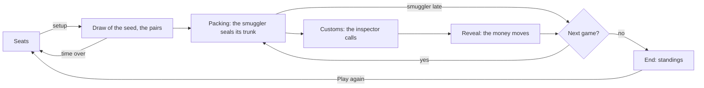

# Contraband session

The **Contraband** is a game of the manga *Liar Game*: two countries of 1 to 4 players, the North and the South, smuggle
their money across the customs of the other one. In each game of the match, a smuggler seals a trunk, an inspector of
the other country passes it or doubts it, then the trunk is revealed and the money moves; the richer country wins. It is
played in a room, peer to peer, without any game server: no participant reads a trunk before the inspector called. It has
two variants: the **Classic** of the manga, a trunk of any amount up to 100 million, and the **Gold Rush**, a gold bar
or an iron bar.

The countries plot in **private conversations**, encrypted end to end: one for each country, and one between the
smuggler and the inspector of each game, open while its customs are. The other participants, the sequencer included,
see who writes and when, never what (see
[Private conversations](blockchain-and-anti-cheat.md#private-conversations)).

A **session** is the state of the matches of the room for one participant. Every participant runs its own, and the
sessions stay the same because they apply the same messages, in the same order, delivered by the `contraband` block
chain of the room (see [Block chains and anti-cheat](blockchain-and-anti-cheat.md)).

In the code, a game of the match is a `crossing`, apart from the `game` of a message, the index of the match in the
room: the table says `Game 3 of 10`, the history of the room `Match 1: …`.

The code lives in `application/frontend/game-app/src/app/modules/contraband`.

- [Classes](#classes)
- [Rules](#rules)
- [The setup and the pairs](#the-setup-and-the-pairs)
- [A game](#a-game)
- [Sealed trunks](#sealed-trunks)
- [Private conversations](#private-conversations)
- [Life cycle](#life-cycle)
- [Seats and countries](#seats-and-countries)
- [The settlement](#the-settlement)
- [End of the match](#end-of-the-match)
- [A new match](#a-new-match)
- [The clock of a phase](#the-clock-of-a-phase)
- [Reloading the page](#reloading-the-page)
- [Messages](#messages)
- [Interface](#interface)
- [Limits](#limits)
- [Testing](#testing)

## Classes

| Class | File | Role |
|---|---|---|
| `CONTRABAND_RULES` | `classes/rules/contraband-rules.ts` | The rules: the seats and the countries, the times, the times of the customs and the numbers of games offered, the money; the variants, the countries and the calls, the checks of a setup, a call and a trunk received |
| `drawSchedule` | `classes/rules/schedule.ts` | The pairs of every game of the match, drawn from the seed of the match |
| `settleCall`, `withheldMovement` | `classes/rules/customs.ts` | The money a call moves, the trunk revealed, and the money a trunk withheld moves |
| `settleContraband` | `classes/rules/standings.ts` | The end of the match: the ATMs left shared, the balance of each player, the totals of the countries, the winner |
| `ContrabandGameState` | `classes/rules/contraband-game-state.ts` | The match in signals: the phases, the pair of the game, the call, the money of each player, the absent players, the events |
| `PlayedContrabandGame` | `classes/game-sessions/played-contraband-game.ts` | A match of the room: its players, its countries, its setup, the id of its secrets, the draw of its seed, then the match |
| `ContrabandSession` | `classes/game-sessions/contraband-session.ts` | The matches of the room: seats, the draw, the commitments and reveals of the trunks, the calls, the timeouts, the conversations of the match |
| `FairDraw`, `SeededRandom` | `modules/commit-reveal/classes` | The seed no player chose alone, and the pairs every page draws alike from it |
| `SealedCommitments`, `SealedStore`, `commitmentOf` | `modules/commit-reveal/classes` | The commitments of the smugglers, and the trunk of the local player kept across the reloads of the page |
| `TableSeats` | `modules/game-table/classes/table-seats.ts` | The 8 seats of the table: the requests of the participants, the salts, a seat freed |
| `PrivateConversations` | `modules/private-conversations/classes` | The private conversations of the room, for its life: the table declares the ones of the match into it |
| `ContrabandTableComponent` | `components/contraband-table` | Shows the session, turns the clicks into seats, a setup, trunks and calls, runs the clock of each phase, flies the chips, declares the conversations |
| `ContrabandSeatComponent` | `components/contraband-seat` | A seat: its player, its role in the game, late, its ATM and its account, its balance at the end |
| `ChipFlightsComponent` | `modules/game-table/components/chip-flights` | The chips the money moved flying from the trunk or an account to an account |

## Rules

- 8 seats: the seats 0 to 3 are of the **Northern country**, the seats 4 to 7 of the **Southern country**. The match
  starts once both countries hold as many players, one at least: from 1 against 1 up to 4 against 4. The other
  participants are spectators.
- The player starting the match picks its **variant**, Classic or Gold Rush, the **time of the customs**, 1, 2 or 5
  minutes (2 by default), and its **number of games**, 10, 20 or 30 (10 by default).
- **The money**, in millions. Each player starts with 300 in an ATM of its country, and 100 on an account in a third
  country; it owes 400 at the end. Only the money of the third country counts: a smuggler packs its trunk from its
  ATM, and the money smuggled or seized reaches an account.
- **The Classic variant.** The trunk holds an integer from 0 to `min(100, ATM)`. The inspector calls Pass, or Doubt
  with an integer amount X from 1 to 100:

  | Trunk | Call | Outcome |
  |---|---|---|
  | c | Pass | c goes to the account of the smuggler |
  | empty | Doubt X | the inspector pays X/2 to the smuggler |
  | c > 0 | Doubt X ≥ c | the inspector seizes c, on its own account |
  | c > 0 | Doubt X < c | c goes to the account of the smuggler, and the inspector pays it X/2 |

  Half millions exist: doubting 7 million of an empty trunk pays 3.5 million.
- **The Gold Rush.** The trunk holds a gold bar, 100 million taken from the ATM (an ATM under 100 has none to pack), or
  an iron bar, worth nothing. The inspector calls Pass or Check: a gold bar passed, 100 go to the smuggler; an iron
  bar passed, nothing moves; a gold bar checked, the inspector seizes 100; an iron bar checked, the inspector pays 100
  to the smuggler.
- **The end.** After the last game, the money left in the ATMs of a country goes to the other country, shared equally
  between its players. The balance of a player is what it smuggled, plus its indemnities received less the ones paid,
  plus what it seized, plus its share of the enemy ATMs, plus its account of 100, less its debt of 400. The country of
  the highest total wins; a tie is possible, each player keeping its balance.
- **A player late gets its worst case**: a smuggler not packing in time packs nothing, nothing moves; an inspector not
  calling in time passes the trunk; a trunk not revealed is seized at the most it could hold (see
  [Sealed trunks](#sealed-trunks)).

## The setup and the pairs

1. A seated player starts the match with `CB_draw` naming the seated players, in the order of the seats, the number of
   players of the North (`north`), and the setup. A setup the rules do not offer is reported (`invalidMessage`); a
   start naming other players or other countries, a seat changed meanwhile, or countries of different sizes is void.
   The players, their countries and the setup are then final: the players of the North are the first `north` ones.
2. The players draw a seed (`FairDraw`), as for the Minority Game: each one commits to a random part, then reveals it
   once every player committed; the seed is the SHA-256 of the parts in the order of the seats. The context of the
   draw is the id of the match, made of the salts of the players, the index of the match in the room and its attempt.
3. The pairs of every game are drawn from the seed (`drawSchedule`), before the next message applies, alike on every
   page, a page catching up included. For each rotation `r`, the South players are shuffled
   (`SeededRandom`, labelled `seed:pairing:r`): then, for each North player `k` in its order, North `k` smuggles across
   the customs of the South player shuffled to `k`, then that South player across the customs of North `k`. A rotation
   holds 2 games for each pair, the countries smuggling by turns; the match stops after its games, in a rotation too.
   Each country smuggles in half of the games: in 3 against 3, some players smuggle once more than others.

## A game

A game is three phases, each one waiting for one player:

1. **Packing** (`PACKING`, 60 seconds). The smuggler packs its trunk: `Pack the trunk` with its amount in the Classic
   variant, `Gold bar` or `Iron bar` in the Gold Rush. Its page sends the commitment (`CB_commit`), and the customs open.
   A smuggler late packs nothing: the history tells it (`Game 1: alice packs no trunk in time, nothing moves`), and the
   next game starts.
2. **Customs** (`CUSTOMS`, the time picked). The private conversation of the smuggler and the inspector opens: anyone
   may say anything, true or false. The inspector calls (`CB_call`): `Pass`, `Doubt` with its amount, or `Check`. A call
   the variant does not offer is reported (`invalidMessage`), the inspector still awaited; a call of another player is
   reported (`illegalMove`). An inspector late passes the trunk.
3. **Reveal** (`REVEALING`, 15 seconds). The page of the smuggler reveals the trunk by itself (`CB_reveal`), and the money
   moves: the history tells the game (`Game 1: bob doubts 30 million, alice smuggles 40 million and receives 15
   million`).

A phase closes as soon as its player acted. Each game counts a step per phase: a claim of a timeout names its step.

## Sealed trunks

A trunk is the commitment `SHA-256(id:trunk:player:crossing:amount:salt)`, sent with `CB_commit`: the id of the match,
the index of the smuggler among the players, the index of the game, the money of the trunk (0 for an empty trunk or an
iron bar, 100 for a gold bar) and a salt. The amount and the salt are kept in the tab (`SealedStore`, kind `trunks`)
before the commitment is sent, by commitment, until revealed, or until the chain refuses its commitment (too late, or a
second one); the match over, the page clears its seals, a commitment lost on its way included.

- No participant, the sequencer and the inspector included, reads a trunk before the call: the commitment hides it.
- The first commitment of the smuggler for a game counts (`SealedCommitments`); a commitment of a spectator, of
  another game or a second one is ignored, a malformed one is reported (`invalidMessage`), one of another player than
  the smuggler is reported (`illegalMove`).
- A reveal not matching its commitment is reported (`invalidReveal`); a trunk matching its commitment but out of the
  rules (more than the ATM held, an amount in the Gold Rush other than a bar) is reported (`illegalMove`). The page
  checks the types of the amount and the salt before hashing them.
- **A trunk withheld.** The smuggler reveals after the call: knowing it, it could take back a trunk the inspector
  caught. A trunk withheld, not revealed in time, revealed otherwise than sealed or out of the rules, is seized at the
  most it could hold, the call aside: `min(100, ATM)` in the Classic variant; in the Gold Rush a gold bar, or nothing
  from an ATM under 100 (`Game 1: the trunk of alice is not revealed in time, bob seizes 100 million`). Withholding never
  pays more than revealing.

## Private conversations

The session gives the conversations of the match (`conversations`, a computed list), the same on every page; the table
declares them into the `PrivateConversations` of the room (`declare()`, which replaces the list) as each message
applies, and the page gives that instance to the layout of the room (`app-room-layout`, `[conversations]`), which shows
them in the panel of the room. The page routes the messages of the chat, of the private conversations
(`privateBlockChains`) and of the game.

| Conversation | Id | Members | Open |
|---|---|---|---|
| A country of 2 players or more (`Northern country`, `Southern country`) | `cb-{game}-{attempt}-north`, `cb-{game}-{attempt}-south` | its players | from the start of the match until it is over |
| The customs of a game packed (`Customs of game 1: alice and bob`) | `cb-{game}-{attempt}-customs-{crossing}` | its smuggler and its inspector | while its inspector calls |

- A country of 1 player has none. A spectator is a member of none: it has no panel of the conversations.
- The customs of a game over stay readable, closed (`This conversation is closed: it can still be read`).
- The countries of a match are final, so the members of each id: a player changing country in a new match gets the
  conversations of that match only, under their new ids.

## Life cycle

## Seats and countries

The table has 8 seats (`TableSeats`). A participant takes a free seat with `Sit here`, leaves it with `Leave`, while the
seats are open: before the match starts, and once it is over. Another seated player, or the host, frees the seat of a
player away (`Free the seat`, `CB_unseat`). The country of a player is the one of its seat: until the match starts,
`north` counts the seats 0 to 3 taken, then the match keeps its own (`played.north()`). The status tells the countries
seated (`Northern country: 1, Southern country: 2. The match needs as many players in each, 1 at least.`) until they
are balanced.

The table shows the countries as two rows of 4 seats, the country of the local player at the bottom, the North at the
bottom for a spectator, each one with the total of its ATMs.

## The settlement

Every page settles each trunk revealed (`settleCall`) or withheld (`withheldMovement`), the same way: a movement of the
money smuggled (from the ATM of the smuggler to its account), seized (from the ATM of the smuggler to the account of the
inspector) and of the indemnity (from the account of the inspector to the one of the smuggler). The seats show the ATM
and the account of each player, the chips of the movement flying from the trunk to the accounts, and from the account
of the inspector to the one of the smuggler for an indemnity. `#last-crossing` tells the game over last until the next
customs open, the history of the room every game.

A seizure changes no total of the countries: the money seized would have gone to the country of the inspector anyway,
left in the ATM of the smuggler. It moves money between the players of that country only.

## End of the match

After its last game, every page settles the match (`settleContraband`): the winning country and by how much (`The
Northern country wins by 150 million`, or `A tie: each player keeps its balance`), then the standings: for each player,
its country, what it smuggled and seized, its indemnities, its share of the enemy ATMs and its balance. The totals of the
countries are summed without any division, exact, and sum to 0: a tie is told as one. Only the share of a player, a
third among 3 players, is rounded to the hundredth, as its balance.

## A new match

Once the match is over, a seated player clicks `Play again`: the match joins the former ones of the room (in the
history, `Match 1: The Northern country wins by 150 million`), the seats stay open, and a seated player starts the next
one with a setup of its own, the players free to change country. The new match has its own commitments, its own seals and
its own conversations.

## The clock of a phase

Each phase has its time, from when the page sees it (`turnClock`, shown in minutes and seconds): 20 seconds for each
step of the draw, 60 seconds to pack, the time picked for the customs, 15 seconds to reveal. The reveal lasts 15 seconds,
never less: more than the 10 seconds of the watch of the censorship, so a sequencer holding the reveal of a smuggler,
which would seize its trunk, is caught first. A player away gives the phase 15 seconds more, once. Once the time is over,
the page of a player of the match claims it (`CB_timeout`, with the step its clock ran for): the first claim in the
chain counts, a claim naming a step past is void.

- A claim coming before the time of the phase, on the time of the chain (2 seconds of slack), is void: a page can not
  close a phase early. Its page waits again for 5 seconds, then claims again.
- The players late are **absent** (the seat shows `Late`): a phase waiting for them away gives no more time, until they
  act again.
- The draw timing out frees the seats of its late players and opens the seats again, for a new attempt.

## Reloading the page

The chain replays the whole match to a reloaded page, the pairs drawn again from the seed. The trunk the player sealed
comes back from the session storage of the tab (key `synchronous-chess:sealed-trunks:<room>:<player>`, by commitment):
it shows sealed again (`Your trunk holds 40 million, sealed`), and its page reveals it once called. The random part of
the draw comes back too (kind `draws`). Without session storage, a trunk sealed is lost: its player withholds it, and
the trunk is seized. The private conversations come back from their own chain, the key of agreement of the player kept
in IndexedDB.

## Messages

| Type | Payload | Sent by | When |
|---|---|---|---|
| `CB_seat` | `{ seat, salt }` / `{ seat: null }` | a participant | the seats open |
| `CB_unseat` | `{ seat, name }` | another seated player, the host | a player away, the seats open |
| `CB_draw` | `{ game, attempt, players, north, variant, customsTime, games }` | a seated player | the start, both countries of the same size |
| `CB_draw` | `{ game, attempt, commitment }`, then `{ game, attempt, part }` | each player, by its page | the draw |
| `CB_commit` | `{ game, attempt, crossing, commitment }` | the smuggler | its trunk packed |
| `CB_call` | `{ game, attempt, crossing, call }`: `{ kind: 'pass' }`, `{ kind: 'doubt', amount }` or `{ kind: 'check' }` | the inspector | the customs open |
| `CB_reveal` | `{ game, attempt, crossing, amount, salt }` | the smuggler, by its page | the call made |
| `CB_timeout` | `{ game, attempt, step }` | a player, by its page | the time of the phase over |
| `CB_rematch` | `{ game }` | a seated player | the match over |

The private conversations send their `PV_key` and `PV_message` through the `private` chain.

| Message | Ignored | `invalidMessage` | `illegalMove` | `invalidReveal` |
|---|---|---|---|---|
| The start | another match, a match started, other players or countries, countries of different sizes | a setup out of the options | | |
| The draw | | a commitment malformed | | a part not matching its commitment |
| `CB_commit` | a spectator, another game, a second commitment | a commitment malformed | another player than the smuggler | |
| `CB_call` | another game, out of the customs | a call the variant does not offer (the inspector still awaited) | another player than the inspector | |
| `CB_reveal` | not awaited | | a trunk out of the rules (seized) | a trunk not matching its commitment (seized) |
| `CB_timeout` | a spectator, a step past; before the time of the phase on the time of the chain: void | | | |

## Interface

- What the match is at (`#crossing`, `Game 3 of 10`; `#variant`, `Classic · customs of 2 min`), the status line
  (`<output>`, the `status` role) and the clock of the phase (`#clock`); the customs of the game (`#customs`: `#smuggler`,
  `#inspector`, the trunk `#trunk`, `Packing…`, then `Sealed`, then the last trunk once the match is over, the game over
  last `#last-crossing`, then `#winners` and `#standings` once the match is over); the setup of the next match (`#setup`:
  the variant, the time of the customs and the games as radio buttons, then `Start the game`); the actions of the local
  player (`#actions`: the trunk, `Trunk (millions)` and `Pack the trunk`, or `Gold bar` and `Iron bar`; the call, `Pass`,
  then `Doubt (millions)` and `Doubt`, or `Check`; its trunk sealed; `Play again`); the countries (`#team-north`,
  `#team-south`) and their seats (`#seat-0` to `#seat-7`).
- The status, the customs and the actions keep their tallest height (`SteadyHeightDirective`), the line of the game over
  last keeping its place empty: the page does not jump while the match is played.
- The amounts go through the plurals of ICU (`112.5` in English, `112,5` in French), and the sign of a balance through
  a select, never a `+` added to the text.
- The sounds: a seat taken, the customs open, a trunk revealed, the chips of the money moved, and the end of the match
  (won, lost, or a tie, won for a spectator). A page reloaded hears the changes from its first live message only, and
  flies the chips of the live trunks only; a hidden page hears the chips without flying them.

## Limits

- **The pairs can be foreseen.** Every pair is drawn from the seed: once the seed is known, the pairs of every game
  are. The last player to reveal its part of the draw reads the seed first, and may withhold its part to time the draw
  out.
- **A conversation closed is closed in the composer only**: a modified client may still write in the customs of a game
  over, and its members read it.
- **A player away** makes each phase it is awaited in last its time: the customs of 5 minutes of a player gone last 5
  minutes each, its trunks never packed and its calls passed.
- **Nobody replaces a player**: a player gone for good stays in the match until it is over.
- **4 against 4** leaves no seat to a spectator: the room holds 8 participants, the WebRTC mesh of a phone.
- **The clock** of a page starts again when it is reloaded, and a frozen page (a phone in the background) claims
  nothing.
- **The attempt of the draw is in the ids of the conversations**: a draw timing out starts the conversations of the
  countries again, empty, and a new match its own ones; the former ones no longer show.
- **Withholding a trunk caught** costs its country nothing more: a seizure never changes the totals of the countries
  (see [The settlement](#the-settlement)), only who holds the money in the country of the inspector. It never gains by it
  either, and the history tells the trunk withheld.
- **The sequencer** can not read the trunks, but it may hold a commitment or a call for less than the 10 seconds of the
  watch of the censorship, late in a phase.

## Testing

- The rules: `classes/rules/*.spec.ts`: each case of the customs (a doubt of the contents, of one less, a pass on an
  empty trunk, the halves, gold and iron, a trunk withheld from an ATM of 300, 100, 40 or 0), the pairs from 1 against 1
  to 4 against 4 (the roles swapped in each pair, the match cut in a rotation, the same pairs from one seed), the
  standings (the thirds of 3 against 3, the totals summing to 0, a tie), and the match (the phases and the steps, the
  moves ignored or illegal, each player late, the absent players, an ATM emptied, full matches of both variants).
- The session: `contraband-session.spec.ts`, a `RoomHub` of 2 against 2 and a spectator, with matches of 4 games: the
  start and its refusals, the draw, the same pairs on a page joining late, a full match of each variant, no page reading
  a trunk before the call (the spectator, the inspector, the sequencer), every cheat, a trunk withheld, each player late,
  an early claim void, the draw timing out, a reload in each phase, a new match with a player changing country, the
  conversations declared.
- The table: `contraband-table.component.spec.ts`, the pairs fixed (`SeededRandom` stubbed), the clock on fake timers: the
  statuses, the forms, full matches of both variants, a tie, the chips flown, the sounds, the conversations declared;
  the seat, the texts of the history, the sounds and the page have their own specs.
- End to end: `e2e/contraband.e2e.ts`, the spectator hosting the room: a Classic game in 1 against 1; the four Classic
  calls in 2 against 2, the countries and the customs talking privately, the page keeping its place; a Classic match of
  10 games to its end, then a new match; a Gold Rush match to its end; a reload keeping the trunk sealed and the customs
  talk. `SLOW`: a trunk withheld by a smuggler gone, seized once claimed (about 35 seconds: the reveal and the wait of a
  player away).
