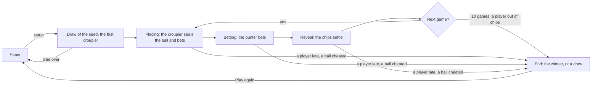

# Fixed Roulette session

The **Fixed Roulette** is the roulette that does not spin of the manga *Liar Game*: a duel of bluff on a fixed wheel of
4 pockets, over 10 games. In each game, the **croupier** places the ball in a pocket, sealed, and bets first, in public;
the **punter** bets second, reading the bets of the croupier; then the ball is revealed and the chips are settled. The
croupier knows where the ball lies: it bets, and talks, to make the punter bet on the wrong pockets. It is played in a
room, peer to peer, without any game server: no participant reads the ball before the punter bet.

The two players talk in a **watched conversation**, besides the chat of the room: they write in it, every participant
reads it, spectators and latecomers included, and the moderation of the chat reaches it (see
[A watched conversation](blockchain-and-anti-cheat.md#a-watched-conversation)).

A **session** is the state of the matches of the room for one participant. Every participant runs its own, and the
sessions stay the same because they apply the same messages, in the same order, delivered by the `fixed` block chain of
the room (see [Block chains and anti-cheat](blockchain-and-anti-cheat.md)).

In the code, a game of the match is a `round`, apart from the `game` of a message, the index of the match in the room:
the table says `Game 3 of 10`, the history of the room `Match 1: …`.

The code lives in `application/frontend/game-app/src/app/modules/fixed-roulette`.

- [Classes](#classes)
- [Rules](#rules)
- [The setup and the first croupier](#the-setup-and-the-first-croupier)
- [A game](#a-game)
- [Sealed balls](#sealed-balls)
- [The settlement](#the-settlement)
- [The conversation of the players](#the-conversation-of-the-players)
- [Life cycle](#life-cycle)
- [Seats](#seats)
- [End of the match](#end-of-the-match)
- [A new match](#a-new-match)
- [The clock of a phase](#the-clock-of-a-phase)
- [Reloading the page](#reloading-the-page)
- [Messages](#messages)
- [Interface](#interface)
- [Limits](#limits)
- [Testing](#testing)

## Classes

| Class | File | Role |
|---|---|---|
| `FIXED_ROULETTE_RULES` | `classes/rules/fixed-roulette-rules.ts` | The rules: the seats, the times, the times of the bets offered, the pockets, the games, the chips; the sides, the checks of a setup, a pocket and bets received, `betError`, the one check of the bets shared by the forms and every page, the croupier of each game |
| `drawCroupier` | `classes/rules/croupier.ts` | The croupier of the first game, drawn from the seed of the match |
| `settle`, `payoutOf`, `netOf`, `pocketStakes` | `classes/rules/settlement.ts` | Where the chips bet go once the ball is revealed, what each side gets back and wins, the stakes of each player on each pocket |
| `FixedRouletteGameState` | `classes/rules/fixed-roulette-game-state.ts` | The match in signals: the phases, the croupier and the punter, the bets, the chips of each player, the bank, the events, the result |
| `PlayedCommitRevealGame` | `modules/commit-reveal/classes/played-commit-reveal-game.ts` | A match of the room (`PlayedFixedRouletteGame` of `fixed-roulette-session.ts`): its players, its setup, the id of its secrets, the draw of its seed, then the game |
| `FixedRouletteSession` | `classes/game-sessions/fixed-roulette-session.ts` | The matches of the room, built on `CommitRevealSession`: the setup, the first croupier, the balls committed with the bets then revealed, the bets of the punter, the conversation of the players |
| `CommitRevealSession` | `modules/commit-reveal/classes/commit-reveal-session.ts` | The session of every game committing then revealing its moves, shared by the Bid Poker, the Minority Game, the Contraband, the Garden of Eden and the Fixed Roulette: the messages applied in the order of the chain, the seats, the draw of the seed, the values the local player seals and their reveals, the claims of a timeout, a new game |
| `phaseClock`, `watchMatch`, `canRematchOf`, `pastResultsOf` | `modules/commit-reveal/helpers` | What the tables of these games share: the clock of a phase in minutes and seconds and the claims of its timeout, the warning before leaving a game in progress, a new game, the games over |
| `FairDraw`, `SeededRandom` | `modules/commit-reveal/classes` | The seed no player chose alone, and the first croupier every page draws alike from it |
| `SealedCommitments`, `SealedStore`, `commitmentOf` | `modules/commit-reveal/classes` | The commitments of the croupiers, and the ball of the local player kept across the reloads of the page |
| `TableSeats` | `modules/game-table/classes/table-seats.ts` | The 2 seats of the table: the requests of the participants, the salts, a seat freed |
| `PrivateConversations` | `modules/private-conversations/classes` | The private conversations of the room, for its life: the table declares the watched conversation of the match into it |
| `FixedTableComponent` | `components/fixed-table` | Shows the session, turns the clicks into seats, a setup, balls and bets, runs the clock of each phase, flies the chips, declares the conversation |
| `FixedSeatComponent` | `components/fixed-seat` | A seat: its player, its side in the game, the clock of the phase it is awaited in, its chips off the table |
| `FixedWheelComponent` | `components/fixed-wheel` | The fixed wheel, a round board of 4 pockets holding the stakes of both players and the fields of the local player, with the ball on its rim, rolling there from the hub once revealed |
| `eventText`, `resultText` | `helpers/fixed-texts.helper.ts` | The lines of the history: a game over, the result of a match |
| `betTransfers`, `settlementTransfers`, `voidTransfers` | `helpers/chip-transfers.helper.ts` | The chips a bet, a settlement or a game void moves, from a place of the table to another one |
| `tableSounds` | `helpers/table-sound.helper.ts` | The sounds of a change of the table |
| `ChoiceFieldComponent`, `NumberFieldComponent`, `FormErrorComponent` | `modules/form` | The time of the bets and the pocket of the ball, picked as toggle buttons; the chips on each pocket; the error of the bets as a whole, under their fields |
| `ChipFlightsComponent` | `modules/game-table/components/chip-flights` | The chips moved flying from a stack to a pocket, from a pocket to a stack or to the bank |

## Rules

- 2 seats: the other participants are spectators. A room holds 6 participants.
- The player starting the match picks the **time of the bets**, 30 seconds, 1, 2 or 5 minutes (1 by default): the time
  of the croupier to place the ball and bet, and the one of the punter to bet.
- **The match.** Each player starts with **500 chips**. The match lasts **10 games**, the players swapping their roles each
  game: the croupier of the first game is drawn (see [The setup and the first croupier](#the-setup-and-the-first-croupier)),
  then each player is the croupier 5 times.
- **A game.** The croupier, in one action, seals the pocket of the ball and bets in public: 1 chip at least in all, on 1
  to 4 pockets, never more chips than it holds. The punter then bets on **2 pockets at most**, in all as many chips as
  the croupier at least, or every chip it holds when it holds fewer, never more chips than it holds. Then the page of the
  croupier reveals the ball by itself, and the chips are settled (see [The settlement](#the-settlement)). Anyone may say
  anything about the ball in the conversation of the players, true or false.
- **The end.** The match is over after its 10 games, or at once when a player has no chip left after a game: it loses.
  The player with the most chips wins; equal chips make a draw, two players out of chips at once included. The chips
  the bank took are lost to both.
- **A player missing its time loses the match**: a croupier not placing the ball and betting in time, a punter not
  betting in time, a croupier whose page does not reveal the ball in time. So does a croupier revealing another ball
  than the one it sealed, or a ball off the wheel. The bets of the game then go back to their owners, the game void, and
  the other player wins the match, whatever the chips.
- **The order of the moves.** A move out of its phase is ignored by every page: a bet of the punter before the croupier
  placed the ball, a commitment of the croupier once it placed it. A move of the other player in its phase, or bets
  beyond the rules, is reported, the player of the phase still awaited.
- No team variant: the 3 against 3 of the manga is out of scope.

## The setup and the first croupier

1. A seated player starts the match with `FR_draw` naming the seated players, once both seats are taken, with the time
   of the bets (`betTime`, in seconds). A setup the rules do not offer is reported (`invalidMessage`); a start naming
   others, a seat changed meanwhile, is void. The players and the setup are then final, in the order of the seats.
2. The players draw a seed (`FairDraw`), as every game built on `CommitRevealSession`: each one commits to a random part,
   then reveals it once both committed; the seed is the SHA-256 of the parts in the order of the seats. The context of
   the draw is the id of the match, made of the salts of the players, the index of the match in the room and its attempt.
3. The croupier of the first game is drawn from the seed (`drawCroupier`, `SeededRandom` labelled `seed:croupier`),
   before the next message applies, alike on every page, a page catching up included; then the croupier of the game `r`
   is the player `(first + r) % 2`. Every player starts with 500 chips, and the croupier of the first game places the ball.

## A game

A game is three phases, each one waiting for one player:

1. **Placing** (`PLACING`, the time of the bets). The croupier picks the pocket of the ball and its bets, then `Place the
   ball and bet`: its page sends the commitment to the ball and the bets in one message (`FR_commit`). The chips bet
   leave its stack for the pockets.
2. **Betting** (`BETTING`, the time of the bets). The punter reads the bets of the croupier, then bets (`FR_bet`): the
   form tells it what it bets at least, and on how many pockets at most (`alice bets 65 chips: bet as many at least, on 2
   pockets at most.`).
3. **Reveal** (`REVEALING`, 15 seconds). The page of the croupier reveals the ball by itself (`FR_reveal`), and the chips
   are settled: the history tells the game (`Game 1: ball in pocket 2, both players on it. alice (croupier) −26 chips,
   bob (punter) +26 chips`).

A phase closes as soon as its player acted, the next game starts once the chips are settled: no pause parts two games.
Each phase counts a step: a claim of a timeout names its step.

Every page checks the bets with `betError`, the check of the forms too: a croupier betting no chip (`none`), a side betting
more chips than it holds (`over`), a punter covering more than 2 pockets (`pockets`), a punter betting less than the
croupier's total (`under`) or, holding fewer chips than that total, not all its chips (`allIn`). The chips of a player are
the ones it holds off the table, its bets of the game left aside: the least the punter bets is read on its chips before
it bets.

## Sealed balls

A ball is the commitment `SHA-256(id:ball:croupier:round:pocket:salt)`, sent with `FR_commit`: the id of the match, the
index of the croupier among the players, the index of the game, the pocket (1 to 4) and a salt. The pocket and the salt
are kept in the tab (`SealedStore`, kind `balls`) before the commitment is sent, by commitment, until revealed, or until
the chain refuses its commitment (too late, or a second one); the match over, the page clears its seals, a commitment
lost on its way included. The game of the ball is fixed before the hash: a timeout applied meanwhile ends the match, and
the commitment naming the game past is ignored.

- No participant, the sequencer and the punter included, reads the ball before the punter bet: the commitment hides it.
  The page of the croupier shows it, sealed, to its player only (`Your ball, sealed: pocket 3`); no other page has it in
  its DOM.
- The first commitment of the croupier for a game counts (`SealedCommitments`): once applied, the game waits for the
  punter, and a second commitment is out of its phase, ignored. A commitment of a spectator, of another game or match is
  ignored; a malformed one, its commitment or its bets, is reported (`invalidMessage`); one of the punter, or with bets
  the rules refuse, is reported (`illegalMove`), the croupier still awaited.
- A reveal not matching its commitment is reported (`invalidReveal`); a ball matching its commitment but off the wheel is
  reported (`illegalMove`). The page checks the type of the pocket and the salt before hashing them. Either way, the
  croupier loses the match.
- **A ball withheld.** The croupier reveals after the punter bet: knowing the bets, it could take back a ball the punter
  caught. A ball withheld, not revealed in time, revealed otherwise than sealed or off the wheel, loses the match, the
  bets of the game back to their owners: never better for the croupier than revealing.

## The settlement

Once the ball is revealed, every page settles the game (`settle`), the same way. Every chip bet on the pocket of the ball
goes back to its owner; the chips of the other pockets go:

| Bet on the ball | The chips of the other pockets |
|---|---|
| The croupier only (`CROUPIER`) | to the croupier |
| The punter only (`PUNTER`) | to the punter |
| Both players (`SPLIT`) | shared in the ratio of their chips on the ball, each share rounded down, the chip left over to the punter |
| Neither player (`BANK`) | to the bank: every chip bet is lost |

The shares are integer divisions, exact on every page (`(a - a % b) / b`, no floating division): rounded down, they leave
one chip at most, given to the punter. With the example of the issue, the croupier betting 15 chips on pocket 2 and 50
on pocket 3, the punter 35 on pocket 2 and 30 on pocket 4:

| Ball | Case | Croupier | Punter | Bank |
|---|---|---|---|---|
| 2 | `SPLIT`: the 80 chips of the other pockets shared 15 to 35, 24 and 56 | −26 | +26 | |
| 3 | `CROUPIER` | +65 | −65 | |
| 4 | `PUNTER` | −65 | +65 | |
| 1 | `BANK` | −65 | −65 | 130 |

The croupier betting 10 chips on pocket 1 and 5 on pocket 2, the punter 20 on pocket 1, the ball in pocket 1: the 5 chips
to share give the croupier 1 and the punter 3, and the chip left over, 4: −4 and +4. Both players on the ball only,
nothing moves; both all in off the ball, the bank takes 1,000 chips, and the match is a draw.

`#last-game` tells the game over last until the next one is over, the history of the room every game. The chips fly
once the ball reached its pocket: the chips on its pocket back to their owners, then the chips of the other pockets, pocket by
pocket, to their takers, the croupier first, else to the bank. `#bank` counts the chips the bank took in the match.

## The conversation of the players

The session gives the conversation of the match (`conversations`, a computed list), the same on every page; the table
declares it into the `PrivateConversations` of the room (`declare()`, which replaces the list) as each message applies,
and the page gives that instance to the layout of the room (`app-room-layout`, `[conversations]`), which shows it in the
panel of the room. The page routes the messages of the chat, of the private conversations (`privateBlockChains`) and of
the game.

| Conversation | Id | Members | Open |
|---|---|---|---|
| The players of the match (`alice and bob`), watched | `fr-{game}-{attempt}` | its 2 players | from the start of the match until it is over |

- **Watched**: its members write in it, every participant reads it, a spectator joining later or a page reloaded
  included, from the history of the `chat` chain, where its messages (`PV_watched`) travel in clear text. A spectator
  reads it without composer (`Only the players write here`).
- **Moderated as the chat**: the host muting a player of the chat mutes it there too (its composer waits, `You are muted
  until 12:38 PM`), and every page drops its messages sent meanwhile, a message sent around the composer included; a
  participant removed from the room no longer writes in it.
- **The match over**, the conversation stays readable, closed (`This conversation is closed: it can still be read`).
  While the next match has no players yet (after `Play again`, or a draw timed out), the session gives the conversation
  of the last match over, closed: the spectators keep reading it until the next match starts. Before the first match,
  or once its draw timed out, there is none.

## Life cycle

## Seats

The table has 2 seats (`TableSeats`), `#seat-top` and `#seat-bottom`. A participant takes a free seat with `Sit here`,
leaves it with `Leave`, while the seats are open: before the match starts, and once it is over. Another seated player, or
the host, frees the seat of a player away (`Free the seat`, `FR_unseat`). The table shows the seat of the local player at
the bottom, the other one at the top; a spectator sees the first free seat at the bottom while the seats are open, else
the first seat. Each seat of a player of the match shows its chips off the table and, while the match is played, its side
(`Croupier`, `Punter`) and the clock of the phase it is awaited in. Once the match is over, a participant taking the seat of a player of the match shows
no chips.

## End of the match

The match ends after its 10 games (`GAMES`), or at once when a player has no chip left after a game (`BANKRUPT`); then the
player with the more chips wins, equal chips making a draw. A player missing its time (`FORFEIT`, the phase it missed as
the cause) or a croupier cheating with its ball (`CHEAT`, `invalidReveal` or `illegalPocket`) loses it, the bets of the
game back to their owners. The result tells it (`alice wins, 550 chips to 450 chips`, `alice wins: bob has no chip left`,
`bob wins: alice does not reveal the ball in time`, `A draw, 0 chips each`), and the history the game (`Game 1: bob does
not bet in time and loses the match`).

## A new match

Once the match is over, a seated player clicks `Play again`: the match joins the former ones of the room (in the history,
`Match 1: alice wins, 550 chips to 450 chips`), the seats stay open, and a seated player starts the next one with a setup
of its own. The new match has its own commitments, its own seals, its own first croupier and its own conversation.

## The clock of a phase

Each phase has its time, from when the page sees it (`phaseClock`, shown in minutes and seconds): 20 seconds for each
step of the draw, the time picked for the croupier to place and for the punter to bet, 15 seconds to reveal. The reveal
lasts 15 seconds, more than the 10 seconds of the watch of the censorship: a sequencer holding the reveal of a croupier,
which would lose it the match, is caught first. A player away gives the phase 15 seconds more, once: meanwhile, the other
pages read `Waiting for alice to come back…`. Once the time is over, the page of a player of the match claims it
(`FR_timeout`, with the step its clock ran for): the first claim in the chain counts, a claim naming a step past is void,
and the player the phase waited for loses the match.

- A claim coming before the time of the phase, on the time of the chain (2 seconds of slack), is void: a page can not
  close a phase early. Its page waits again for 5 seconds, then claims again.
- The player to act reads `Hurry: your time runs out!` in the last 5 seconds.
- The draw timing out frees the seats of its late players and opens the seats again, for a new attempt: no match was
  played, nobody loses.

## Reloading the page

The chain replays the whole match to a reloaded page, the first croupier drawn again from the seed. The ball the croupier
sealed comes back from the session storage of the tab (key `synchronous-chess:sealed-balls:<room>:<player>`, by
commitment): it shows sealed again (`Your ball, sealed: pocket 3`), and its page reveals it once the punter bet. The
random part of the draw comes back too (kind `draws`). Without session storage, a ball sealed is lost: its croupier
withholds it, and loses the match. The conversation of the players comes back from the `chat` chain. A player of the match
leaving the page while it is in progress is asked to confirm.

## Messages

| Type | Payload | Sent by | When |
|---|---|---|---|
| `FR_seat` | `{ seat, salt }` / `{ seat: null }` | a participant | the seats open |
| `FR_unseat` | `{ seat, name }` | another seated player, the host | a player away, the seats open |
| `FR_draw` | `{ game, attempt, players, betTime }` | a seated player | the start, both seats taken |
| `FR_draw` | `{ game, attempt, commitment }`, then `{ game, attempt, part }` | each player, by its page | the draw |
| `FR_commit` | `{ game, attempt, round, commitment, bets }` | the croupier | its ball placed and its bets |
| `FR_bet` | `{ game, attempt, round, bets }` | the punter | the croupier placed |
| `FR_reveal` | `{ game, attempt, round, pocket, salt }` | the croupier, by its page | the punter bet |
| `FR_timeout` | `{ game, attempt, step }` | a player, by its page | the time of the phase over |
| `FR_rematch` | `{ game }` | a seated player | the match over |

The bets are 4 whole numbers of chips, 0 or more, the first pocket first. The conversation of the players sends its
`PV_watched` messages through the `chat` chain.

| Message | Ignored | `invalidMessage` | `illegalMove` | `invalidReveal` |
|---|---|---|---|---|
| The start | another match, a match started, other players than the seated ones | a setup out of the options | | |
| The draw | | a commitment malformed | | a part not matching its commitment |
| `FR_commit` | a spectator, another game or match, out of the placing (a second commitment, once the croupier placed) | a commitment or bets malformed | the punter, bets the rules refuse (the croupier still awaited) | |
| `FR_bet` | a spectator, another game or match, out of the betting (before the croupier placed, once the punter bet) | bets malformed | the croupier, bets the rules refuse (the punter still awaited) | |
| `FR_reveal` | not awaited: the punter, a spectator, another game, out of the reveal | | a ball off the wheel matching its commitment (the match lost) | a ball not matching its commitment (the match lost) |
| `FR_timeout` | a spectator, a step past; before the time of the phase on the time of the chain: void | | | |

## Interface

- What the match is at (`#game`, `Game 3 of 10`; `#terms`, `Bets of 1 min`), and the spectators; the seats (`#seat-top`,
  `#seat-bottom`: the player, `Croupier` or `Punter`, the clock of the phase, `500 chips`, `Sit here`, `Leave`, `Free the
  seat`); the cloth (`#cloth`): the chips the bank took (`#bank`, `Bank: 130 chips`), the wheel (`app-fixed-wheel`) and
  the game over last (`#last-game`, 3 lines kept); the status line (`<output>`, the `status` role) and the clock of the
  phase (`#clock`); the actions of the local player (`#actions`): the form of the croupier (`#place-form`: its hint and
  `Place the ball and bet`), the form of the punter (`#bet-form`: its hint, `Bet`), `Play again`; the result (`#result`);
  the setup of the next match (`#setup`: the time of the bets as radio buttons, then `Start the match`). The fields of both
  forms lie in the pockets of the wheel, tied to their form by its id.
- **The wheel** is a disk that never turns, in its square: its 4 pockets in reading order (1 and 2 above 3 and 4) around
  a hub, red and black by turns around it (`#pocket-1` to `#pocket-4`). Each pocket holds its number on the side of the
  rim, then the stake of the player of the top seat above the one of the player of the bottom seat, against the hub; it is
  an image named by its stakes (`Pocket 3, alice: 50 chips`), a group once it holds a field. The local player types its
  stakes in the pockets, in place of its own stakes (`StakeFieldComponent`: `Chips on 1` to `Chips on 4`, two buttons
  stepping the stake by 5 for a pointer), and the croupier places its ball by clicking the number of a pocket
  (`ChoiceAreaComponent`: the radio buttons `1` to `4` of the group `Pocket of the ball`): a pale ball shows on the rim of
  the pocket under its pointer (`data-ghost`), then on the one picked.
- **The ball** lies on the rim of its pocket. It shows sealed, dashed, on the page of its croupier only, until revealed
  (`Your ball, sealed: pocket 3`, `Pocket 3, your ball, sealed, alice: 20 chips`), then on every page as the last ball
  until the croupier of the next game places its own (`Last ball: pocket 2`, `Pocket 2, the last ball`), its pocket ringed
  in gold. It carries `data-ball`, `sealed` or `last`.
- **The ball revealed rolls** from the hub to the rim of its pocket, turning around the hub, for 2.5 seconds (`BALL_ROLL`).
  Until it is there, the table keeps the game as it was (`view()`): the stakes on the pockets, the chips and the roles of
  the seats, the bank, the game and its status (`The ball is revealed…`), no form nor clock of the next game, no result of
  the match, the history of the room included. Once there (`rolled`), the table shows the game settled and its chips fly.
  A page asking for no motion shows the ball in its pocket at once; a hidden page, whose animations would wait for it,
  shows the game settled at once; the history of the room rolls nothing.
- **The forms** show no error before the player types, and are empty again for each game. An empty field bets no chip; a
  field refuses a negative number (`No negative bet`) or a part of a chip (`Bet whole chips`), the croupier's form a
  missing pocket (`Pick the pocket of the ball`): the field refused is ringed, and the form tells the first error of the
  fields touched on one line (`FormErrorComponent`, `summary`), with the error of `betError` telling why the bets are refused
  (`Bet 1 chip at least`, `You hold 40 chips only`, `Bet on 2 pockets at most`, `Bet 65 chips at least, as many as alice`,
  `You hold fewer chips than alice bet: bet all your chips`).
- The seats, the cloth and the status block keep their tallest height (`SteadyHeightDirective`), the line of the game over
  last keeping its place empty: the page does not jump while the match is played.
- The amounts go through the plurals of ICU (`1,000 chips`), and the sign of a net through a select, never a `+` added
  to the text.
- **The seats** show the part of their player (`Croupier`, `Punter`), its chips in a stack and counted, and what the game
  settled last gave or took (`+26`, `−26`), until the next ball is placed. The seat the game waits for is outlined, a halo
  beating around it, the time left to its player in a ring emptying with it, red in its last 5 seconds. The button of what
  the table waits for from the local player beats too (`Sit here`, `Start the match`, `Place the ball and bet`, `Bet`,
  `Play again`), and the result of the match pops up over the wheel for a moment, beside its line (`#result`).
- **The chips fly** (`ChipFlightsComponent`): a bet from the stack of its player to its pockets, a settlement once the ball
  reached its pocket, a game void its bets back to their owners. A page reloaded flies the chips of the live moves only, a hidden page
  none.
- The sounds: a seat taken (`SEAT_TAKEN`), the chips of a bet (`CHIPS`), the ball revealed rolling to its pocket
  and bouncing there (`FIXED_BALL_DROP`, a sound of its own, as long as the roll, in the group `Fixed roulette` of the sound
  lab), then, once it is there, 2.5 seconds later (at once on a page asking for no motion), the chips
  settled (`POKER_POT_WON` for a player of the match winning chips, `POKER_POT_LOST` for one losing some, else `CHIPS`), the
  bets of a game void going back (`CHIPS`), and the end of the match (`GAME_WON` or `GAME_LOST`, won for a spectator,
  `GAME_DRAW` on a draw). A page reloaded hears the changes from its first live message only; a hidden page hears them.

## Limits

- **The croupier knows the ball**: that is the game. Nobody checks what it says in the conversation.
- **The first croupier can be foreseen** by the last player to reveal its part of the draw, which reads the seed first; it
  may withhold its part to time the draw out, which frees its seat, nothing more.
- **A ball withheld loses the match**, the game void: a croupier sure to lose the match anyway loses nothing more by
  withholding a ball the punter caught, but never gains by it.
- **A player away** loses the match once its phase and the 15 seconds of a player away are over: no player is replaced.
- **The conversation is in clear text**, as authentic as the chat (see the
  [limits](blockchain-and-anti-cheat.md#trust-model-and-limits)): the host moderating it is often one of the two players,
  who can mute its opponent. A conversation closed is closed in the composer only: a modified client may still write in
  it once the match is over.
- **The attempt of the draw is in the id of the conversation**: a draw timing out starts the conversation again, empty.
- **The clock** of a page starts again when it is reloaded, and a frozen page (a phone in the background) claims nothing.
- **The sequencer** can not read the ball, but it may hold a commitment or a bet for less than the 10 seconds of the watch
  of the censorship, late in a phase.

## Testing

- The rules: `classes/rules/*.spec.ts`: the checks of the bets of each side (`fixed-roulette-rules.spec.ts`), the croupier
  drawn (`croupier.spec.ts`), every case of the settlement with the example of the issue, the leftover chip, both players
  all in off the ball, and every bets and ball of a loop keeping every chip (`settlement.spec.ts`), and the match
  (`fixed-roulette-game-state.spec.ts`: the phases and the roles, the moves ignored or illegal, the bets refused, the end
  after the games, a draw, a player out of chips, a punter all in, each forfeit, the reveals off the wheel).
- The session: `fixed-roulette-session.spec.ts`, a `RoomHub` of alice and bob and a spectator, with matches of 2 games:
  the start and its refusals, the same croupier on a page joining late, a full match, no other page reading the ball
  before the punter bet (the punter ordering the chain included), the order of the moves (each move ignored changing
  nothing on any page), every cheat, each player late, an early claim void, the draw timing out, a reload in each phase, a
  new match, the conversation declared, a seat freed.
- The table: `fixed-table.component.spec.ts`, the clock on fake timers: the statuses, both forms and every error, the
  ball on the page of its croupier only, the stakes, the chips flown or not, the sounds, each forfeit, the seats freed; the
  seat, the wheel, the presentation, the rules, the texts of the history (`fixed-texts.helper.spec.ts`), the chips moved
  (`chip-transfers.helper.spec.ts`), the sounds (`table-sound.helper.spec.ts`) and the page have their own specs.
- End to end: `e2e/fixed-roulette.e2e.ts`, the spectator hosting the room: a match of 10 games to its end, then a new
  match; the four settlements and the chip left over, the page keeping its place; a game on a phone in German, nothing
  running out of the window; a player out of chips ending the match, then a draw of two players all in off the ball; a
  croupier reloading with its ball sealed, named by no other page; the conversation of the players read by the room, a
  spectator joining later included, a player muted by the host. `SLOW`: a punter not betting in a time of 30 seconds
  (about 35 seconds), a croupier gone not revealing its ball, claimed after 15 seconds and 15 more for a player away
  (about 35 seconds).
