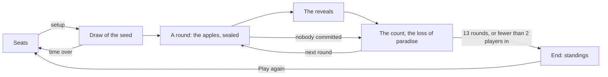

# Garden of Eden session

The **Garden of Eden** is a game of the film *Liar Game: The Final Stage*: 3 to 8 players pick an apple 13 times, gold,
silver or red, their apples sealed. A lone red apple costs its player 1,000 million, a lone gold or silver one among 2 red
ones or more wins 200 million; when every apple is red, every player wins. It is played in a room, peer to peer, without any game
server: no participant reads an apple before every player picked one. A player whose balance falls to −500 million or
below loses paradise, for good.

A **session** is the state of the games of the room for one participant. Every participant runs its own, and the
sessions stay the same because they apply the same messages, in the same order, delivered by the `eden` block chain of
the room (see [Block chains and anti-cheat](blockchain-and-anti-cheat.md)).

The code lives in `application/frontend/game-app/src/app/modules/garden-of-eden`.

- [Classes](#classes)
- [Rules](#rules)
- [The setup](#the-setup)
- [Sealed apples](#sealed-apples)
- [Life cycle](#life-cycle)
- [Seats](#seats)
- [The count](#the-count)
- [The loss of paradise](#the-loss-of-paradise)
- [End of the game](#end-of-the-game)
- [A new game](#a-new-game)
- [The clock of a phase](#the-clock-of-a-phase)
- [Reloading the page](#reloading-the-page)
- [Messages](#messages)
- [Interface](#interface)
- [Limits](#limits)
- [Testing](#testing)

## Classes

| Class | File | Role |
|---|---|---|
| `EDEN_RULES` | `classes/rules/eden-rules.ts` | The rules: the seats, the times, the times of a vote and the starting moneys offered, the rounds, the gains and the penalties, the floor of paradise; the apples, the checks of an apple and of a setup received |
| `countApples` | `classes/rules/apple-count.ts` | The table of gains: the line the apples of a round fall on, the lone apple, the gain of each apple |
| `settleEden` | `classes/rules/standings.ts` | The end of the game: the places by balance (`placesOf` of `modules/commit-reveal/classes/places.ts`), the winners |
| `EdenGameState` | `classes/rules/eden-game-state.ts` | The game in signals: the phases, the apples committed then revealed, the apples missed, the balances, the players out of paradise, the absent players, the events |
| `PlayedCommitRevealGame` | `modules/commit-reveal/classes/played-commit-reveal-game.ts` | A game of the room (`PlayedEdenGame` of `eden-session.ts`): its players, its setup, the id of its secrets, the draw of its seed, then the game |
| `EdenSession` | `classes/game-sessions/eden-session.ts` | The games of the room, built on `CommitRevealSession`: the setup, the apples committed then revealed, the loss of paradise |
| `CommitRevealSession` | `modules/commit-reveal/classes/commit-reveal-session.ts` | The session of every game committing then revealing its moves, shared by the Bid Poker, the Minority Game, the Contraband and the Garden of Eden: the messages applied in the order of the chain, the seats, the draw of the seed, the values the local player seals and their reveals, the claims of a timeout, a new game |
| `phaseClock`, `watchMatch`, `canRematchOf`, `pastResultsOf` | `modules/commit-reveal/helpers` | What the tables of these games share: the clock of a phase in minutes and seconds and the claims of its timeout, the warning before leaving a game in progress, a new game, the games over |
| `FairDraw` | `modules/commit-reveal/classes` | The seed no player chose alone, drawn as in the other games, unused by this one |
| `SealedCommitments`, `SealedStore`, `commitmentOf` | `modules/commit-reveal/classes` | The commitments of the players, and the apple of the local player kept across the reloads of the page |
| `TableSeats` | `modules/game-table/classes/table-seats.ts` | The 8 seats of the table: the requests of the participants, the salts, a seat freed |
| `EdenTableComponent` | `components/eden-table` | Shows the session, turns the clicks into seats, a setup and apples, runs the clock of each phase |
| `EdenSeatComponent` | `components/eden-seat` | A seat: its player, its apple sealed, its last apple and its gain, its balance, late, out of paradise, its place at the end |
| `EdenAppleComponent` | `components/eden-apple` | An apple in its color, decorative: the text beside it names it |
| `ChoiceFieldComponent` | `modules/form/choice-field` | The time of a vote and the starting money, picked as toggle buttons |

## Rules

- 3 to 8 players take the seats; one of them starts the game, picking the **time of a vote**, 30 seconds, 1, 2 or 5
  minutes (1 by default), and the **starting money** of every player, 0, 500 or 1,000 million (0 by default).
- **A round.** The game lasts 13 rounds. In each round, every player still in paradise picks an apple at the same time,
  sealed: gold, silver or red, the apple of truth. Nobody has to keep its word: the chat is there to agree, or to
  betray. Once revealed, the apples are counted by the table of gains (see [The count](#the-count)).
- **The apples missed.** A player still in who has not picked an apple when the time of the vote is over loses 100
  million, and its apple does not count. A player who picked an apple and withholds it, not revealed within 15 seconds,
  revealed otherwise than sealed, or revealed as something else than an apple, loses 1,000 million, and its apple does
  not count: as much as a lone red apple, so the last player to reveal never saves its loss reading the apples of the
  others.
- **The loss of paradise.** Once a round is counted, a player at −500 million or below loses paradise, for good (see
  [The loss of paradise](#the-loss-of-paradise)).
- **The end.** The game is over after its 13 rounds, or as soon as fewer than 2 players are still in paradise. The player
  still in with the most money wins, equal balances sharing the place; when every player lost paradise, nobody wins.
- **Public apples.** The apples revealed and the balances are public, where the film told the counts only. An
  anonymous tally (ElGamal), proposed by the issue, was set aside: with the balances public, the gains tell the red
  apples anyway, and it would hide only gold against silver.
- **No money moves between players**: no transfer, no debt paid. The deals stay words in the chat.

## The setup

1. A seated player starts the game with `GE_draw` naming the seated players, 3 at least, with the time of a vote
   (`voteTime`, in seconds) and the starting money (`startMoney`, in millions). A setup the rules do not offer is
   reported (`invalidMessage`); a start naming others, a seat changed meanwhile, is void. The players and the setup are
   then final, in the order of the seats.
2. The players draw a seed (`FairDraw`), as every game built on `CommitRevealSession`: each one commits to a random part,
   then reveals it once every player committed; the seed is the SHA-256 of the parts in the order of the seats. The
   context of the draw is the id of the game, made of the salts of the players, the index of the game in the room and
   its attempt. The Garden of Eden draws nothing from it (see [Limits](#limits)): the id of the game is all it uses, in
   the commitments of the apples.
3. Every player starts with the starting money, and the vote of the first round opens.

## Sealed apples

An apple is the commitment `SHA-256(id:apple:player:round:apple:salt)`, sent with `GE_commit`: the id of the game, the
index of the player among the players, the index of the round, the apple (`gold`, `silver` or `red`) and a salt. The
apple and the salt are kept in the tab (`SealedStore`, kind `apples`) before the commitment is sent, by commitment, until
revealed, or until the chain refuses its commitment (too late, or a second one); the game over, the page clears its
seals, a commitment lost on its way included. The round of the vote is fixed before the hash: a timeout applied
meanwhile moves the game to the next round, and the commitment naming the round past is ignored. Once every player still
in committed, or the time of the vote is over, each page reveals the apple of its player (`GE_reveal`).

- No participant, the sequencer included, reads an apple before the vote closes: the commitment hides it.
- The first commitment of a player for a round counts (`SealedCommitments`); a commitment of a spectator, of another round
  or game, or a second one is ignored, a malformed one is reported (`invalidMessage`), one of a player out of paradise is
  reported (`illegalMove`).
- A reveal not matching its commitment is reported (`invalidReveal`); a reveal matching its commitment but of something
  else than an apple is reported (`illegalMove`). The apple counts as withheld.
- **An apple withheld.** The reveals come one after the other in the chain: the last player to reveal reads the apples
  of the others first. Withholding its apple would let it change the line of the count, or save a lone red apple: an
  apple withheld, not revealed in time or revealed otherwise than sealed, loses 1,000 million, as much as a lone red
  apple, and does not count.

## Life cycle

A round is a vote (`VOTING`), then a reveal phase (`REVEALING`); a vote nobody committed to is counted at once. A phase
closes as soon as every player it waits for acted. No pause parts two rounds: the vote of the next round opens with the
count, the count staying shown while it is voted.

## Seats

The table has 8 seats (`TableSeats`). A participant takes a free seat with `Sit here`, leaves it with `Leave`, while the
seats are open: before the game starts, and once it is over. Another seated player, or the host, frees the seat of a
player away (`Free the seat`, `GE_unseat`). The table shows every seat, the one of the local player at the bottom, a
spectator seeing it from the first free seat.

## The count

Once every apple is revealed, or withheld, every page counts the apples revealed (`countApples`), by the table of gains:
`r` the red apples counted, `n` the gold and silver ones. The lines are tested in this order, the first one matching
deciding:

| Apples counted | Line | A red apple | A gold or silver apple |
|---|---|---|---|
| none | `NO_VOTE` | | |
| `r = 0`, as many gold as silver | `TIE` | | 0 |
| `r = 0`, all of one color | `ONE_COLOR` | | −100 million |
| `r = 0` | `MAJORITY` | | the color of the most apples +100 million, the other one −100 million |
| `n = 0` | `ALL_RED` | +100 million | |
| `r = 1` | `LONE_RED` | −1,000 million, its player named | +100 million |
| `n = 1` | `LONE_APPLE` | −100 million | +200 million |
| else | `MIXED` | −100 million | +100 million |

A single red apple against a single gold one is a lone red: its row comes first. The penalties of the apples missed are
added to the gains of the round, apart from the count: −100 million for a vote missed, −1,000 million for an apple
withheld. The history of the room tells the apples missed (`dave: no apple in time, −100 million`, `bob: apple not
revealed in time, −1,000 million`) and the count (`Round 1: 3 gold, 0 silver, 1 red. alice alone picked red and loses
1,000 million, the other apples win 100 million`). The seats show the apple each player revealed, its gain and its
balance until the next count.

## The loss of paradise

After the count, every player still in whose balance is at −500 million or below loses paradise, for good (`Round 1:
alice loses paradise`). From no money, a lone red apple loses it in a single round, as do 5 votes missed; from 1,000
million, a lone red apple leaves 0.

A player out of paradise becomes a spectator: its seat shows `Out`, its balance frozen; it no longer votes, a commitment
of it is reported (`illegalMove`), and no phase waits for it. It leaves the page without being asked to confirm
(`inMatch` false). It still claims the timeouts of the phases, and may ask for a new game once the game is over.

## End of the game

The game ends after its 13 rounds, or as soon as fewer than 2 players are still in paradise: nobody is left to trust.
Every page settles it (`settleEden`): the players ranked by balance, equal balances sharing a place; the winners are the
players of the first place still in paradise (`Winner: dave`). A player out of paradise never wins: its balance is below
the one of every player still in, so the first place is out only once every player is (`No winner: every player lost
paradise`). The standings tell the place of each player, whether it is still in paradise or the round it lost it (`Out at
round 3`), and its balance.

## A new game

Once the game is over, a seated player, one out of paradise included, clicks `Play again`: the game joins the former
games of the room (in the history, `Game 1: Winner: alice, +2,400 million`, or `Game 1: No winner`), the seats stay open,
and a seated player starts the next one with a setup of its own. The new game has its own commitments and its own seals.

## The clock of a phase

Each phase has its time, from when the page sees it (`phaseClock`, shown in minutes and seconds): 20 seconds for each
step of the draw, the time picked for a vote, 15 seconds to reveal. A player away gives the phase 15 seconds more, once.
Once the time is over, the page of a player of the game, one out of paradise included, claims it (`GE_timeout`, with the
step its clock ran for): the first claim in the chain counts, a claim naming a step past is void.

- A claim coming before the time of the phase, on the time of the chain (2 seconds of slack), is void: a page can not
  close a vote early. Its page waits again for 5 seconds, then claims again.
- The players late are **absent** (the seat shows `Late`) until they commit again. Every vote waits for every player
  still in, absent ones too: a player back always gets the time to vote, and a player gone makes each vote last its
  time. A player away who missed the phase before gives it no more time: the 15 seconds go to the other players away
  only.
- The draw timing out frees the seats of its late players and opens the seats again.

## Reloading the page

The chain replays the whole game to a reloaded page. The apple the player sealed comes back from the session storage of
the tab (key `synchronous-chess:sealed-apples:<room>:<player>`, by commitment): it shows sealed again (`Your apple,
silver, is sealed`), and its page reveals it. The random part of the draw comes back too (kind `draws`). Without session
storage, an apple sealed is lost: its player withholds it.

## Messages

| Type | Payload | Sent by | When |
|---|---|---|---|
| `GE_seat` | `{ seat, salt }` / `{ seat: null }` | a participant | the seats open |
| `GE_unseat` | `{ seat, name }` | another seated player, the host | a player away, the seats open |
| `GE_draw` | `{ game, attempt, players, voteTime, startMoney }` | a seated player | the start, 3 players at least |
| `GE_draw` | `{ game, attempt, commitment }`, then `{ game, attempt, part }` | each player, by its page | the draw |
| `GE_commit` | `{ game, attempt, round, commitment }` | a player still in paradise | its apple |
| `GE_reveal` | `{ game, attempt, round, apple, salt }` | each player who committed, by its page | the vote closed |
| `GE_timeout` | `{ game, attempt, step }` | a player, by its page | the time of the phase over |
| `GE_rematch` | `{ game }` | a seated player | the game over |

## Interface

- What the game is at (`#round`, `Round 3 of 13 · 4 players in`; `#terms`, `Votes of 1 min · starting money 0 million`),
  the status line (`<output>`, the `status` role) and the clock of the phase (`#vote-clock`); the apples (`#apples`: the
  count of the round before `#last-round`, kept while the next round is voted, then `#winners` and `#standings` once the
  game is over); the setup of the next game (`#setup`: the time to vote and the starting money as radio buttons, then
  `Start the game`); the actions of the local player (`#actions`: `Gold apple`, `Silver apple` and `Red apple`, its apple
  sealed, `You lost paradise: follow the rest of the game and the chat.`, `Play again`); the seats (`#seat-0` to
  `#seat-7`: `Out`, `Sealed`, `Late`, the last apple and its gain, `Balance: −900 million`).
- The status, the apples and the actions keep their tallest height (`SteadyHeightDirective`), the line of the count
  keeping its place empty: the page does not jump while the game is played.
- The amounts go through the plurals of ICU, and the sign of a balance or a gain through a select, never a `+` added to
  the text.
- The sounds, the ones of the other games: a seat taken (`SEAT_TAKEN`), the apples counted (`POKER_CARD_TURN`), the local
  player losing paradise (`GAME_LOST`), and the end of the game (`GAME_WON` or `GAME_LOST`, won for a spectator,
  `GAME_DRAW` when nobody won). A page reloaded hears the changes from its first live message only.

## Limits

- **The last reveal.** The last player to reveal reads the other apples first, and may withhold its own to change the
  line of the count for the others: one of two red apples withheld turns the other one into a lone red apple, a lone gold
  apple withheld among red ones turns them into a round of red apples only. It always pays 1,000 million for it, as much
  as a lone red apple: never less than what revealing would cost it, so withholding never saves a traitor. Players
  agreeing together may sacrifice one of them that way.
- **The apples and the balances are public**, where the film told the counts only: a traitor is named by the history.
- **Deals stay talk**: no money moves between players, a promise of the chat binds nobody.
- **The seed is drawn for nothing**: the draw every game built on `CommitRevealSession` makes before the game delays the
  start, up to 2 steps of 20 seconds, and the last player to reveal its part may withhold it to time the draw out.
- **The sequencer** can not read the apples, but it may hold a commitment of another player for less than the 10 seconds
  of the watch of the censorship, late in a vote.
- **A long vote.** The clock of a page starts again when it is reloaded, and a frozen page (a phone in the background)
  claims nothing: fine for minutes, not for the hours of the film.
- **A player gone** makes each vote last its time, losing 100 million a round, until it loses paradise.
- **8 players** leave no seat to a spectator: the room holds 8 participants, the WebRTC mesh of a phone.

## Testing

- The rules: `classes/rules/*.spec.ts`: every line of the table of gains (`apple-count.spec.ts`), the rules
  (`eden-rules.spec.ts`), the standings, equal balances and no winner (`standings.spec.ts`), and the game
  (`eden-game-state.spec.ts`: the phases, the moves ignored, the lone red apple out from no money and kept in from 1,000
  million, a vote missed, no apple counted, an apple withheld, refused or of no apple, the end with fewer than 2 players
  in, after its rounds, every player out).
- The session: `eden-session.spec.ts`, a `RoomHub` of 4 players and a spectator, 2 rounds: the start and its setup, the
  votes sealed then revealed by themselves, the cheats, the loss of paradise, the timeouts (a vote missed, an apple sealed
  as the vote times out, an early claim void, a reveal withheld), a reload keeping a sealed apple, a seat freed, a new
  game.
- The table: `eden-table.component.spec.ts`, 2 rounds, the clock on fake timers: the setup, the statuses, the count kept
  during the next vote, the standings, the loss of paradise, the seats freed, the sounds; the seat, the apple, the
  presentation, the rules, the texts of the history (`eden-texts.helper.spec.ts`), the sounds
  (`table-sound.helper.spec.ts`) and the page have their own specs.
- End to end: `e2e/garden-of-eden.e2e.ts`: the rounds of red apples only, a tie and a mix, the page keeping its place;
  the lone traitor out of paradise, reloading without being asked to confirm, the game ending once a single player is
  still in; a reload keeping a sealed apple. `SLOW`: the 13 rounds to the end watched by a spectator with the chat, then
  a new game; a player not voting in a vote of 30 seconds, losing 100 million and awaited still by the next vote.
