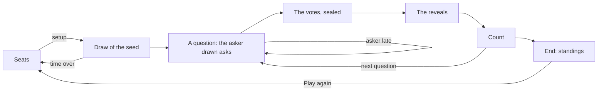

# Minority Game session

The **Minority Game** is a game of the manga *Liar Game*: 3 to 8 players answer a question by yes or no, their votes
sealed, and the majority loses. It is played in a room, peer to peer, without any game server: no participant reads a
vote before every player voted. It has two variants: the **elimination** of the manga, the majority eliminated down to
the last 1 or 2 players, and a **score** variant of 10 rounds, nobody eliminated, the minority scoring.

A **session** is the state of the games of the room for one participant. Every participant runs its own, and the
sessions stay the same because they apply the same messages, in the same order, delivered by the `minority` block chain
of the room (see [Block chains and anti-cheat](blockchain-and-anti-cheat.md)).

The code lives in `application/frontend/game-app/src/app/modules/minority-game`.

- [Classes](#classes)
- [Rules](#rules)
- [The setup and the askers](#the-setup-and-the-askers)
- [A question](#a-question)
- [Sealed votes](#sealed-votes)
- [Life cycle](#life-cycle)
- [Seats](#seats)
- [The count](#the-count)
- [End of the game](#end-of-the-game)
- [A new game](#a-new-game)
- [The clock of a phase](#the-clock-of-a-phase)
- [Reloading the page](#reloading-the-page)
- [Messages](#messages)
- [Interface](#interface)
- [Limits](#limits)
- [Testing](#testing)

## Classes

| Class | File | Role |
|---|---|---|
| `MINORITY_RULES` | `classes/rules/minority-rules.ts` | The rules: the seats, the times, the times of a vote offered, the rounds, the stakes; the variants and the votes |
| `isQuestionText` | `classes/rules/question.ts` | A question of the form the application sends: not blank, 120 characters at most, without link nor e-mail address |
| `drawAsker` | `classes/rules/asker.ts` | The asker of a question, drawn from the seed of the game |
| `settleElimination`, `settleScore` | `classes/rules/standings.ts` | The end of the game: the winners, the places, the points or the stakes won |
| `MinorityGameState` | `classes/rules/minority-game-state.ts` | The game in signals: the phases, the asker, the votes, the eliminations, the scores, the absent players and the gone ones, the events |
| `PlayedCommitRevealGame` | `modules/commit-reveal/classes/played-commit-reveal-game.ts` | A game of the room (`PlayedMinorityGame` of `minority-session.ts`): its players, its setup, the id of its secrets, the draw of its seed, then the game |
| `MinoritySession` | `classes/game-sessions/minority-session.ts` | The games of the room, built on `CommitRevealSession`: the setup, the askers, the questions, the votes committed then revealed |
| `CommitRevealSession` | `modules/commit-reveal/classes/commit-reveal-session.ts` | The session of every game committing then revealing its moves, shared by the Bid Poker, the Minority Game, the Contraband, the Garden of Eden and the Fixed Roulette: the messages applied in the order of the chain, the seats, the draw of the seed, the values the local player seals and their reveals, the claims of a timeout, a new game |
| `phaseClock`, `watchMatch`, `canRematchOf`, `pastResultsOf` | `modules/commit-reveal/helpers` | What the tables of these games share: the clock of a phase in minutes and seconds and the claims of its timeout, the warning before leaving a game in progress, a new game, the games over |
| `FairDraw`, `SeededRandom` | `modules/commit-reveal/classes` | The seed no player chose alone, and the draws every page makes alike from it |
| `SealedCommitments`, `SealedStore`, `commitmentOf` | `modules/commit-reveal/classes` | The commitments of the players, and the vote of the local player kept across the reloads of the page |
| `TableSeats` | `modules/game-table/classes/table-seats.ts` | The 8 seats of the table: the requests of the participants, the salts, a seat freed |
| `MinorityTableComponent` | `components/minority-table` | Shows the session, turns the clicks into seats, a setup, a question and votes, runs the clock of each phase |
| `MinoritySeatComponent` | `components/minority-seat` | A seat: its player, the asker, its vote sealed or revealed, eliminated, its points |
| `ChoiceFieldComponent` | `modules/form/choice-field` | The variant and the time of a vote, picked as toggle buttons |

## Rules

- 3 to 8 players take the seats; one of them starts the game, picking its **variant** and the **time of a vote**: 30
  seconds, 1, 2 or 5 minutes.
- **A question.** A player drawn asks a question answered by yes or no, in free text. Then every player still in votes
  yes or no at the same time, sealed. Nobody has to answer honestly: the chat is there to agree, or to betray. The side
  with the fewest votes is the minority.
- **The elimination variant** (the manga). The majority is eliminated; a tie, or a unanimous vote, eliminates nobody
  and another player asks a new question, with no limit on the ties in a row. A player who does not vote in time is
  eliminated, as is a player who withholds its vote. The game is over once 1 or 2 players are left: they win. When no
  vote counts at all, every player left is eliminated, and nobody wins. Each player brings 100 million: the winners
  share the stakes of every player.
- **The score variant.** Nobody is eliminated: the game lasts 10 questions, its rounds. Each player of the minority
  scores the number of votes of the majority (7 yes against 3 no: each no scores 7). A tie, a unanimous vote or no vote
  counted scores nothing, the round counting all the same. A player who does not vote in time scores nothing for the
  round; a player who withholds its vote loses as many points as players but one, the most a round gives. After the 10
  rounds, the highest total wins, equal totals sharing the place. The score variant has no stakes.
- An eliminated player becomes a spectator: it follows the game and the chat, no longer votes, and leaves the page
  without being asked to confirm.

## The setup and the askers

1. A seated player starts the game with `MG_draw` naming the seated players, 3 at least, with the variant and the time
   of a vote. A setup the rules do not offer is reported (`invalidMessage`); a start naming others, a seat changed
   meanwhile, is void. The players and the setup are then final, in the order of the seats.
2. The players draw a seed (`FairDraw`), as for the deck of the Bid Poker: each one commits to a random part, then
   reveals it once every player committed; the seed is the SHA-256 of the parts in the order of the seats. The context
   of the draw is the id of the game, made of the salts of the players, the index of the game in the room and its
   attempt.
3. The asker of each question is drawn from the seed (`SeededRandom`, labelled `seed:asker:round:ask`), among the
   players still in and not absent, never the asker of the question before while another player may ask; every player
   still in when all are absent. The session draws it right after the message that opened the question, before the
   next one applies: every page, a page catching up included, draws the same asker.

## A question

The asker types its question and clicks `Ask` (`MG_question`). The form and every page refuse a question blank, longer
than 120 characters, or holding a link or an e-mail address, as the chat does: one sent around the form is reported
(`invalidMessage`), and the asker stays awaited. A question of another player than the asker is reported (`illegalMove`).
The question shows its offensive words masked while the setting of the chat hides them. An asker who does not ask in 60
seconds is absent, and another player is drawn for the same question (`ask` + 1): it uses up no round. An asker late
once every player still in was absent leaves nobody to ask: the question counts no vote, so the game always ends,
every player left eliminated, or the round used up in the score variant.

## Sealed votes

A vote is the commitment `SHA-256(id:vote:index:round:ask:vote:salt)`, sent with `MG_commit`. The vote and the salt are
kept in the tab (`SealedStore`, kind `votes`) before the commitment is sent, by commitment, until revealed, or until the
chain refuses its commitment (too late, or a second one); the game over, the page clears its seals, a commitment lost
on its way included. Once every player the vote
waits for committed, or its time is over, each page reveals the vote of its player (`MG_reveal`).

- No participant, the sequencer included, reads a vote before the vote closes: the commitment hides it.
- The first commitment of a player for a question counts (`SealedCommitments`).
- A reveal not matching its commitment is reported (`invalidReveal`); a vote neither yes nor no matching its commitment
  is reported (`illegalMove`); a commitment of an eliminated player is reported (`illegalMove`). The vote counts as
  withheld.
- **A vote withheld.** The reveals come one after the other in the chain: the last player to reveal reads the votes of
  the others first. Withholding its vote would let it change the count, a tie for one: a vote withheld, not revealed in
  time or revealed otherwise than sealed, eliminates its player, or loses it the most a round gives.

## Life cycle

A question is an asking phase (`ASKING`), a vote (`VOTING`), then a reveal phase (`REVEALING`); a vote nobody committed
to is counted at once. A phase closes as soon as every player it waits for acted.

## Seats

The table has 8 seats (`TableSeats`). A participant takes a free seat with `Sit here`, leaves it with `Leave`, while the
seats are open: before the game starts, and once it is over. Another seated player, or the host, frees the seat of a
player away (`Free the seat`, `MG_unseat`). The table shows every seat, the one of the local player at the bottom, a
spectator seeing it from the first free seat.

## The count

Once every vote is revealed, or withheld, every page counts the votes revealed: `MINORITY` (one side has fewer votes),
`TIE`, `UNANIMOUS`, or `NO_VOTE`. The history of the room tells each question (`Question 1, asked by bob: “…”`), the
votes missed (`dave: no vote in time`; in the score variant, once until its player acts again), and the count, the eliminated players or the points of each one (`Question 1:
3 yes, 1 no. Eliminated: alice, bob, carol`, `Round 2: 3 yes, 1 no. Points: dave +3`). The seats show the votes revealed
until the next vote opens.

## End of the game

The elimination variant ends once 1 or 2 players are left, or none when no vote counted; the score variant after its
10 rounds. Every page settles the game: the winners (`Winner: dave`, or `No winner: every player left was eliminated`),
then the standings by place: the question that eliminated each player, the later the better, the players of one count
sharing a place, and the millions won or lost; or the points of each player.

## A new game

Once the game is over, a seated player, an eliminated one included, clicks `Play again`: the game joins the former games
of the room (in the history, `Game 1: Winner: dave`, `Game 1: First place, 3 points: dave`, `Game 1: No winner`), the seats
stay open, and a seated player starts the next one with a setup of its own. The new game has its own commitments and
its own seals.

## The clock of a phase

Each phase has its time, from when the page sees it (`phaseClock`, shown in minutes and seconds): 20 seconds for each
step of the draw, 60 seconds to ask, the time picked for a vote, 15 seconds to reveal. A player away gives the phase 15
seconds more, once. Once the time is over, the page of a player of the game, an eliminated one included, claims it
(`MG_timeout`, with the step its clock ran for): the first claim in the chain counts, a claim naming a step past is void.

- A claim coming before the time of the phase, on the time of the chain (2 seconds of slack), is void: a page can not
  close a vote early. Its page waits again for 5 seconds, then claims again.
- The players late are **absent**: not drawn to ask until they act again. Every vote waits for every player still in,
  absent ones too: a player back always gets the time to vote, and a player gone makes each vote last its time. In the
  score variant, a player away who missed the vote before gives it no more time (`gone`, until it acts again): the 15
  seconds go to the other players away only.
- The draw timing out frees the seats of its late players and opens the seats again.

## Reloading the page

The chain replays the whole game to a reloaded page, the askers drawn again from the seed. The vote the player sealed
comes back from the session storage of the tab (key `synchronous-chess:sealed-votes:<room>:<player>`, by commitment):
it shows sealed again, and its page reveals it. The random part of the draw comes back too (kind `draws`). Without
session storage, a vote sealed is lost: its player withholds it.

## Messages

| Type | Payload | Sent by | When |
|---|---|---|---|
| `MG_seat` | `{ seat, salt }` / `{ seat: null }` | a participant | the seats open |
| `MG_unseat` | `{ seat, name }` | another seated player, the host | a player away, the seats open |
| `MG_draw` | `{ game, attempt, players, variant, voteTime }` | a seated player | the start, 3 players at least |
| `MG_draw` | `{ game, attempt, commitment }`, then `{ game, attempt, part }` | each player, by its page | the draw |
| `MG_question` | `{ game, attempt, round, ask, text }` | the asker | its question |
| `MG_commit` | `{ game, attempt, round, ask, commitment }` | a player still in | its vote |
| `MG_reveal` | `{ game, attempt, round, ask, vote, salt }` | each voter, by its page | the vote closed |
| `MG_timeout` | `{ game, attempt, step }` | a player, by its page | the time of the phase over |
| `MG_rematch` | `{ game }` | a seated player | the game over |

## Interface

- What the game is at (`#round`, `#variant`, `#stakes` in the elimination variant), the status line (`<output>`, the
  `status` role) and the clock of the phase (`#vote-clock`); the question (`#question`: its title, `#question-text`, the
  last count `#last-vote`, then `#winners` and `#standings` once the game is over); the setup of the next game
  (`#setup`: the variant and the time to vote as radio buttons, then `Start the game`); the actions of the local player
  (`#actions`: the question form, `Yes` and `No`, its vote sealed, `Play again`); the seats (`#seat-0` to `#seat-7`).
- The status, the question and the actions keep their tallest height (`SteadyHeightDirective`), each line of the
  question keeping its place empty: the page does not jump while the game is played.
- The sounds: a seat taken, a question asked, the votes revealed, the local player eliminated, and the end of the game
  (won or lost). A page reloaded hears the changes from its first live message only.

## Limits

- **The last reveal.** The last player to reveal reads the other votes first, and may withhold its own to change the
  count. In the score variant it always loses by it, the most a round gives. In the elimination variant, a player of
  the majority side is eliminated anyway: withholding costs it nothing more, and may save the others of its side, a
  tie, or even reverse the count. Players agreeing together may sacrifice one of them that way.
- **The askers can be foreseen.** Every asker is drawn from the seed: once the seed is known, the askers of every
  question are. The last player to reveal its part of the draw reads the seed first, and may withhold its part to time
  the draw out.
- **The sequencer** can not read the votes, but it may hold a commitment of another player for less than the 10 seconds
  of the watch of the censorship, late in a vote.
- **A long vote.** The clock of a page starts again when it is reloaded, and a frozen page (a phone in the background)
  claims nothing: fine for minutes, not for the hours of the manga.
- **A longer question** than the ones before makes the question grow, once.
- **8 players** leave no seat to a spectator: the room holds 8 participants, the WebRTC mesh of a phone.

## Testing

- The rules: `classes/rules/*.spec.ts`: the variants (the majority eliminated, a tie and a unanimous vote, a vote missed
  or withheld, no vote counted, 1 or 2 winners; the points of the minority, the penalty of a vote withheld, the rounds),
  the askers drawn (never the one before, every player once all are absent), the questions, the standings.
- The session: `minority-session.spec.ts`, a `RoomHub` of 4 players and a spectator, 2 rounds in the score variant: the
  start and its setup, the draw, the questions, the votes, the cheats, the timeouts (an early claim void, an eliminated
  player claiming, the draw timing out), a page joining late drawing the same askers, a reload keeping a sealed vote, a
  new game.
- The table: `minority-table.component.spec.ts`, the asker drawn first in its candidates (`SeededRandom` stubbed), the
  clock on fake timers; the seat, the choice field, the texts of the history and the sounds have their own specs.
- End to end: `e2e/minority-game.e2e.ts`, an elimination game to its end watched by a spectator with the chat and a new
  game, a tie then a new question with the page keeping its place, a reload keeping a sealed vote; `SLOW`: a player not
  voting in a vote of 30 seconds, eliminated, and a score game of 10 rounds.
