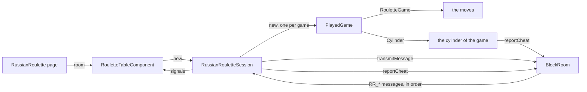

# Russian roulette session

The **24-shot Russian roulette** is the duel of the manga *Liar Game*: two players, a revolver of 24 chambers, 3
bullets placed by each player in the chambers of its choice. It is played in a room, peer to peer, without any dealer
nor game server: no participant knows which chamber holds a bullet before it fires, not even the owner of the bullet,
once the cylinder is spun.

A **session** is the state of the games of the room for one participant. Every participant runs its own, and the
sessions stay the same because they apply the same messages, in the same order, delivered by the `roulette` block
chain of the room (see [Block chains and anti-cheat](blockchain-and-anti-cheat.md)).

The code lives in `application/frontend/game-app/src/app/modules/russian-roulette`.

- [Classes](#classes)
- [Rules](#rules)
- [The cylinder](#the-cylinder)
- [Life cycle](#life-cycle)
- [Seats](#seats)
- [A game](#a-game)
- [End of the game](#end-of-the-game)
- [A new game](#a-new-game)
- [The clock of a move](#the-clock-of-a-move)
- [Reloading the page](#reloading-the-page)
- [Messages](#messages)
- [Interface](#interface)
- [Limits](#limits)
- [Testing](#testing)

## Classes

| Class | File | Role |
|---|---|---|
| `RouletteGame` | `classes/rules/roulette-game.ts` | The game without the cylinder, in signals: the passes, the shots, the stacks, the deaths, the result, a game lost on time |
| `ExponentialElGamal`, `zk-proofs` | `modules/mental-poker/classes` | The cipher of the cylinder and its proofs (see [Mental poker](mental-poker.md#the-exponential-elgamal)) |
| `CylinderState` | `classes/cylinder/cylinder-state.ts` | What the chain tells of a cylinder, the same for every participant: the keys, the loads and the spins, the shares of each chamber fired, the disclosures |
| `Cylinder` | `classes/cylinder/cylinder.ts` | Applies the messages of a cylinder, makes the steps of the local player (its load, its spin, its shares, its disclosure) |
| `verifyCylinder` | `classes/cylinder/cylinder-verification.ts` | Checks the spins once both players disclosed their keys |
| `SecretStore` | `modules/mental-poker/classes/secret-store.ts` | Keeps the secrets of the player across the reloads of the page, as for the decks of the poker |
| `PlayedGame` | `classes/game-sessions/played-game.ts` | A game of the room: its rules, its cylinder, its check and its result, final once checked |
| `RussianRouletteSession` | `classes/game-sessions/russian-roulette-session.ts` | The games of the room: seats, moves, timeouts, a new game once one is over |
| `RouletteTableComponent` | `components/roulette-table` | Shows the session, turns the clicks into seat requests and moves, and runs the clock of each move |
| `RouletteCylinderComponent` | `components/roulette-cylinder` | The 24 chambers around the cylinder: buttons while the player places its bullets, then the chambers fired |
| `RouletteSeatComponent` | `components/roulette-seat` | A seat: its player, its chips and its deaths, a ring and the clock of the move while the game waits for its player, the stamp of a pass, the shot of its player |
| `RouletteRevolverComponent` | `components/roulette-revolver` | The revolver from its side: it aims at the player shooting, holds still, then fires, its recoil and its blast on a bullet |
| `RouletteRulesComponent` | `components/roulette-rules` | The rules, on the page |

The chips (`ChipStackComponent`) come from `modules/playing-cards`, shared with the card games.

## Rules

- Each player starts with 150 chips, and loads 3 bullets in the chambers of its choice, in secret. A chamber may hold
  a bullet of each player.
- The cylinder is spun: no one knows which chamber comes first, but the bullets of each player keep their spacing. A
  draw tells which player plays first.
- In turn, each player passes or shoots:
  - **Pass**: the player puts chips on the table, 1, doubled at each pass in a row (1, 2, 4, 8, 16). The 5th pass in
    a row is a draw: the bank takes the 31 chips of the table, the next pass costs 1 chip, and the next chamber is
    **revealed**: its bullets are spent, without a death, and count among the 6 fired. Passing never dodges a bullet,
    else the players would pass for ever. A player who can not pay the pass shoots.
  - **Shot, empty chamber**: the shooter takes the chips of the table.
  - **Shot, a bullet or two**: one death. The shooter gives 50 chips and the chips of the table to the other player,
    its stack going below 0 if need be, a debt.
- The game ends once its 6 bullets fired (or its 24 chambers). The player with fewer deaths wins, then the one with
  more chips; else the game is a draw. A chamber loaded by both players counts both its bullets, for one death.
- Each move lasts 45 seconds at most (`turnTime`), 30 more once while a seated player is away (`awayTime`): see
  [The clock of a move](#the-clock-of-a-move). The player late loses the game, whatever its deaths and its chips.
- A player whose spin the check finds cheated, or who never shows its key, loses the game (see
  [End of the game](#end-of-the-game)).

## The cylinder

The cylinder hides two things: the bullets of each player from the other one, and the offset of the spin from both, a
player knowing it would know when its own bullets come. It is encrypted with the **exponential ElGamal** over the
squares of the safe prime of the mental poker (g = 4), a count m hidden as g^m: the product of two cipher texts hides the
sum of their counts, and a cipher text re-randomized can not be told from a new one.

1. **Keys** (`RR_key`): once both seats are taken, each player picks its chambers and clicks `Load`: its page draws a
   share x of the key and gives h = g^x, with a Schnorr proof it knows x. Without the proof, the second player could give
   a key made from the first one, and decrypt the cylinder alone. It gives too the SHA-256 of its random part of the
   draw of the first shooter. The key of the cylinder is h₁ × h₂.
2. **Loads** (`RR_load`): once both keys are in, each page encrypts the bullets of its player under the key of both, a
   cipher text of 0 or 1 for each chamber, with the proof that each one hides 0 or 1 (the disjunctive proof of Cramer,
   Damgård and Schoenmakers) and that their product hides 3: a load copying the other one to cancel its bullets, or
   loading 0 or 24 bullets, is refused (`invalidLoad`). The load reveals the random part of the draw (`invalidReveal` if
   it is not the one committed to). Every participant multiplies both loads, chamber by chamber: the cylinder, each
   chamber hiding the bullets of both players. The first shooter is the last digit of the hash of both random parts.
3. **Spins** (`RR_spin`): the first seat, then the second one, turns the cylinder by an offset of its own and
   re-randomizes every chamber. No participant follows a chamber through a spin, the owner of a bullet included. A spin
   that is not a cylinder breaks it (`invalidSpin`): its player loses the game once the keys are disclosed.
4. **Shots**: the n-th shot fires the chamber n. Each player gives its share of the decryption, c1^x, with the
   Chaum-Pedersen proof that it is made with its share of the key (`RR_share`): without the proof, the player giving its
   share last could choose the count. With both shares, every participant reads the count of the chamber: 0, 1 or 2
   bullets, never whose they are. A count out of 0 to 2 breaks the cylinder: a spin made it.
5. **Disclosure** (`RR_disclose`): once the game is over, or stopped, each player gives x. With both, every
   participant decrypts the cylinder after each spin and checks each spin turned the cylinder it received
   (`verifyCylinder`): a spin made otherwise is reported against its player (`invalidSpin`). The randomness of the
   spins is never disclosed: the counts of the chambers tell a spin made otherwise. A chamber of no count turned by the
   next spin is the cheat of the spin that made it only.

Each proof is bound to the id of the cylinder, the step, the seat and the chamber (Fiat-Shamir): a proof of another
cylinder, seat or chamber proves nothing. The id holds the salt of each player, drawn when it took its seat, and the
index of the game in the room (`<salt 1>:<salt 2>:<game>`), as the decks of the poker: a player can not make the other
one use again the secrets of a former cylinder.

**A spin is not proven.** A proof of rotation costs 4 to 20 seconds at 2048 bits. A player can then replace the
cylinder with chambers of its choice, and decide the game: the check of the disclosures finds it, and the result of the
game stays **provisional** until then. The player whose spin was cheated loses, whatever the chambers fired; both
cheating, no one wins.

The computations yield to the browser every 40 milliseconds (`timeSlices`), through a message of the page, which a
hidden page runs at once: a hidden page loads and fires as fast, and does not run out of time.

## Life cycle

- The page builds the `BlockRoom` once the room is set up, with the routing of the chat and of the game, and gives it
  to the table, which builds the session. Only a new room builds a new one.
- The messages of the game and of its cylinder apply **one after the other**, in a single queue: a load waits for its
  proofs to be checked before the next message applies. Once the messages received are applied, the cylinders of the
  room make the steps of the local player: a reloaded page does not make again, while the chain replays them, the steps
  of its former page.
- The session plays the games of the room one after the other: `played` is the game in progress, else the latest, a new
  `PlayedGame` for each one (see [A new game](#a-new-game)).

## Seats

Each participant takes a seat with `Sit here` (`RR_seat`): the first request for a free seat gets it, a participant has
a single seat, and `Leave the seat` frees it. Once both seats are taken, the session prepares the cylinder of their
players, a new one when a seat changes; the first key given makes the seats final, until the game is settled: over, and
its keys disclosed, or withheld by a player out of time. The other participants are spectators.

A player draws a random **salt** for each seat it takes, in the id of the cylinder: a request without a salt of 32
hexadecimal digits is ignored.

A player losing on time loses its seat too. While the seats are open, a seated player frees the seat of the other one,
away from the room, with `Free the seat` (`RR_unseat`): no page can tell when the other one was away, so the chain
applies the request whatever the presence of the player. A spectator frees no seat.

The table shows the local player at its bottom, a spectator the first seat.

## A game

1. Each player picks the chambers of its bullets and clicks `Load`: its page gives its key. Once both keys are in, the
   pages load the bullets, then spin the cylinder, by themselves.
2. The player drawn plays first. Each move (`RR_pass`, `RR_shoot`) names the index of the game and its **step**: the
   moves and the steps of the cylinder applied in the game. A move of another step or of another game is ignored, a
   move against the rules or out of the turn of its player is ignored and reported (`illegalMove`). The table sends a
   move of the local player once: its buttons wait for the chain to bring it back.
3. A shot asks both shares of the chamber: the game applies its count once both are in. The 5th pass in a row asks
   them too: the chamber is revealed (`RouletteActionKind.REVEAL`), the next player waiting for it.
4. A cylinder that breaks stops the game: its keys are disclosed, and the check names the player whose spin broke it,
   who loses the game. A spin that is not a cylinder names its player at once, without the keys. Until then, the table
   tells the game stopped. A player late with its key then withholds it: it does not lose on time.

## End of the game

Once the game is over, both players disclose their keys and every participant checks the spins. The table tells the
result, provisional until the check ends, then whether the cylinder was fair: a cheated spin gives the game to the other
player. A game over before its cylinder was spun has nothing to check: the session drops its cylinder, a step coming
late applies nothing. The key of a player who lost on time is awaited too, its result provisional until the check: a
spin it finds cheated still decides the game. Its time over again, the key is withheld, and the result final. A share
coming once the game is lost on time fires nothing.

## A new game

Once the game is settled (`settled`: over or stopped, and waiting for no key), a seated player clicks `Play again`
(`RR_rematch`), both seats taken: the request names the index of the new game in the room, the first one counts. Until
then, the seats stay closed and no new game starts: a key of the former game would be left without a clock to claim it,
its result provisional for good. The new game starts over: a new `RouletteGame`, a new cylinder of a new id, the step at
0. The former game joins `pastGames`, one line each in `Games played` below the table, its check going on.

## The clock of a move

The table runs the clock of each move the game waits for (`awaited`): the second `Load` once the first key is in, a
pass or a shot, and the steps the page of a player makes by itself, a load, a spin, a share or a disclosure. The clock
starts again at each step of the game, or when another player is awaited. The first tick seeing a seated player away
adds 30 seconds to the move, once. The clock reads the time of the page (`performance.now()`): `turnClock` of
`helpers/turn-clock.helper.ts`, the clock of the poker too.

When the clock runs out, the page of the local player plays its move: it passes, or shoots when it can not pay, and
loads its bullets in the chambers picked, completed at random. A shot still firing on the table ends first: a hidden page
plays no animation, and would wait to be shown. Else the page of the other player sends `RR_timeout`,
naming the step: for a move of the player (`own`), while it is away; for a step of its page, whether it is connected or
not, a page withholding a share once it saw the count, or its key once the game is over. The late player loses the game
and its seat. A player of the game claims even once it lost its seat: the key of the winner may still be awaited. A timeout of another step is void, a move made meanwhile, as one of a player the game waits for too: both
shares missing, a player claiming the time of the other one would claim against its own late share.

## Reloading the page

The chain replays every message to a reloaded page: the session plays the games again, creates the cylinders again,
and the `SecretStore` gives back the secrets of the player (its share of the key, its random part of the draw, its
chambers), stored in the session storage of the tab before its key is sent, under
`synchronous-chess:cylinder-keys:<room>:<player>:<cylinder>`. Its page loads, gives its shares and discloses its key
again; the steps of its former page already in the chain are the first ones, the others are ignored. A load or a spin
made again draws a new randomness: no randomness is stored.

Without session storage, the page plays with the secrets it drew, but a reload loses them: the key in the chain is not
made from the secrets of the new page, which drops them and tells it; the game waits for the player, and the clock ends
it.

## Messages

All the messages go through the `roulette` chain (`rouletteBlockChains`).

| Type | Payload | Sent by | When |
|---|---|---|---|
| `RR_seat` | `{ seat, salt }`: 0, 1, or null to leave; the salt of the player, 16 random bytes in hexadecimal | a participant | before the first key of a game, or once it is settled |
| `RR_key` | `{ game, key, proof, commitment }`: the id of the cylinder, h, its Schnorr proof, the commitment to the draw | a player | `Load`, both seats taken |
| `RR_load` | `{ game, chambers, proofs, bullets, nonce }`: a cipher text per chamber, its proof of a bit, the proof of 3 bullets, the random part of the draw | each player, by its page | both keys in |
| `RR_spin` | `{ game, chambers }`: the cylinder turned and re-randomized | each player in turn, by its page | both loads in, then the spin of the first seat |
| `RR_pass`, `RR_shoot` | `{ game, step }`: the index of the game, its steps before the move | the player to act | its turn |
| `RR_share` | `{ game, chamber, share, proof }`: c1^x and its Chaum-Pedersen proof | each player, by its page | a shot |
| `RR_disclose` | `{ game, secret }`: x | each player, by its page | the game over, or stopped |
| `RR_timeout` | `{ game, step }` | a player | the time of a move of the other one over |
| `RR_rematch` | `{ game }`: the index of the new game in the room | a player | once the game is settled, both seats taken |
| `RR_unseat` | `{ seat, name }`: the seat of the other player, and its player | a player | while the seats are open, the other player away |

## Interface

- The seats, at the top and the bottom of the table: the player, its chips (as piles and as a count, a debt below 0)
  and its deaths, a ring around a player the game waits for, with the seconds left to its move and a bar emptying over
  them.
- The cloth: the bank, the spectators, the cylinder, the chips of the table and the bullets left, and the latest move.
  The cylinder shows its 24 chambers around its axis, the hammer at the top: while the player places its bullets, its
  chambers are buttons (`aria-pressed`, 3 at most); its bullets show until the spins; then the cylinder turns at each
  shot, the chamber to fire under the hammer, the chambers fired showing empty, a bullet, or two. It turns on itself
  while the players load and spin it.
- The revolver, from its side, lying on the cloth (see [A shot on the table](#a-shot-on-the-table)). Once the cylinder
  is spun, the revolver lies in the vertical middle of the cloth, the cylinder at its right, twice its height, both
  centered together. The table observes its size (`ResizeObserver`): the revolver finds its place again once the window
  is resized, or a move told.
- A status line (`<output>`, of the role `status`): what the table waits for.
- The moves of the player: `Load (n/3)`, `Shoot`, `Pass (price)`, disabled when the player can not pay.
- The result, provisional until the cylinder is checked, then the check; the moves of the game, folded below the
  table; `Play again` for its players, `Free the seat` on the seat of the other player away; the results of the former
  games, folded below the table (`Games played`).

The animations use CSS only, and stop under `prefers-reduced-motion`: the shot keeps its hold, the result waiting for
it, without trembling nor recoil.

### A pass on the table

The pass is stamped on the seat of its player (`Pass (2)`), landing turned then fading out, and its chips fly from its
stack to the table; the 5th one in a row takes the chips of the table to the bank. The seat getting the turn lights up,
a glow around it, before its ring pulses.

### A shot on the table

A shot, or a chamber revealed, plays in front of everyone, keeping its result for the end:

1. The revolver leaves the cloth for the player shooting: it aims from the cloth next to its seat, the line of its
   barrel on the name of the player, its hammer cocked turning its cylinder one chamber (`aiming`). A chamber revealed
   is fired to the sky, the revolver upright in the middle of the cloth.
2. It holds still, trembling, 3.5 seconds from when it started aiming (`REVOLVER_HOLD`, its travel and the suspense):
   it looks the same whatever the chamber holds, the shares of the chamber coming meanwhile.
3. It fires (`blast`): on an empty chamber, the hammer falls with a dry click, the seat of the player glowing; on a
   bullet, the blast at the muzzle, the recoil raising it, the smoke, the table shaking and the seat of the player
   turning red.
4. Once the shot is over (`fired`), the table shows its result, then the chips it moved fly: the table to the player
   on an empty chamber, the chips of a death and the table to the other player on a bullet. The revolver goes back to
   the cloth.

Until the shot is over, the table shows the state before it (`view`): the chambers fired, the stacks, the deaths, the
latest move and the result of the game. Its turn waits too: from the shot, while the shares of the chamber come, until
it is over, no seat shows its ring nor its clock, which runs meanwhile, and no button shows, the status telling the
chamber fires. The history of the room a reloaded page catches up with plays nothing, nor does a hidden page: their moves show
at once.

## Limits

- **A spin is checked at the end of the game only**: a player replacing the cylinder decides the game, and loses it
  once the check ends. Its key withheld, it loses it on time.
- **The player giving its share last reads the count first**: it can only withhold its share, and loses the game on
  time.
- The clock runs on the page of each player, and no page can tell when the other one was away: a page changed to send
  `RR_timeout` early ends the game of the other player, as in the poker.
- A sequencer that is also a player can delay a share of the other one, then claim its time: the anti-cheat reports a
  sequencer withholding an entry (`censoredEntry`) after 10 seconds, before the move is over.
- Both players gone before one of them disclosed its key: no one claims its time, the seats stay closed and no new game
  starts in the room.
- A frozen page (a phone putting it in the background) makes none of its steps until shown again: its player may lose
  on time.
- A reloaded page starts the clock of the move in progress again, at 45 seconds.
- The clock of the next player runs while the revolver holds and fires, about 4.5 seconds of its 45: the table shows it
  once the shot is over only.

## Testing

- The rules: `classes/rules/roulette-game.spec.ts`, the passes, the draw after 5 passes revealing a chamber, the deaths, a chamber of 2
  bullets, the end and the ties.
- The cipher and the proofs: `exponential-elgamal.spec.ts`, `zk-proofs.spec.ts` in `modules/mental-poker`, a small
  prime (`@testing/sra-test-group`) and one proof at 2048 bits.
- The cylinder: `cylinder.spec.ts`, with a `RoomHub` and 12 chambers: a game, a chamber of 2 bullets, the reloads with
  and without storage, and each cheat (a key without proof, a load of 4 bullets or copied, a wrong random part, a spin
  broken or reversed, a wrong share, a wrong disclosure).
- The session: `russian-roulette-session.spec.ts`: seats, a full game, the passes, the steps and the timeouts, a key
  withheld, the cheats, a new game, a seat freed, a reloaded page.
- The table: `roulette-table.component.spec.ts`, the session options given through `ROULETTE_SESSION_OPTIONS`, the
  clock on fake timers (`setInterval` and `performance` only), the draw fixed where the first player matters (the cylinder
  too, to reveal chambers of known bullets), the revolver firing at once (`REVOLVER_HOLD` of 0) and the animations ended
  by the spec, as the browser runs them. The revolver: `roulette-revolver.component.spec.ts`, its hold on fake timers.
- End to end: `e2e/russian-roulette.e2e.ts`, a game to its end watched by a spectator (`SLOW`, a shot lasting about 5
  seconds), 5 passes in a row revealing a chamber, a player reloading the page (`SLOW`), a move played once its time is
  over (`SLOW`), and the game of a player away ended (`SLOW`).
