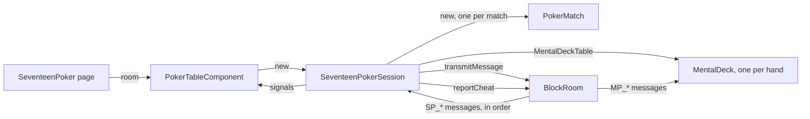

# Seventeen Poker session

The **Seventeen Poker** is the poker of the manga *Liar Game*: two players, a deck of 17 cards (the
aces, kings, queens and jacks of the four suits, and a joker), 10 hands. It is played in a room, peer
to peer, without any dealer nor game server: each hand is dealt with a deck no participant can see, the
[mental poker](mental-poker.md).

A **session** is the state of the match for one participant of the room. Every participant runs its
own, and the sessions stay the same because they apply the same messages, in the same order, delivered
by the `poker` block chain of the room (see [Block chains and anti-cheat](blockchain-and-anti-cheat.md)).

The code lives in `application/frontend/game-app/src/app/modules/seventeen-poker`.

- [Classes](#classes)
- [Rules](#rules)
- [Life cycle](#life-cycle)
- [Seats](#seats)
- [A hand](#a-hand)
- [End of the match](#end-of-the-match)
- [A new match](#a-new-match)
- [The clock of a move](#the-clock-of-a-move)
- [Reloading the page](#reloading-the-page)
- [Messages](#messages)
- [Interface](#interface)
- [Limits](#limits)
- [Testing](#testing)

## Classes

| Class | File | Role |
|---|---|---|
| `SEVENTEEN_DECK` | `classes/rules/seventeen-deck.ts` | The card of each of the 17 positions a mental deck deals |
| `evaluateHand`, `compareHands` | `classes/rules/hand-evaluator.ts` | The value of a hand, the joker standing for the card giving the best one, and their comparison |
| `BettingRound` | `classes/rules/betting-round.ts` | A betting round, as a value: check, bet, raise, call and fold within its bounds |
| `PokerMatch` | `classes/rules/poker-match.ts` | The match without the cards, in signals: antes, rounds, exchange, showdown, the 10 hands, a match lost on time |
| `SeventeenPokerSession` | `classes/game-sessions/seventeen-poker-session.ts` | The matches in a room: seats, decks, cards, cheat reports, a new match once one is over |
| `TableSeats` | `modules/two-seat-table/classes/table-seats.ts` | The two seats, shared with the Russian roulette: the requests of the participants, the salts, a seat freed, what the local participant may do |
| `PokerTableComponent` | `components/poker-table` | Shows the session, turns the clicks into seat requests and actions, and runs the clock of each move |
| `PokerSeatComponent` | `components/poker-seat` | A seat: its player and its chips, a ring and the clock of the move while its player acts, what it won in the hand over |
| `PokerRulesComponent` | `components/poker-rules` | The rules, on the page |

The cards and the chips themselves (`PlayingCardComponent`, `CardHandComponent`, `CardDeckComponent`,
`ChipStackComponent`) live in `modules/playing-cards`, shared with the card games to come.

## Rules

- Each player starts with 150 chips. A hand starts with an ante of 5 chips each, then 5 cards each.
- **First round**: check, bet (1 chip at least), raise, call or fold. Both checks are a no contest:
  the antes go to the bank.
- **Exchange**: in the speaking order, each player discards cards and draws as many from the 7 cards
  left; the second one is limited to the cards the first one left.
- **Second round**: a bet is at least the one of the first round, 6 antes (30 chips) at most, the first
  bet when it is above. Both checks lead to the showdown.
- **Showdown**: the best hand takes the pot, equal hands split it. A player folding leaves the pot to
  the other one.
- The bets of a hand are capped by the stack of the poorer player, once the antes are paid: a player
  paying the ante with its last chips plays the hand to the showdown, without a bet.
- Each move (an action of a betting round, an exchange) lasts 45 seconds at most (`turnTime`): once over, the player
  checks, folds against a bet, or keeps its hand in the exchange. While a seated player is away, the move gets 30 more
  seconds, once (`awayTime`): the player to act still away once the time is up loses the hand, as on a fold, and the
  match, whatever the chips.
- The player speaking first alternates, the other one deals the hand. The match ends after 10 hands, or once a player can not pay the
  ante; the player with the most chips wins.

The hands, from the best: five of a kind, royal flush (the joker as the ten: the only flush of the
deck), four of a kind, full house, straight (the joker as the ten), three of a kind, two pair, one pair.
Every hand holds a pair at least. Equal categories compare the ranks of their groups of cards, then a
natural hand beats the same hand made with the joker.

## Life cycle

- The page builds the `BlockRoom` once the room is set up, with the routing of the chat, the game and
  its decks, and gives it to the table, which builds the session. Only a new room builds a new one.
- The session creates its `MentalDeckTable` first, before any message of a deck can come, then
  subscribes to its own message types.
- The messages of the game apply **one after the other**: each one awaits the deck it acts on (a deal,
  the showdown) before the next one applies. The messages of the decks apply meanwhile, so every
  participant reaches the same state.
- The session plays the matches of the room one after the other: `match` is the match in progress, else the latest, a
  new `PokerMatch` for each one (see [A new match](#a-new-match)).

## Seats

The seats are a `TableSeats`, shared with the [Russian roulette](russian-roulette-session.md#seats): the session
applies its messages in the order of the chain, and tells when the seats are open.

Each participant takes a seat with `Sit here`: the first request for a free seat gets it, a participant
has a single seat, and `Leave the seat` frees it. The seats are final from the first hand of a match until it is
over, or stopped by a broken deck (`seatsOpen`); the other participants are spectators. Once the match is over, its
players may leave their seats and the spectators take the free ones, as before its first hand: the table keeps the
names of the players of the match (`players`, read from the deck of its latest hand) for its result and its hands. A
participant taking a seat shows the stack of the next match, without the cards, the gain nor the hand of the former
player.

The seats open once the match is over in the chain, the same message for every page: they do not wait for the check
of its decks, which ends on each page at its own time, out of the chain, and never while a player is away.

A player leaving the room keeps its seat, but loses it with a match lost on time (see
[The clock of a move](#the-clock-of-a-move)). While the seats are open, a seated player also frees the seat of the
other one, away from the room, with `Free the seat` (`SP_unseat`), shown on that seat: no page can tell when the other
one was away, as for a timeout, so the chain applies the request whatever the presence of the player. The request names
the player freed: applied once another participant took the seat, it frees nothing. The host frees the seat of a player
away too, on either seat, even as a spectator: a player seated alone and gone keeps no seat for the life of the room. Its
request holds when the host ordered the block of its message, as the sequencer of the chain: a page replaying the chain,
or joining late, applies it alike, even once another participant orders the chain. Another spectator frees no seat: it
could take it at once.

A player draws a random **salt** for each seat it takes, given in its `SP_seat`: the id of each deck is made of the
salts of both seats, the index of the match in the room and the index of the hand (`<salt 1>:<salt 2>:<match>:<hand>`).
A request without a salt of 32 hexadecimal digits is ignored. The page of a player keeps its secrets until the decks
are disclosed, at the end of the match: its fresh salt keeps the other player from giving the id of a deck
of a former match, in a room of the same name, which would make the page use its former secrets again, and
show cards the other player knows. The index of the match gives each deck of a new match an id of its own, though its
players keep their seats and their salts: the table of the decks holds a single deck by id, and the secrets of a deck
disclosed are dropped.

The table shows the local player at its bottom. A spectator sees it from the free seat it may take, the only one
showing `Sit here`: it clicks where it then sits. Once both seats are taken, it sees the first seat at the bottom.

## A hand

1. The dealer clicks `Deal` (`SP_deal`), once both seats are taken and both players are in the room: the
   players deal by turns, the second seat first, the other player speaking first. The deal starts the
   hand, the antes paid; a deal of the other player is ignored. Every participant creates the deck of
   the hand.
2. The players shuffle and lock the deck, then the session deals the positions 0 to 4 to the first seat
   and 5 to 9 to the second one. The betting opens once **both** players read their cards: the first
   one reading them learns nothing before the other one.
3. Each action (`SP_bet`) applies to the match; an action against the rules, out of the turn of its
   player or of another hand is ignored by everyone, and reported as `illegalMove`. The table sends an
   action of the local player once: its buttons wait for the chain to bring it back (`sending`), a
   second click sending nothing.
4. The exchange (`SP_exchange`) gives the positions of the cards discarded: the cards drawn are the next
   positions of the draw pile (10, 11...), dealt to the player, in the places of the cards discarded.
5. At the showdown, every participant opens both hands: the deck asks the keys of both players, and the
   match settles the pot with the cards opened. A folded hand stays hidden.

A deck that breaks (a step that is not a deck, a hand that does not open) stops the match, without a result: the
table tells it, and no hand is dealt anymore. The session then ignores the moves of the match (`SP_deal`, `SP_bet`,
`SP_exchange`, `SP_timeout`) but applies the seats (`SP_seat`, `SP_unseat`) and a new match (`SP_rematch`), `over`
being true: the seats open, and a seated player may start a new match, as after a match over. Every deck of the match
is disclosed at once: the players drop their secrets, and the participants report the cheats of the decks played
before, as a key not giving any card at the showdown. The broken deck discloses nothing. The match has no check of its
own: while a seat is free, the note of the check tells the cheat, the status telling the table waits for a player.

## End of the match

Once the match is over, every participant discloses every deck of the match: the players give all their
keys, and each participant checks every shuffle, lock and key (see
[Checking the deck](mental-poker.md#checking-the-deck)). The table tells the winner, or a draw, then
whether every deck was fair. The check of each match has its own signal (`verification`, then the one of its line in
`pastMatches`): a check ending once the next match started tells the former match, a player away giving its keys once
back.

## A new match

Once the match is over, or stopped by a broken deck, a seated player clicks `Play again` (`SP_rematch`), once both
seats are taken, without waiting for the check of the decks: the request names the index of the new match in the room
(1 for the second one). Every participant applies it in the order of the chain: the first request starts the new match, the others name a match started already and are
ignored, as a request of a spectator, or before the end of the match, or with a free seat.

The new match starts over: a new `PokerMatch`, 150 chips each, the hands counted from 1, the second seat dealing the
first hand, no deck, and the check of its decks pending. The result of the former match, with its players and the
check of its decks, joins `pastMatches`, one line each in `Matches played` in the history of the room: a match stopped has no
result nor check, its line tells it was stopped (`Stopped: a deck was cheated.`). The seats stay open until
its first hand. The decks of the new match have ids of their own, so the decks of the former one may be checked later,
or never: a cheat found then is reported to the room, and told on the line of its match.

## The clock of a move

The table starts the clock of a move when its page sees it: once the hand waits for the player to act, its cards dealt,
and again at each action, a seat acting twice in a row included (a call, then the first exchange). The first tick seeing
a seated player away adds 30 seconds to the move, once: a player leaving and coming back gets no more. The player to act
plays meanwhile, even while the other one is away: its status tells its turn rather than the absence.
The pages of the players and the spectators run their own clock, none in the chain, which holds no time: they show
the same seconds within the delay of the messages. The clock reads the time of the page (`performance.now()`), not the
one of the system, which a synchronization sets back or forward.

When the clock of the local player runs out, its page plays the move for it (`timeOut()` of the table), through the
buttons the table offers: `Check`, else `Fold`, and `Keep my hand` in the exchange, the cards selected dropped. An
action sent meanwhile is the move: the table offers nothing while it waits for the chain. The clock of the other player
stops at 0: still connected, its page plays the move; away, the page of the local player sends `SP_timeout` (`claimTimeout()`
of the session), and the player away loses the match (`forfeit()` of the match, `forfeited` telling who), and its seat,
which a spectator may take for the next match. The timeout
names its move, the index of the hand and the actions played in it (`moves`): the chain orders it with the move, and the
first one counts, a move played before it making it void. A tick may come a bit before the end of the move: the move is
over once less than half a tick is left.

The bar of the clock follows the seconds left, from a second to the next one (a CSS transition of its width): it fills
again for a new move of the same seat, and shows the time left at once on a page shown again, rather than an animation
over the whole move, started late on a hidden page and never restarted on the same element.

## Reloading the page

The page joins its room again by itself, from its URL and the session of its tab, as the chess does (see
[Reloading the page](chess-game-session.md#reloading-the-page)), and leaving a match in progress, seated, asks to
confirm. The chain replays every message to a reloaded page: the session plays the match again, creates the
decks again, and the `SecretStore` gives back the secrets of the player (through `KeptSecrets`, shared with the cylinders
of the Russian roulette), so it reads its cards and
gives its keys again: the ids of the decks are the same, the salts being read back from the chain. A player leaving the room keeps its seat: the hand waits for it to come back.

A page reloaded during a new match plays the former matches again, then the match in progress, the decks of the former
ones checked again from the keys disclosed in the chain.

## Messages

All the messages go through the `poker` chain, with the messages of the decks (`pokerBlockChains`).

| Type | Payload | Sent by | When |
|---|---|---|---|
| `SP_seat` | `{ seat, salt }`: 0, 1, or null to leave; the salt of the player, 16 random bytes in hexadecimal | a participant | before the first hand of a match, or once it is over |
| `SP_deal` | `{ hand }`: the index of the hand | the dealer of the hand | between two hands |
| `SP_bet` | `{ hand, action, amount? }`: the amount is the total of the player in the round | a player | its turn of a betting round |
| `SP_exchange` | `{ hand, positions }`: the positions discarded | a player | its turn of the exchange |
| `SP_timeout` | `{ hand, move }`: the actions played in the hand before the move over; the player away loses its seat too | a player | the time of the move of the other player over, while it is away |
| `SP_rematch` | `{ match }`: the index of the new match in the room | a player | once the match is over or stopped, both seats taken |
| `SP_unseat` | `{ seat, name }`: the seat freed, and its player | a player, or the host | while the seats are open, the player of the seat away |
| `MP_*` | see [Mental poker](mental-poker.md#messages) | the players, by themselves | as the session deals and opens |

## Interface

- The seats, at the top and the bottom of the table: the player, its chips, as piles and as a count, and
  a ring around the one to act, with the seconds left to its move and a bar emptying over them (in the color of an
  error from 5 seconds left, second by second under `prefers-reduced-motion`).
- The hands, in fans: the cards of the local player face up, the others face down until the showdown.
  During the exchange, the cards of the player are buttons selecting the ones to discard. At the
  showdown, each hand tells its kind, the winning one outlined, the other one dimmed.
- The cloth, with the deck and its count (riffling while the players shuffle), the pot, the count of the
  hands, and the spectators. The chips of the bets of the round lie in front of each player, the pot in
  the middle: the fewest chips making each amount, of 1, 5, 25 and 100 (`chipsOf`).
- Once a hand is over, its outcome on the cloth and the chips won on the seat of the winner (`+32`),
  until the next hand is dealt.
- A status line (`<output>`, of the role `status`): what the table waits for, a player shuffling or giving its keys, a
  player away from the room, and once, from 5 seconds left, that the time of the move of the local player runs out,
  without a count (a screen reader announces it before the page plays for the player).
- The actions of the player: `Check`, `Call`, `Bet` or `Raise` with the amount set by steps of 5 chips,
  `Min` and `Max`, and `Fold` against a bet only (with nothing to call, a player checks for free).
- The result of the match, and `Play again` for its players.
- `Free the seat` on the seat of a player away, while the seats are open: for the other player, and for the host.
- Out of the table, in the panel of the room beside the game or over it (`RoomHistoryComponent` of
  `modules/room-layout`, opened by the `History` button of the bar): the hands of the match (`Hands played`), the
  latest first, then the results of the former matches of the room, each one with the check of its decks
  (`Matches played`). The table computes them (`history`, `pastResults`), the page gives them to the panel.

The page never jumps: what comes and goes keeps its place. The hands keep the height of a card before the deal, the
lines of the kinds of hands, the count of the hands and the outcome of a hand theirs on the cloth, and the status line,
the row of the actions and the lines of the result and of the check of the decks are always there, empty or not: the
histories, in the panel of the room, move nothing below the table. The cloth, the seats and the block of the status keep the
tallest height they had (`SteadyHeightDirective` of `modules/room-layout`): a text on two lines in another language or
on a phone moves nothing. On a phone, a seat keeps two rows, the status, the outcome of a hand and the result two
lines, and the actions two rows: the amount of a bet below them.

The animations (the deal, the turn over of the cards, the riffle, the chips, the ring) use
`animate.enter` / `animate.leave` and CSS only, and stop under `prefers-reduced-motion`. Once the table
shows a change of its chips, `chipTransfers` tells the chips it moved: a bet from a stack to the cloth,
the antes and the bets of a round over to the pot, the pot to its winner, half to each player when it is
split, to the bank on a no contest; a player taking the pot alone takes the bets of the cloth with it (a
fold). The chips of each move fly between the places as the page shows them, measured once rendered
(`ChipFlightsComponent` of `modules/two-seat-table`, shared with the Russian roulette), then the stack there shows them dropping on it, the gains and the outcome with them, the chips it changes for others
fading out then. A stack paying out shows its change at once, a chip leaving it fading out. A hidden page moves its chips without flights,
as does the history of the room a reloaded page or a participant joining late catches up with: the
session counts the steps of the history it applies (`historySteps`: the start and the end of each of its
messages, a showdown moving the chips once the cards are opened), and a change of the table while it
grows does not fly.

The files of the sounds of the table load ahead (`SoundService.preload()`), and the first live message after the history
of the room waits for the page to render the end of it (`wait(0)`), not to be taken for history.
Each change of the table plays its sounds on every page, a hidden one included, none while the history grows
(`tableSounds()` of `helpers/table-sound.helper.ts`): a seat taken (a pop, as at every game), a new deck shuffled (the
table shows it shuffled 3.1 seconds at least, `SHUFFLE_HOLD`, the length of the sound: the cards, the actions and the
clock of the move wait for it, a deck of the history of the room or already dealt shown at once), each card entering a hand as it flies in
(0.16 second apart, as the deal), the chips moved, and the end of a hand, the fold or the cards turned at the showdown,
then the pot once the end of the hand showed (0.8 second, `HAND_ENDING`: the cards turned over, or the hand folded
fading), as its chips fly, the stacks of the seats showing them once they landed (`--chip-landing`): won for its winner and a spectator, lost for the other player, the chips moving when
split or gone to the bank. The end of the match follows, 0.3 second after the end of its last hand: won, lost or drawn,
as for every game (`gameEndSound()` of `services/sound/game-sounds.ts`). The cards, the chips and the fold are CC0 files of Kenney (`SOUND_FILES` of
`services/sound/sound-files.ts`), the pot synthesized.

## Limits

- A player leaving for good while the deck waits for its keys (a deal, the cards drawn in the exchange) blocks the match:
  no move is awaited, so no clock runs. On its move, the other player wins once its time is over. A player the host
  removes from the room between two hands, or while the deck waits for its keys, stalls the match alike.
- The clock runs on the page of each player, and no page can tell when the other one was away: a page changed not to
  play the move once its time is over keeps the other player waiting while connected, and a page changed to send
  `SP_timeout` early ends the match of the other player, and a page changed to send `SP_unseat` frees the seat of the
  other player between two matches: it takes it back with `Sit here`, unless another participant, an accomplice, takes
  it first. Once the match is over, its decks are checked
  once the player away is back, its keys disclosed: never if it does not come back, the next match not waiting for it.
- A page hidden for long plays the move late: the browser runs its timers once a minute after 5 minutes hidden
  (Chrome), and none on a frozen page (a phone putting it in the background), until it is shown again. As its deck
  waits for its keys meanwhile, the other player waits for it either way.
- A reloaded page starts the clock of the move in progress again, at 45 seconds.
- The timing of the messages may tell something: the chain shows when each player acted.
- The sequencer can delay the messages, as in every game of a room, and is watched for it by the
  anti-cheat.
- Moves applied between two renders (a burst of messages) fly as one, their net change.

## Testing

- The rules: `classes/rules/*.spec.ts`, every hand of the deck evaluated once.
- The session: `seventeen-poker-session.spec.ts`, with a `RoomHub` and a small prime
  (`@testing/sra-test-group`): seats, deals, bets, exchanges, showdowns, the end of the match, a new
  match (the seats open again, fresh deck ids, the check of the former decks ending later, a page reloaded during it),
  the seat freed of a player away, by the other player or the host, a new match after a broken deck, a reloaded page
  and the cheats.
- The table: `poker-table.component.spec.ts`, the session options given through `POKER_SESSION_OPTIONS`, the clock of
  the moves on fake timers (`setInterval` and `performance` only: the decks run on real ones).
- End to end: `e2e/seventeen-poker.e2e.ts`, a hand to the showdown, a fold, a player reloading the
  page, a second match once the first one is over (all in until a hand takes every chip), a spectator taking the seat of
  a player, the moves played once their time is over (a check, then a fold against a bet, `SLOW`), and the match of a player
  leaving the room ended once the time of its move is over, a spectator taking its seat for a new match (`SLOW`), and
  the host, a spectator, freeing the seat of a lone player away.
