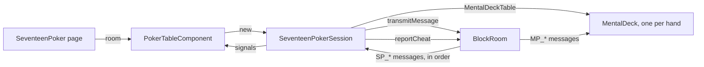

# Seventeen Poker session

The **Seventeen Poker** is the poker of the manga *Liar Game*: two players, a deck of 17 cards (the
aces, kings, queens and jacks of the four suits, and a joker), 10 hands. It is played in a room, peer
to peer, without any dealer nor game server: each hand is dealt with a deck no participant can see, the
[mental poker](mental-poker.md).

A **session** is the state of the match for one participant of the room. Every participant runs its
own, and the sessions stay the same because they apply the same messages, in the same order, delivered
by the `poker` block chain of the room (see [Block chains and anti-cheat](blockchain-and-anti-cheat.md)).

The code lives in `application/frontend/game-app/src/app/modules/seventeen-poker`.

- [Classes](#classes)
- [Rules](#rules)
- [Life cycle](#life-cycle)
- [Seats](#seats)
- [A hand](#a-hand)
- [End of the match](#end-of-the-match)
- [Reloading the page](#reloading-the-page)
- [Messages](#messages)
- [Interface](#interface)
- [Limits](#limits)
- [Testing](#testing)

## Classes

| Class | File | Role |
|---|---|---|
| `SEVENTEEN_DECK` | `classes/rules/seventeen-deck.ts` | The card of each of the 17 positions a mental deck deals |
| `evaluateHand`, `compareHands` | `classes/rules/hand-evaluator.ts` | The value of a hand, the joker standing for the card giving the best one, and their comparison |
| `BettingRound` | `classes/rules/betting-round.ts` | A betting round, as a value: check, bet, raise, call and fold within its bounds |
| `PokerMatch` | `classes/rules/poker-match.ts` | The match without the cards, in signals: antes, rounds, exchange, showdown, the 10 hands |
| `SeventeenPokerSession` | `classes/game-sessions/seventeen-poker-session.ts` | The match in a room: seats, decks, cards, cheat reports |
| `PokerTableComponent` | `components/poker-table` | Shows the session, and turns the clicks into seat requests and actions |
| `PokerSeatComponent` | `components/poker-seat` | A seat: its player, chips and bet, a ring while its player acts |
| `PokerRulesComponent` | `components/poker-rules` | The rules, on the page |

The cards themselves (`PlayingCardComponent`, `CardHandComponent`, `CardDeckComponent`) live in
`modules/playing-cards`, shared with the card games to come.

## Rules

- Each player starts with 150 chips. A hand starts with an ante of 5 chips each, then 5 cards each.
- **First round**: check, bet (1 chip at least), raise, call or fold. Both checks are a no contest:
  the antes go to the bank.
- **Exchange**: in the speaking order, each player discards cards and draws as many from the 7 cards
  left; the second one is limited to the cards the first one left.
- **Second round**: a bet is at least the one of the first round, 6 antes (30 chips) at most, the first
  bet when it is above. Both checks lead to the showdown.
- **Showdown**: the best hand takes the pot, equal hands split it. A player folding leaves the pot to
  the other one.
- The bets of a hand are capped by the stack of the poorer player, once the antes are paid: a player
  paying the ante with its last chips plays the hand to the showdown, without a bet.
- The player speaking first alternates, the other one deals the hand. The match ends after 10 hands, or once a player can not pay the
  ante; the player with the most chips wins.

The hands, from the best: five of a kind, royal flush (the joker as the ten: the only flush of the
deck), four of a kind, full house, straight (the joker as the ten), three of a kind, two pair, one pair.
Every hand holds a pair at least. Equal categories compare the ranks of their groups of cards, then a
natural hand beats the same hand made with the joker.

## Life cycle

- The page builds the `BlockRoom` once the room is set up, with the routing of the chat, the game and
  its decks, and gives it to the table, which builds the session. Only a new room builds a new one.
- The session creates its `MentalDeckTable` first, before any message of a deck can come, then
  subscribes to its own message types.
- The messages of the game apply **one after the other**: each one awaits the deck it acts on (a deal,
  the showdown) before the next one applies. The messages of the decks apply meanwhile, so every
  participant reaches the same state.

## Seats

Each participant takes a seat with `Sit here`: the first request for a free seat gets it, a participant
has a single seat, and `Leave the seat` frees it. The seats are final once the first hand is dealt; the
other participants are spectators.

A player draws a random **salt** for each seat it takes, given in its `SP_seat`: the id of each deck of the
match is made of the salts of both seats and the index of the hand (`<salt 1>:<salt 2>:<hand>`). A request
without a salt of 32 hexadecimal digits is ignored. The page of a player keeps its secrets until the decks
are disclosed, at the end of the match: its fresh salt keeps the other player from giving the id of a deck
of a former match, in a room of the same name, which would make the page use its former secrets again, and
show cards the other player knows.

The table shows the local player at its bottom, a spectator the first seat.

## A hand

1. The dealer clicks `Deal` (`SP_deal`), once both seats are taken and both players are in the room: the
   players deal by turns, the second seat first, the other player speaking first. The deal starts the
   hand, the antes paid; a deal of the other player is ignored. Every participant creates the deck of
   the hand.
2. The players shuffle and lock the deck, then the session deals the positions 0 to 4 to the first seat
   and 5 to 9 to the second one. The betting opens once **both** players read their cards: the first
   one reading them learns nothing before the other one.
3. Each action (`SP_bet`) applies to the match; an action against the rules, out of the turn of its
   player or of another hand is ignored by everyone, and reported as `illegalMove`. The table sends an
   action of the local player once: its buttons wait for the chain to bring it back (`sending`), a
   second click sending nothing.
4. The exchange (`SP_exchange`) gives the positions of the cards discarded: the cards drawn are the next
   positions of the draw pile (10, 11...), dealt to the player, in the places of the cards discarded.
5. At the showdown, every participant opens both hands: the deck asks the keys of both players, and the
   match settles the pot with the cards opened. A folded hand stays hidden.

A deck that breaks (a step that is not a deck, a hand that does not open) stops the match: the table
tells it, and no hand is dealt anymore.

## End of the match

Once the match is over, every participant discloses every deck of the match: the players give all their
keys, and each participant checks every shuffle, lock and key (see
[Checking the deck](mental-poker.md#checking-the-deck)). The table tells the winner, or a draw, then
whether every deck was fair.

## Reloading the page

The chain replays every message to a reloaded page: the session plays the match again, creates the
decks again, and the `DeckKeyStore` gives back the secrets of the player, so it reads its cards and
gives its keys again: the ids of the decks are the same, the salts being read back from the chain. A player leaving the room keeps its seat: the hand waits for it to come back.

## Messages

All the messages go through the `poker` chain, with the messages of the decks (`pokerBlockChains`).

| Type | Payload | Sent by | When |
|---|---|---|---|
| `SP_seat` | `{ seat, salt }`: 0, 1, or null to leave; the salt of the player, 16 random bytes in hexadecimal | a participant | before the first hand |
| `SP_deal` | `{ hand }`: the index of the hand | the dealer of the hand | between two hands |
| `SP_bet` | `{ hand, action, amount? }`: the amount is the total of the player in the round | a player | its turn of a betting round |
| `SP_exchange` | `{ hand, positions }`: the positions discarded | a player | its turn of the exchange |
| `MP_*` | see [Mental poker](mental-poker.md#messages) | the players, by themselves | as the session deals and opens |

## Interface

- The seats, at the top and the bottom of the table: the player, its chips, its bet of the round, and
  a ring around the one to act.
- The hands, in fans: the cards of the local player face up, the others face down until the showdown.
  During the exchange, the cards of the player are buttons selecting the ones to discard.
- The cloth, with the deck and its count (riffling while the players shuffle), the pot, the count of the
  hands, and the spectators.
- A status line (`role="status"`): what the table waits for, a player shuffling or giving its keys, a
  player away from the room.
- The actions of the player: `Check`, `Call`, `Bet` or `Raise` with the amount set by steps of 5 chips,
  `Min` and `Max`, and `Fold` against a bet only (with nothing to call, a player checks for free).
- The history of the hands, folded below the table, then the result of the match.

The animations (the deal, the turn over of the cards, the riffle, the chips, the ring) use
`animate.enter` / `animate.leave` and CSS only, and stop under `prefers-reduced-motion`.

## Limits

- A player leaving for good blocks the match: the deck waits for its keys, and there is no timeout.
- The timing of the messages may tell something: the chain shows when each player acted.
- The sequencer can delay the messages, as in every game of a room, and is watched for it by the
  anti-cheat.

## Testing

- The rules: `classes/rules/*.spec.ts`, every hand of the deck evaluated once.
- The session: `seventeen-poker-session.spec.ts`, with a `RoomHub` and a small prime
  (`@testing/sra-test-group`): seats, deals, bets, exchanges, showdowns, the end of the match, a
  reloaded page and the cheats.
- The table: `poker-table.component.spec.ts`, the session options given through `POKER_SESSION_OPTIONS`.
- End to end: `e2e/seventeen-poker.e2e.ts`, a hand to the showdown, a fold and a player reloading the
  page.
